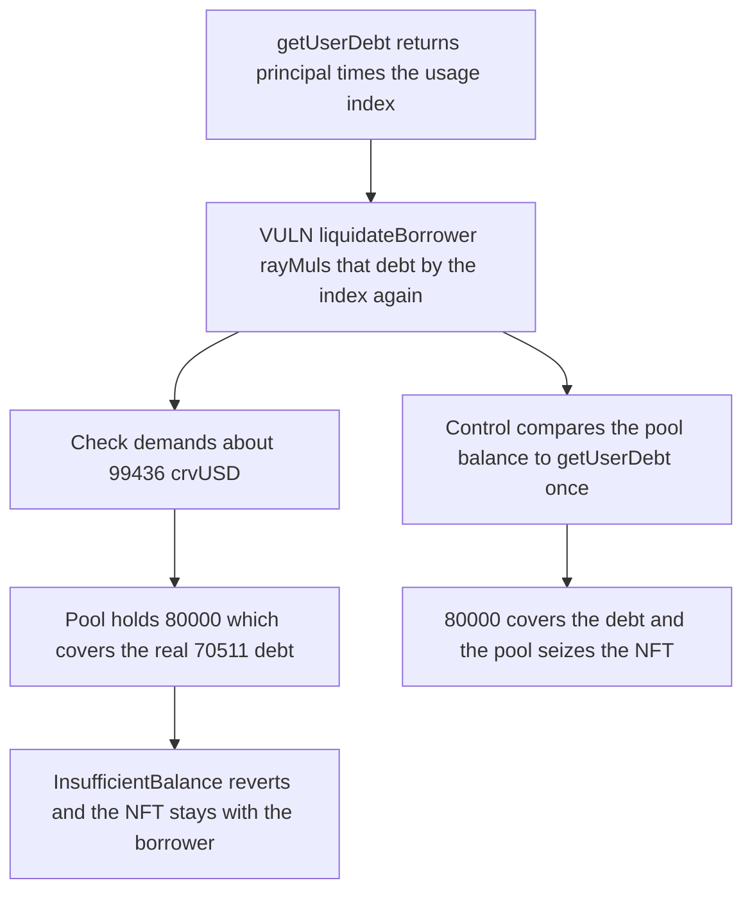

# RAAC StabilityPool: liquidateBorrower scales debt by the usage index twice and the liquidation reverts

> **Vulnerability classes:** vuln/logic/liquidation-logic · vuln/logic/wrong-condition

<!-- non-defihacklabs -->
<!-- source-auditvault: https://github.com/Auditware/AuditVault/blob/main/findings/57192-double-usage-index-scaling-in-stabilitypool-liquidation-infl.md -->
<!-- date: 2025-02 -->

## Key info

| Field | Value |
|---|---|
| **Loss** | Liquidation reverts. 80000 crvUSD covers the 70511 actual debt but not the double-scaled 99436, so the NFT stays with the borrower |
| **Vulnerable contract** | `StabilityPool.liquidateBorrower` |
| **Attacker EOA** | `0x1111111111111111111111111111111111111111` (the keeper) |
| **Attack contract** | `Exploit` |
| **Attack tx** | `Exploit.run()` |
| **Chain / block / date** | Ethereum model · block 0 · 2025-02 |
| **Compiler** | solc 0.8.27, cancun, via IR |
| **Bug class** | `getUserDebt` already includes the usage index, and `rayMul` applies it again |

## TL;DR

`LendingPool.getUserDebt` returns `principal * usageIndex`. `StabilityPool.liquidateBorrower` then does `rayMul(userDebt, getNormalizedDebt())`, which multiplies by the same index again. With the report's index after one year, `1410226029899202994928355252`, a 50000 crvUSD borrow is an actual debt of `70511301494960149746417` and a double-scaled check of `99436872770263388970699`. The pool holds 80000 crvUSD, so the check reverts with `InsufficientBalance` and the collateral NFT is not seized. Comparing the balance to `getUserDebt` once seizes the NFT.

## Background

Codehawks' February 2025 RAAC contest, reported by newspacexyz. The stability pool is supposed to repay a borrower's already-normalized debt when the position is liquidatable. The report's Foundry log, after a one-year warp, prints usage index `1410226029899202994928355252`, normalized debt `70511301494960149746418`, double-scaled debt `99436872770263388970701`, and a pool balance of 80000e18. This run stores that index directly so the same comparison happens in one transaction. Integer `rayMul` is one wei below the log's rounded print; the inequalities are the same.

## The vulnerable code

```solidity
uint256 userDebt = lendingPool.getUserDebt(userAddress);
// @> VULN: getUserDebt is already scaled by the usage index, and rayMul scales it again
uint256 scaledUserDebt = WadRayMath.rayMul(userDebt, lendingPool.getNormalizedDebt());
uint256 crvUSDBalance = crv.balanceOf(address(this));
if (crvUSDBalance < scaledUserDebt) revert InsufficientBalance();
```

`getUserDebt` is already:

```solidity
return principal[user] * normalizedDebt / WadRayMath.RAY;
```

## Root cause

The debt is normalized in the lending pool and then treated as raw principal in the stability pool. The balance check therefore asks for `debt * index^2`. The index only increases, so the gap grows until liquidation is impossible even when the pool can pay the real debt.

## Preconditions

- Principal is 50000 crvUSD. The usage index is the report's post-year value.
- The stability pool holds 80000 crvUSD.
- The borrower owns collateral NFT 1. The keeper may call `liquidateBorrower`.

## Attack walkthrough

1. `getUserDebt` returns `70511301494960149746417`.
2. `liquidateBorrower` ray-multiplies that by the index and gets `99436872770263388970699`.
3. 80000 crvUSD is greater than the real debt and less than the double-scaled value. The call reverts.
4. `seized` stays false. The borrower still owns NFT 1. The pool balance is unchanged.
5. The control compares the balance to `getUserDebt` once. 80000 covers 70511, and the pool seizes the NFT.

## Diagrams



## Impact

A liquidatable borrower cannot be liquidated. The stability pool's 80000 crvUSD is enough to repay the actual debt of about 70511 crvUSD and is not used. The collateral NFT remains with the borrower. The single-scale path seizes it.

## Remediation

Use `getUserDebt` as the amount the pool must hold, or scale the stored principal once. Do not ray-multiply a value that is already multiplied by `getNormalizedDebt()`.

## How to reproduce

```bash
cd 57192-double-usage-index-scaling-in-stabilitypool-liquidation-infl_exp
forge test -vv
```

`test_exploit_double_scale_blocks_liquidation` asserts the revert, an unseized NFT, and `actualDebt < 80000 < doubleScaled`. `test_control_single_scale_seizes_collateral` asserts the pool receives the NFT. Captured output is `output.txt`.

## Sources

- AuditVault finding: https://github.com/Auditware/AuditVault/blob/main/findings/57192-double-usage-index-scaling-in-stabilitypool-liquidation-infl.md
- Contest tree: https://github.com/Cyfrin/2025-02-raac
