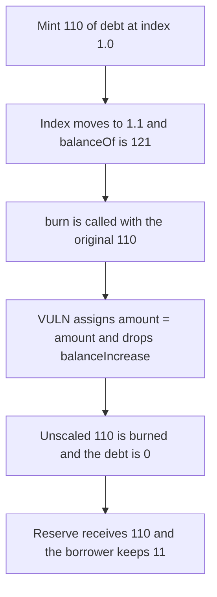

# RAAC: burn clears 121 of debt after the borrower pays 110

> **Vulnerability classes:** `vuln/arithmetic/precision-loss` · `vuln/logic/state-update`

<!-- non-defihacklabs -->
<!-- source-auditvault: https://github.com/Auditware/AuditVault/blob/main/findings/57193-incorrect-debt-scaling-leading-to-protocol-solvency-risk-cod.md -->
<!-- date: 2025-02 -->

## Key info

| Field | Value |
|---|---|
| **Loss** | 11 of accrued interest is forgiven. A 121 debt is cleared by a 110 repayment |
| **Vulnerable contract** | `DebtToken.burn` |
| **Attacker EOA** | `0x1111111111111111111111111111111111111111` |
| **Attack contract** | `Exploit` |
| **Attack tx** | `Exploit.run()` |
| **Chain / block / date** | Ethereum model · block 0 · 2025-02 |
| **Compiler** | solc 0.8.27, cancun, via IR |
| **Bug class** | repayment ignores the usage-index increase and burns unscaled units |

## TL;DR

`DebtToken.burn` takes the repayment `amount` and an `index`. When the stored user index is behind the index passed in, it computes `balanceIncrease` and then executes `amount = amount`. `_burn` subtracts that unscaled amount. A borrower minted 110 at index 1.0 owes 121 after the index moves to 1.1. Burning 110 wipes the scaled balance. The reserve receives 110 and the borrower keeps 11.

## The vulnerable code

```solidity
balanceIncrease = userBalance.rayMul(borrowIndex) - userBalance.rayMul(_indexOf[from]);
amount = amount; // @> VULN: accrued balanceIncrease is computed and then discarded
_burn(from, amount); // burns the unscaled repayment, not amountScaled
```

The fix burns `amount.rayDiv(borrowIndex)` (100 in this case) and leaves the 11 of interest outstanding.

## Root cause

Interest lives in the usage index, not in a second balance update. The scaled balance minted at 1.0 is 110. Burning 110 of those units zeroes the position, including the interest `balanceOf` was already showing. The self-assignment drops the only value that described that interest.

## Preconditions

- Debt was minted at index `1e27`.
- `getNormalizedDebt` is `1.1e27` when `burn` runs.
- The caller repays the original 110, not the current 121.

## Attack walkthrough

1. Mint 110 for the borrower at index 1.0. Scaled balance is 110.
2. Raise the pool index to 1.1. `balanceOf` is 121.
3. Fund the borrower with 121 of cash and call `burn(borrower, 110, 1.1)`.
4. The interest branch runs and discards `balanceIncrease`.
5. `_burn` subtracts 110. Scaled balance is 0. Debt is 0.
6. The reserve pulls 110. The borrower still holds 11.

## Diagrams



## Impact

Lenders are short 11 on this position. The books show no remaining debt, so the interest cannot be collected later. Repeating the pattern at a higher index forgives a larger fraction of each repayment.

## Remediation

Fetch the current index inside `burn`, add `balanceIncrease` only when it is the interest the user still owes, and `_burn` the `rayDiv` of the amount actually paid. A full repayment must pass the current `balanceOf`, not the principal from an earlier index.

## How to reproduce

```bash
cd 57193-incorrect-debt-scaling-leading-to-protocol-solvency-risk-cod_exp
forge test -vv
```

`test_exploit_forgives_accrued_interest` asserts debt 121, cash pulled 110, debt left 0, borrower keeps 11. `test_control_scaled_burn_leaves_the_interest` shows that burning the scaled 100 would leave 11 of debt.

## Sources

- AuditVault finding: https://github.com/Auditware/AuditVault/blob/main/findings/57193-incorrect-debt-scaling-leading-to-protocol-solvency-risk-cod.md
- Contest: https://codehawks.cyfrin.io/c/2025-02-raac
- Quoted source: https://github.com/Cyfrin/2025-02-raac/blob/89ccb062e2b175374d40d824263a4c0b601bcb7f/contracts/core/tokens/DebtToken.sol#L181-L214
