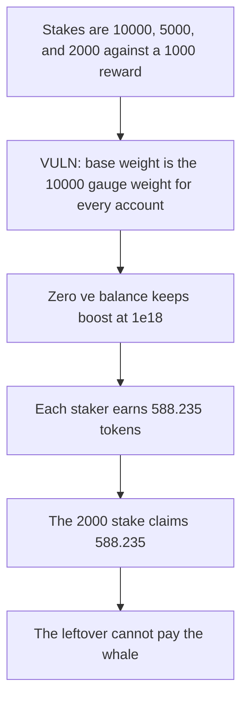

# RAAC BaseGauge: every staker earns the gauge weight, so a 2000 stake is paid 588.235 of a 1000 reward

> **Vulnerability classes:** `vuln/logic/reward-calculation`

<!-- non-defihacklabs -->
<!-- source-auditvault: https://github.com/Auditware/AuditVault/blob/main/findings/57201-boost-miscalculation-leads-to-excess-distribution-codehawks.md -->
<!-- date: 2025-02 -->

## Key info

| Field | Value |
|---|---|
| **Loss** | 588.235 reward tokens paid to a 2000 stake. Fair share is 117.647. The whale cannot be paid in full |
| **Vulnerable contract** | `BaseGauge._getBaseWeight` |
| **Attacker EOA** | `0x1111111111111111111111111111111111111111` |
| **Attack contract** | `Exploit` |
| **Attack tx** | `Exploit.run()` |
| **Chain / block / date** | Ethereum model · block 0 · 2025-02 |
| **Compiler** | solc 0.8.27, cancun, via IR |
| **Bug class** | Base weight is the gauge weight for every account, and a zero ve balance keeps boost at 1e18 |

## TL;DR

`_getBaseWeight` returns `getGaugeWeight(address(this))` and ignores the account. The gauge weight is 10000 ether. ve balances are 0, so `calculateBoost` returns the 1e18 minimum and the boosted weight stays 10000 ether. Stakes of 10000, 5000, and 2000 therefore each earn 588.235 tokens from a 1000 token notification. The 2000-token staker claims that slice. What remains is less than the whale is owed. Weighting by stake pays 117.647 and leaves the rest in the gauge.

## Background

Codehawks contest on the Cyfrin RAAC contracts, February 2025, reported by kkk. `BaseGauge._getBaseWeight` reads the gauge controller weight instead of the account's stake. The published test stakes 10000, 5000, and 2000, notifies 1000, and shows each account earning the same amount, with the sum above the notified reward.

## The vulnerable code

```solidity
function _getBaseWeight(address account) internal view virtual returns (uint256) {
    // @> VULN: base weight is the gauge weight, not account's stake, so every staker is weighted the same
    return IGaugeController(controller).getGaugeWeight(address(this));
}
```

`_applyBoost` multiplies that weight by `calculateBoost`. With `veBalance == 0` the boost is `1e18`, so the product is the gauge weight again. `earned` is `weight * rewardPerToken / 1e18`, and `rewardPerToken` was computed from the sum of stakes.

## Root cause

The per-account weight does not read `stakeOf[account]`. Reward-per-token is still divided by total stake, so each equal weight is a large fraction of the notified amount and the sum of `earned` exceeds the balance.

## Preconditions

- Gauge weight is 10000 ether. Notified reward is 1000 tokens. Total stake is 17000.
- No account holds ve tokens, so every boost is the minimum.
- The caller has staked 2000. A whale has staked 10000. A third account has staked 5000.

## Attack walkthrough

1. `earned` for the 2000 stake calls `_getBaseWeight` and receives 10000 ether.
2. `calculateBoost` returns 1e18. The boosted weight is still 10000 ether.
3. `earned` is 588.235 tokens. The whale's `earned` is the same number.
4. `claim` transfers 588.235 tokens.
5. The gauge's remaining balance is below the whale's earned value.
6. The control returns `stakeOf[account]` as the weight. The same 2000 stake is paid 117.647, and the whale's earned value stays larger.

## Diagrams


