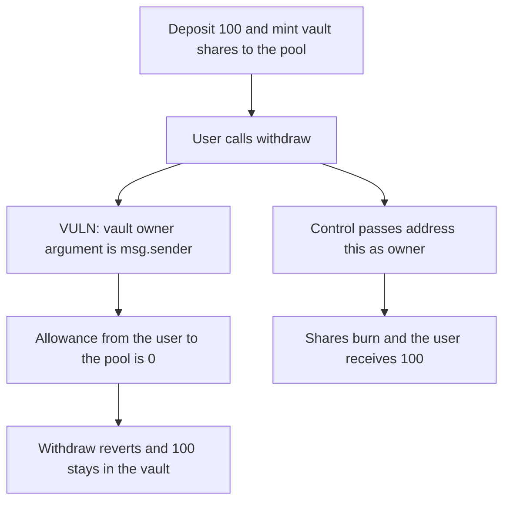

# LendingPool withdraws Curve vault shares with the user as owner and the liquidity stays locked

> **Vulnerability classes:** vuln/dos/frozen-funds · vuln/access-control/missing-owner-check

<!-- non-defihacklabs -->
<!-- source-auditvault: https://github.com/Auditware/AuditVault/blob/main/findings/57202-ownership-parameter-mismatch-in-lendingpools-vault-withdrawa.md -->
<!-- date: 2025-02 -->

## Key info

| Field | Value |
|---|---|
| **Loss** | 100 crvUSD stuck in the Curve vault. The lender's withdraw reverts |
| **Vulnerable contract** | `LendingPool._withdrawFromVault` |
| **Attacker EOA** | `0x1111111111111111111111111111111111111111` |
| **Attack contract** | `Exploit` |
| **Attack tx** | `Exploit.run()` |
| **Chain / block / date** | Ethereum model · block 0 · 2025-02 |
| **Compiler** | solc 0.8.27, cancun, via IR |
| **Bug class** | Vault `owner` is `msg.sender` after `deposit` minted the shares to `address(this)` |

## TL;DR

`_depositIntoVault` calls `curveVault.deposit(amount, address(this))`, so the lending pool owns the shares. `_withdrawFromVault` then calls `withdraw(amount, address(this), msg.sender, ...)`. The vault sees a caller that is not the owner and the user has neither shares nor an allowance, so it reverts. The 100 crvUSD stays in the vault. Passing `address(this)` as the owner returns the 100 to the lender.

## Background

Cyfrin's February 2025 RAAC contest. `LendingPool` parks reserve assets in a Curve vault. Deposit and withdraw must name the same share owner. The deposit names the pool. The withdraw names the end user who called the pool.

## The vulnerable code

```solidity
function _depositIntoVault(uint256 amount) internal {
    token.approve(address(curveVault), amount);
    curveVault.deposit(amount, address(this));
    totalVaultDeposits += amount;
}

function _withdrawFromVault(uint256 amount) internal {
    // @> VULN: owner is msg.sender, but the vault shares were minted to address(this)
    curveVault.withdraw(amount, address(this), msg.sender, 0, new address[](0));
    totalVaultDeposits -= amount;
}
```

The vault spends `allowance[owner][msg.sender]` whenever `msg.sender != owner`, then burns `sharesOf[owner]`.

## Root cause

The owner argument does not match the address that received the shares. The pool is `msg.sender` to the vault and the user is the `owner` argument, so the allowance check runs against an account that holds nothing.

## Preconditions

- A user can deposit, and the deposit is forwarded into the vault under the pool's address. This run deposits 100 crvUSD.
- The user has not approved the pool on the vault. They have no vault shares.

## Attack walkthrough

1. The lender deposits 100. The pool pulls the tokens and `deposit(100, address(this))` credits `sharesOf[pool]`.
2. The lender calls `withdraw(100)`. `supplied` is 100, so the pool calls the vault.
3. The owner argument is the lender. The vault requires `allowance[lender][pool] >= 100`. That allowance is 0 and the call reverts.
4. The lender's crvUSD balance is 0. The vault still holds 100 and `sharesOf[pool]` is still 100. `supplied[lender]` is still 100 because the decrement sits after the vault call.
5. The control calls `withdraw(amount, address(this), address(this), ...)`. The pool is both caller and owner, the shares burn, and the lender receives 100.

## Diagrams



## Impact

The lender cannot withdraw the 100 crvUSD. It remains in the Curve vault under the pool's shares, and the pool's `supplied` balance still says the lender is owed 100. The control returns the full 100 and leaves the vault empty.

## Remediation

Pass `address(this)` as the vault `owner`, matching the deposit:

```solidity
curveVault.withdraw(amount, address(this), address(this), 0, new address[](0));
```

## How to reproduce

```bash
cd 57202-ownership-parameter-mismatch-in-lendingpools-vault-withdrawa_exp
forge test
```

`test_exploit_msg_sender_owner_locks_vault_liquidity` asserts a reverted withdraw, 100 still in the vault, and 100 shares still on the pool. `test_control_address_this_owner_returns_liquidity` asserts the lender receives 100. Captured output is `output.txt`.

## Sources

- AuditVault finding: https://github.com/Auditware/AuditVault/blob/main/findings/57202-ownership-parameter-mismatch-in-lendingpools-vault-withdrawa.md
- LendingPool: https://github.com/Cyfrin/2025-02-raac/blob/main/contracts/core/pools/LendingPool/LendingPool.sol
