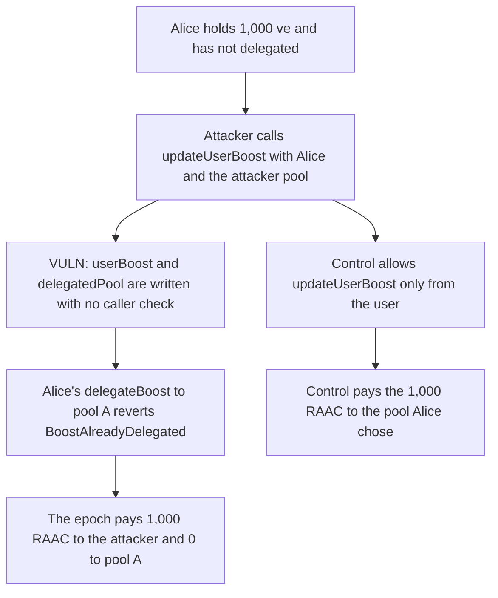

# Anyone can point Alice's veRAAC boost at their own pool and collect her 1,000 RAAC reward

> **Vulnerability classes:** vuln/access-control/missing-auth · vuln/logic/reward-calculation

<!-- non-defihacklabs -->
<!-- source-auditvault: https://github.com/Auditware/AuditVault/blob/main/findings/57206-lack-of-access-control-in-boostcontrollerupdateuserboost-lea.md -->
<!-- date: 2025-02 -->

## Key info

| Field | Value |
|---|---|
| **Loss** | 1,000 RAAC paid to the attacker pool. Alice's pool receives 0 and her delegation reverts |
| **Vulnerable contract** | `BoostController.updateUserBoost` |
| **Attacker EOA** | `0x0000000000000000000000000000000000057206` |
| **Attack contract** | `Exploit` |
| **Attack tx** | `Exploit.run()` |
| **Chain / block / date** | Ethereum model · block 0 · 2025-02 |
| **Compiler** | solc 0.8.27, cancun, via IR |
| **Bug class** | `updateUserBoost` has no caller check |

## TL;DR

`updateUserBoost(user, pool)` writes `userBoost` and `delegatedPool` for any user and any supported pool. An attacker passes Alice and their own pool. Her 1,000 ve is now boosting the attacker. Her later `delegateBoost` to pool A reverts with `BoostAlreadyDelegated`. The epoch's 1,000 RAAC is paid entirely to the attacker. Restricting the call to the user herself sends that 1,000 RAAC to pool A.

## Background

CodeHawks' February 2025 RAAC Core Contracts contest. Users are supposed to call `delegateBoost` to choose a pool. `updateUserBoost` was meant as the follow-up that refreshes the working balance. It is public, and calling it first is enough to set the delegation.

## The vulnerable code

```solidity
function updateUserBoost(address user, address pool) public {
    require(supportedPools[pool], "pool");
    uint256 newBoost = _calculateBoost(user, pool);
    uint256 oldBoost = userBoost[pool][user];
    if (newBoost >= oldBoost) {
        poolBoost[pool].totalBoost += (newBoost - oldBoost);
    } else {
        poolBoost[pool].totalBoost -= (oldBoost - newBoost);
    }
    // @> VULN: updateUserBoost has no caller check, so this write redirects any user's boost to any pool
    userBoost[pool][user] = newBoost;
    if (newBoost > 0) {
        delegatedPool[user] = pool;
    }
}
```

`_calculateBoost` returns Alice's ve balance, 1,000. Nothing checks `msg.sender`.

## Root cause

The delegation record is written by a function that accepts both the user and the pool from the caller. The user is not the caller.

## Preconditions

- Alice holds 1,000 ve and has not delegated.
- The attacker pool is a supported pool.
- An epoch of 1,000 RAAC is paid in proportion to `totalBoost`.

## Attack walkthrough

1. 1,000 RAAC is funded on the controller.
2. The attacker calls `updateUserBoost(Alice, attackerPool)`.
3. Alice's boost and `delegatedPool` now point at the attacker.
4. Alice's `delegateBoost` to pool A reverts `BoostAlreadyDelegated`.
5. `payRewards` sends the full 1,000 RAAC to the attacker. Pool A receives 0.
6. The control rejects the attacker's call. Alice delegates to pool A and that pool receives the 1,000 RAAC.

## Diagrams



## Impact

The attacker receives 1,000 RAAC that tracked Alice's ve. Pool A, the pool she tried to choose, receives 0, and she cannot overwrite the forced delegation. The control pays pool A the full 1,000 RAAC and pays the attacker 0.

## Remediation

Require `msg.sender == user`, or require that `msg.sender` is a pool Alice already selected in `delegateBoost`, before writing `userBoost` or `delegatedPool`.

## How to reproduce

```bash
cd 57206-lack-of-access-control-in-boostcontrollerupdateuserboost-lea_exp
forge test -vv
```

`test_exploit_overwrites_alice_boost_and_takes_rewards` asserts the attacker is paid 1,000 RAAC and Alice cannot delegate. `test_control_only_alice_can_direct_her_boost` asserts the unauthorized call reverts and pool A is paid 1,000 RAAC. Captured output is `output.txt`.

## Sources

- AuditVault finding: https://github.com/Auditware/AuditVault/blob/main/findings/57206-lack-of-access-control-in-boostcontrollerupdateuserboost-lea.md
- Contest: https://codehawks.cyfrin.io/c/2025-02-raac
