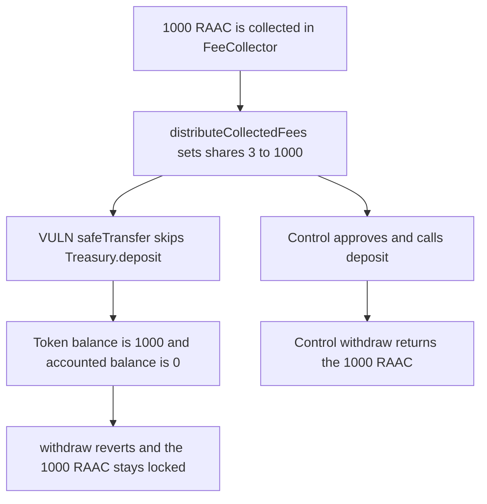

# RAAC: fee distribution safeTransfers 1000 RAAC into a Treasury that cannot withdraw it

> **Vulnerability classes:** vuln/dos/frozen-funds · vuln/logic/missing-check

<!-- non-defihacklabs -->
<!-- source-auditvault: https://github.com/Auditware/AuditVault/blob/main/findings/57207-treasury-balance-tracking-bypass-in-feecollector-codehawks-r.md -->
<!-- date: 2025-02 -->

## Key info

| Field | Value |
|---|---|
| **Loss** | 1000 RAAC locked in the Treasury. `withdraw` reverts `InsufficientBalance` |
| **Vulnerable contract** | `FeeCollector._processDistributions` |
| **Attacker EOA** | `0x1111111111111111111111111111111111111111` |
| **Attack contract** | `Exploit` |
| **Attack tx** | `Exploit.run()` |
| **Chain / block / date** | Ethereum model · block 0 · 2025-02 |
| **Compiler** | solc 0.8.27, cancun, via IR |
| **Bug class** | Direct token transfer skips `Treasury.deposit` |

## TL;DR

`_processDistributions` sends the treasury share with `raacToken.safeTransfer`. `Treasury.withdraw` spends only `_balances`, and `_balances` increases only inside `deposit()`. After a 1000 RAAC distribution the token balance is 1000 and the accounted balance is 0, so the withdraw of that 1000 reverts. Approving the Treasury and calling `deposit()` records the 1000 and the withdraw returns it.

## Background

CodeHawks contest `2025-02-raac` (3–24 February 2025), Regnum Aurum Acquisition Corp core contracts. The report is "Treasury Balance Tracking Bypass in FeeCollector" by nikikiki. The PoC log shows accounted balance 0, actual balance `1000000000000000000000`, and `InsufficientBalance` on withdraw.

## The vulnerable code

```solidity
function _processDistributions(uint256 totalFees, uint256[4] memory shares) internal {
    if (shares[3] > 0 && totalFees > 0) {
        // @> VULN: safeTransfer into Treasury skips deposit(), so the accounted balance stays 0
        raacToken.safeTransfer(treasury, shares[3]);
    }
}
```

The report's fix approves the Treasury and calls `treasury.deposit(address(raacToken), shares[3])`.

## Root cause

The Treasury's solvency check is an internal counter, not `balanceOf`. A raw ERC-20 transfer updates only the token. The fee admin is doing the intended distribution, and still cannot recover the tokens.

## Preconditions

- `FeeCollector.treasury` is the Treasury contract, not an EOA.
- 1000 RAAC has been collected into the FeeCollector.
- The fee admin calls `distributeCollectedFees`.

## Attack walkthrough

1. A payer sends 1000 RAAC into the collector with `collectFee`.
2. The admin distributes. `shares[3]` is the full 1000.
3. `safeTransfer` credits the Treasury. `getBalance(RAAC)` stays 0.
4. `withdraw(RAAC, 1000)` hits `InsufficientBalance` and reverts.
5. The Treasury still holds 1000 RAAC.
6. The control calls `deposit`. Accounted and actual balances are both 1000, and the withdraw pays the admin 1000.

## Diagrams



## Impact

The protocol's treasury cannot spend the 1000 RAAC that fee distribution just delivered. The tokens are not stolen by an outside caller. They are stuck. The control recovers the full 1000.

## Remediation

Replace the `safeTransfer` with `approve` plus `Treasury.deposit`, which is the change the report recommends for both `_processDistributions` and `emergencyWithdraw`.

## How to reproduce

```bash
cd 57207-treasury-balance-tracking-bypass-in-feecollector-codehawks-r_exp
forge test -vv
```

`test_exploit_direct_transfer_locks_1000_raac_in_treasury` asserts actual balance 1000 and accounted balance 0. `test_control_deposit_lets_the_treasury_withdraw_1000` asserts the withdraw pays 1000. Captured output is `output.txt`.

## Sources

- AuditVault finding: https://github.com/Auditware/AuditVault/blob/main/findings/57207-treasury-balance-tracking-bypass-in-feecollector-codehawks-r.md
- CodeHawks contest: https://codehawks.cyfrin.io/c/2025-02-raac
- Submission: https://codehawks.cyfrin.io/c/2025-02-raac/s/2864
