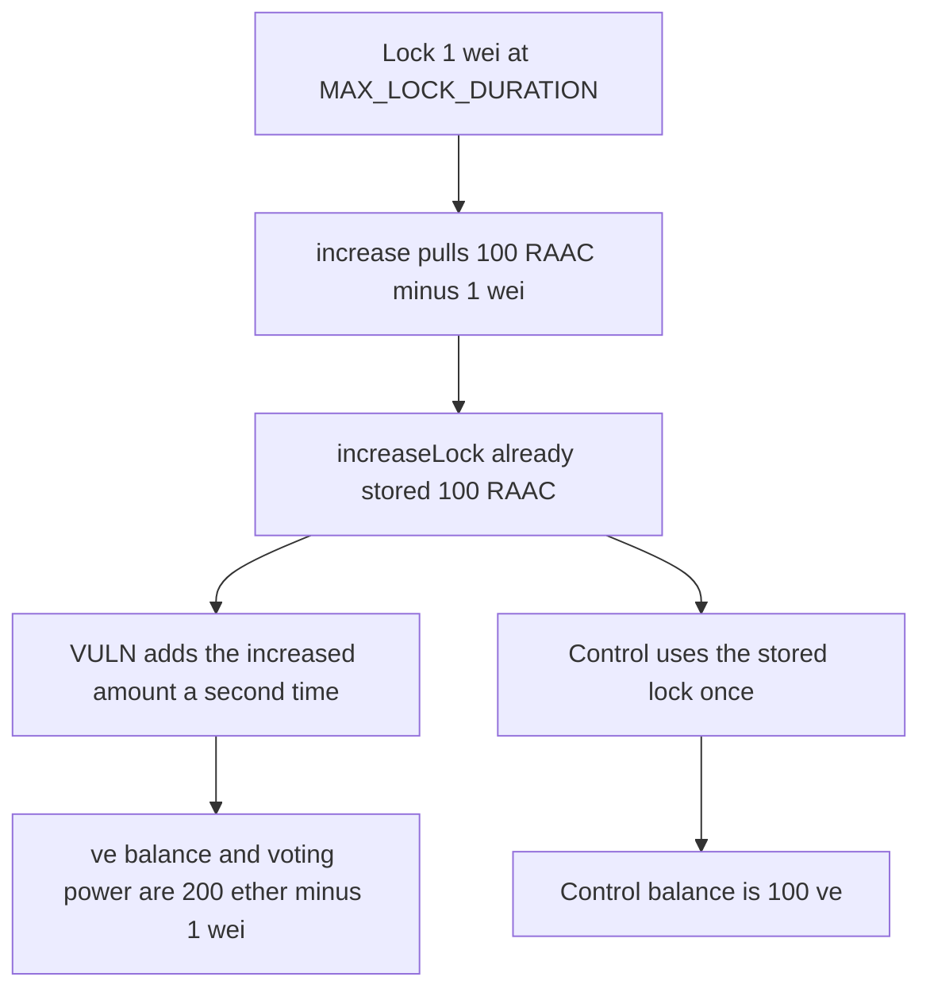

# veRAAC: a dust lock plus increase mints almost twice the voting power

> **Vulnerability classes:** vuln/logic/state-update

<!-- non-defihacklabs -->
<!-- source-auditvault: https://github.com/Auditware/AuditVault/blob/main/findings/57208-attackers-can-double-voting-power-and-vetoken-amount-by-lock.md -->
<!-- date: 2025-02 -->

## Key info

| Field | Value |
|---|---|
| **Loss** | 100 RAAC mints 199.999999999999999999 veRAAC and the same voting power |
| **Vulnerable contract** | `VeToken.increase` |
| **Attacker EOA** | `0x0000000000000000000000000000000000057208` |
| **Attack contract** | `Exploit` |
| **Attack tx** | `Exploit.run()` |
| **Chain / block / date** | Ethereum model · block 0 · 2025-02 |
| **Compiler** | solc 0.8.27, cancun, via IR |
| **Bug class** | `increase` adds `amount` twice when it computes bias |

## TL;DR

`veRAACToken.increase` calls `increaseLock`, which already adds `amount` to the stored lock. It then computes the new bias from `userLock.amount + amount`. A 1 wei lock followed by an increase of `100 ether - 1` mints `200 ether - 1` of ve and voting power. Locking 100 RAAC in one call mints 100.

## Background

Codehawks contest on the February 2025 RAAC core contracts, reported by newspacexyz. Voting power and the ve mint are `lockAmount * duration / MAX_LOCK_DURATION`. At the maximum duration that ratio is 1. The PoC in the report shows alice at 100 ve and eve at 199.999999999999999999 ve for the same 100 RAAC.

## The vulnerable code

```solidity
_increaseLock(msg.sender, amount);
uint256 userAmount = lockedAmount[msg.sender];
// @> VULN: userAmount already includes `amount`, and amount is added again
uint256 counted = userAmount + amount;
uint256 newPower = counted * MAX_LOCK_DURATION / MAX_LOCK_DURATION;
balanceOf[msg.sender] = newPower;
votingPower[msg.sender] = newPower;
```

`_increaseLock` is `lockedAmount[user] += amount`. After a 1 wei lock and an increase of `100 ether - 1`, `userAmount` is `100 ether` and `counted` is `200 ether - 1`.

## Root cause

The lock manager and the bias update both add the same `amount`. The recommended diff in the report drops the extra `+ amount` and passes `userLock.amount` alone into `calculateAndUpdatePower`.

## Preconditions

- The caller has 100 ether of RAAC approved to the locker.
- `MAX_LOCK_DURATION` is the duration used for both the dust lock and the increase, so the bias is 1 ve per 1 RAAC before the double count.
- `increase` is only reachable after a lock exists, which is why the dust lock comes first.

## Attack walkthrough

1. `lock(1, MAX_LOCK_DURATION)` pulls 1 wei and mints 1 ve.
2. `increase(100 ether - 1)` pulls the rest of the RAAC.
3. `increaseLock` stores `100 ether`.
4. `counted` adds `100 ether - 1` again.
5. `balanceOf` and `votingPower` are set to `200 ether - 1`.
6. The control writes the lock once and the balance stays `100 ether`.

## Diagrams



## Impact

The attacker deposits 100 RAAC and receives `200 ether - 1` wei of veRAAC, which is also the voting power. An honest lock of the same 100 RAAC receives 100 ve. The extra ve is unbacked voting power and an inflated locker balance. The control's `increase` sets the balance to `lockedAmount` and the caller holds exactly 100 ether of ve.

## Remediation

Pass `userLock.amount` into the bias update. Do not add `amount` again. The report's diff is that one-line change in `veRAACToken.increase`.

## How to reproduce

```bash
cd 57208-attackers-can-double-voting-power-and-vetoken-amount-by-lock_exp
forge test -vv
```

`test_exploit_dust_lock_then_increase_mints_double_ve` asserts `200 ether - 1` of voting power. `test_control_increase_uses_the_lock_once` asserts 100 ve. Captured output is `output.txt`.

## Sources

- AuditVault finding: https://github.com/Auditware/AuditVault/blob/main/findings/57208-attackers-can-double-voting-power-and-vetoken-amount-by-lock.md
- Code: `veRAACToken.increase` in Cyfrin/2025-02-raac
