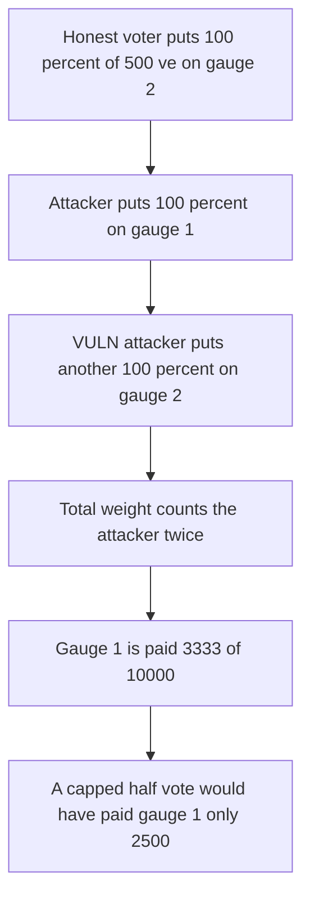

# RAAC: a ve holder can vote 100 percent on every gauge

> **Vulnerability classes:** `vuln/logic/reward-calculation` · `vuln/logic/missing-check`

<!-- non-defihacklabs -->
<!-- source-auditvault: https://github.com/Auditware/AuditVault/blob/main/findings/57213-gauge-voting-misallocation-vulnerability-codehawks-regnum-au.md -->
<!-- date: 2025-02 -->

## Key info

| Field | Value |
|---|---|
| **Loss** | Gauge 1 is paid 3333 veRAAC of a 10000 emission. A capped 50/50 vote would have paid it 2500 |
| **Vulnerable contract** | `GaugeController.vote` |
| **Attacker EOA** | `0x1111111111111111111111111111111111111111` |
| **Attack contract** | `Exploit` |
| **Attack tx** | `Exploit.run()` |
| **Chain / block / date** | Ethereum model · block 0 · 2025-02 |
| **Compiler** | solc 0.8.27, cancun, via IR |
| **Bug class** | `weight` is capped per gauge, never across a user's gauges |

## TL;DR

`vote` rejects a weight above 10000 and then stores that weight for one gauge. It does not track the sum. A user with 500 ve can vote 10000 on gauge 1 and 10000 on gauge 2, and both votes are multiplied by the full 500. An honest voter with the same 500 ve who votes 10000 only on gauge 2 is diluted. Of a 10000 veRAAC emission, gauge 1 receives 3333. A user who had to keep the sum at 10000 and split it in half would have left gauge 1 at 2500.

## The vulnerable code

```solidity
uint256 oldWeight = userGaugeVotes[msg.sender][gauge];
userGaugeVotes[msg.sender][gauge] = weight; // @> VULN: no sum across gauges
_updateGaugeWeight(gauge, oldWeight, weight, votingPower);
```

The report's fix keeps `userTotalGaugeVotes` and reverts when `old` is replaced by `weight` and the new total exceeds `WEIGHT_PRECISION`.

## Root cause

`_updateGaugeWeight` adds `newWeight * votingPower / 10000` and subtracts the old weight the same way. Nothing stops `newWeight` from being 10000 on every gauge. Each gauge therefore counts the full ve balance, so the user's voting power is applied once per gauge they touch.

## Preconditions

- Two gauges of the same type. Type weight equals `MAX_TYPE_WEIGHT`, so the type takes the whole emission.
- Emission for the period is 10000 veRAAC, held by the controller and transferred on `distributeRewards`.
- The attacker and one honest voter each hold 500 ve.

## Attack walkthrough

1. The honest voter calls `vote(gauge2, 10000)`. Gauge 2's weight becomes 500 ve.
2. The attacker calls `vote(gauge1, 10000)` and `vote(gauge2, 10000)`. Gauge 1's weight becomes 500 ve. Gauge 2's weight becomes 1000 ve. Total weight is 1500 ve. The attacker's two weights sum to 20000.
3. `distributeRewards(gauge1)` pays `10000 * 3333 / 10000 = 3333` veRAAC. The 3333 is `10000 / 3` truncated.
4. Gauge 2 is paid 6666. A capped 50/50 attacker would have left the weights at 250 and 750, and gauge 1 would have received 2500.

## Diagrams



## Impact

Gauge 1's stakers receive 3333 veRAAC instead of the 2500 a single 100 percent budget, split in half, would have directed there. Gauge 2 receives 6666 instead of 7500. The attacker has applied 500 ve as if it were 1000. The same missing sum lets any holder do this on every gauge they can vote.

## How to reproduce

```bash
cd 57213-gauge-voting-misallocation-vulnerability-codehawks-regnum-au_exp
forge test -vv
```

`test_double_full_vote_skews_gauge1` asserts gauge 1 holds 3333 veRAAC, gauge 2 holds 6666, and both of the attacker's weights are 10000.

## Sources

- AuditVault finding: https://github.com/Auditware/AuditVault/blob/main/findings/57213-gauge-voting-misallocation-vulnerability-codehawks-regnum-au.md
- CodeHawks contest: https://codehawks.cyfrin.io/c/2025-02-raac
- Controller vote, as quoted in the finding from `GaugeController.sol`
