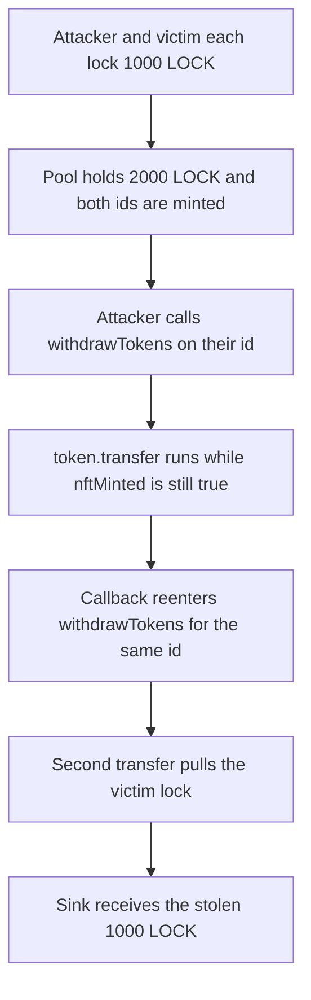

# TrustSwap LockToken: withdrawTokens transfers before clearing nftMinted

> **Vulnerability classes:** vuln/reentrancy/single-function
>
> **Reproduction:** faithful local reproduction of AuditVault 57521. `withdrawTokens` calls `token.transfer` and `nft.burn` before `nftMinted[id] = false`. A token callback re-enters the same id and pulls the deposit a second time.

<!-- non-defihacklabs -->
<!-- source-auditvault: https://github.com/Auditware/AuditVault/blob/main/findings/57521-reentrancy-in-main-functions-zokyo-none-trustswap-markdown.md -->
<!-- date: 2022-08 -->

## Root cause

Zokyo's TrustSwap review of `LockToken.withdrawTokens` reports external `transfer` and `burn` calls before `nftMinted[id]` is written false. While the flag is still true, the same id can be withdrawn again.

```solidity
uint256 amount = depositOf[id];
// @> VULN: external transfer and burn run before nftMinted[id] is cleared
token.transfer(msg.sender, amount);
nft.burn(id);
nftMinted[id] = false;
```

## Attack path



## Impact

The attacker deposited 1,000 LOCK and finished with that principal back. The other locker's 1,000 LOCK was transferred as well and forwarded to the sink. A fixed `withdrawTokens` clears `nftMinted` before the external calls, the reentered withdraw reverts, and the victim lock stays intact.

## PoC

```bash
cd 57521-reentrancy-in-main-functions-zokyo-none-trustswap-markdown_exp
forge test -vv
```

## Sources

- AuditVault finding 57521
- Zokyo, TrustSwap, 2022-08-08: https://github.com/solodit/solodit_content/blob/main/reports/Zokyo/2022-08-08-TrustSwap.md
