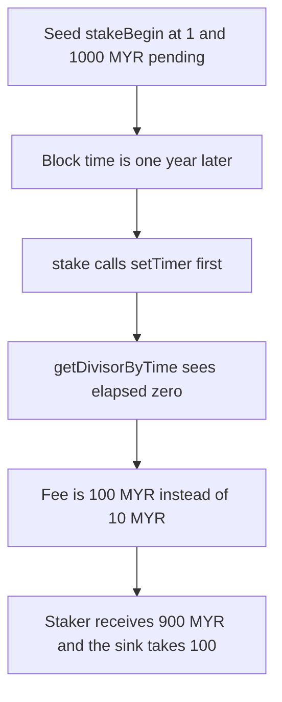

# Magic Yearn MyStaking: setTimer runs before the fee divisor

> **Vulnerability classes:** vuln/logic/reward-calculation
>
> **Reproduction:** faithful local reproduction of AuditVault 57531. `stake` calls `setTimer` before `getDivisorByTime`, so a long stake is charged the maximum fee.

<!-- non-defihacklabs -->
<!-- source-auditvault: https://github.com/Auditware/AuditVault/blob/main/findings/57531-stake-begin-time-updated-before-reward-calculation-in-mystak.md -->
<!-- date: 2022-08 -->

## Root cause

`stakeBegin` is an input to `getDivisorByTime`. `stake` writes `stakeBegin = block.timestamp` before that read, so elapsed time is zero and the divisor is the maximum-fee value.

```solidity
// @> VULN: stakeBegin is updated before getDivisorByTime prices the fee
setTimer(msg.sender);
uint256 divisor = getDivisorByTime(stakeBegin[msg.sender]);
```

A stake that began at timestamp 1, observed at timestamp 31536001, has elapsed a full year. The long-stake divisor is 100, a 10 MYR fee on 1,000 MYR. After `setTimer` the divisor is 10 and the fee is 100 MYR.

## Attack path



## Impact

The staker is overcharged 90 MYR on a 1,000 MYR reward. The fixed `stake` reads `getDivisorByTime` before `setTimer` and charges the 10 MYR long-stake fee, leaving the staker 990 MYR.

## PoC

```bash
cd 57531-stake-begin-time-updated-before-reward-calculation-in-mystak_exp
forge test -vv
```

## Sources

- AuditVault finding 57531
- Zokyo, Magic Yearn, 2022-08-17: https://github.com/solodit/solodit_content/blob/main/reports/Zokyo/2022-08-17-Magic%20Yearn.md
