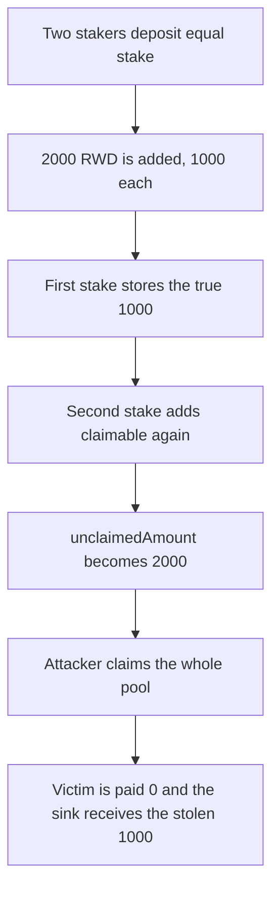

# Magic Yearn MyStaking: stake stores claimable rewards twice

> **Vulnerability classes:** vuln/logic/reward-calculation
>
> **Reproduction:** faithful local reproduction of AuditVault 57532. `claimableAmount` already adds `unclaimedAmount`, and `stake` adds that total back onto `unclaimedAmount`.

<!-- non-defihacklabs -->
<!-- source-auditvault: https://github.com/Auditware/AuditVault/blob/main/findings/57532-incorrect-storage-of-user-rewards-during-staking-in-mystakin.md -->
<!-- date: 2022-08 -->

## Root cause

`claimableAmount` returns fresh accrual plus `unclaimedAmount`. `stake` then does `unclaimedAmount += claimable`. The stored rewards are counted twice.

```solidity
uint256 claimable = claimableAmount(msg.sender);
// @> VULN: claimable already includes unclaimedAmount, so this doubles it
u.unclaimedAmount += claimable;
```

Two equal stakers share a 2,000 RWD pool, 1,000 each. The attacker's second `stake(0)` turns a stored 1,000 into 2,000. Their claim empties the pool.

## Attack path



## Impact

The attacker is paid 2,000 RWD. The other staker is paid 0. 1,000 RWD of that payout is the victim's share and is forwarded to the sink. The fixed `stake` adds only the fresh accrual, and each staker claims 1,000 RWD.

## PoC

```bash
cd 57532-incorrect-storage-of-user-rewards-during-staking-in-mystakin_exp
forge test -vv
```

## Sources

- AuditVault finding 57532
- Zokyo, Magic Yearn, 2022-08-17: https://github.com/solodit/solodit_content/blob/main/reports/Zokyo/2022-08-17-Magic%20Yearn.md
