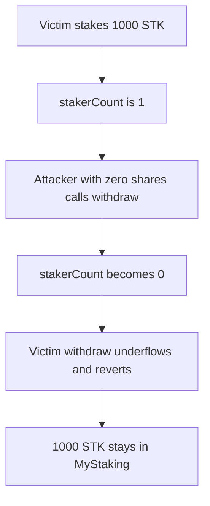

# Magic Yearn MyStaking: a non-staker can zero stakerCount

> **Vulnerability classes:** vuln/dos/frozen-funds
>
> **Reproduction:** faithful local reproduction of AuditVault 57533. `withdraw` decrements `stakerCount` without checking that the caller has a share.

<!-- non-defihacklabs -->
<!-- source-auditvault: https://github.com/Auditware/AuditVault/blob/main/findings/57533-user-funds-lock-in-mystaking-due-to-stakercount-manipulation.md -->
<!-- date: 2022-08 -->

## Root cause

`stake` increments `stakerCount` only when a user goes from zero shares to a position. `withdraw` always executes `stakerCount -= 1`. A caller with zero shares can drive the counter to zero. The real staker's later withdraw underflows and reverts.

```solidity
uint256 share = shares[msg.sender];
shares[msg.sender] = 0;
// @> VULN: stakerCount decreases even when the caller has no share
stakerCount -= 1;
if (share > 0) token.transfer(msg.sender, share);
```

## Attack path



## Impact

The victim's 1,000 STK cannot be withdrawn. The attacker's call moved no tokens. The fixed `withdraw` requires `share > 0`, so the zero-share call reverts and the victim exits with their 1,000 STK.

## PoC

```bash
cd 57533-user-funds-lock-in-mystaking-due-to-stakercount-manipulation_exp
forge test -vv
```

## Sources

- AuditVault finding 57533
- Zokyo, Magic Yearn, 2022-08-17: https://github.com/solodit/solodit_content/blob/main/reports/Zokyo/2022-08-17-Magic%20Yearn.md
