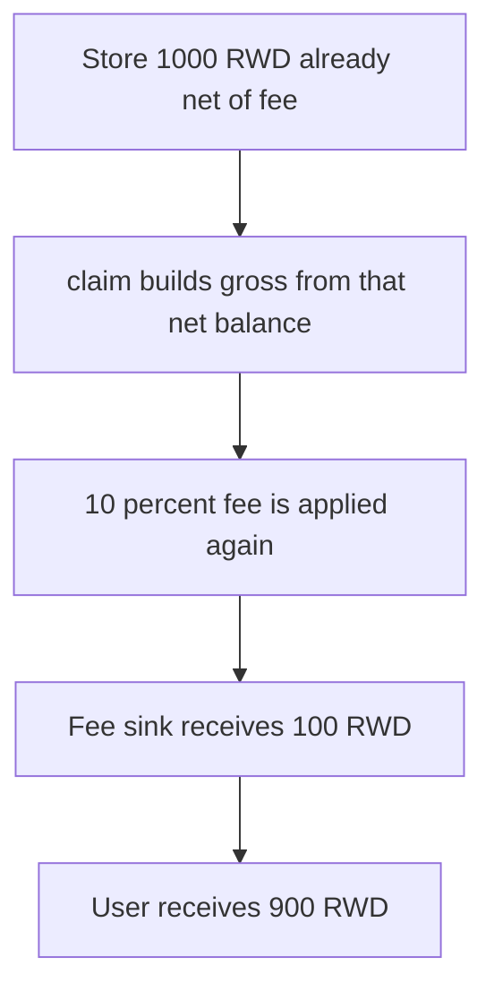

# Magic Yearn MyStaking: claim fees an already-net unclaimed balance

> **Vulnerability classes:** vuln/logic/reward-calculation
>
> **Reproduction:** faithful local reproduction of AuditVault 57534. `claimableAmount` applies the fee to `unclaimedAmount` that was already stored net of fee.

<!-- non-defihacklabs -->
<!-- source-auditvault: https://github.com/Auditware/AuditVault/blob/main/findings/57534-fee-can-be-applied-multiple-times-to-same-rewards-in-mystaki.md -->
<!-- date: 2022-08 -->

## Root cause

`unclaimedAmount` is the post-fee balance. `claimableAmount` adds it into `gross` and takes `FEE_BPS` of that sum, so the same rewards are commissioned again.

```solidity
uint256 gross = unclaimedAmount[user] + pending[user];
fee = gross * FEE_BPS / 10_000;
// @> VULN: fee is taken from unclaimedAmount that was already stored net of fee
lastFee = fee;
```

A stored net balance of 1,000 RWD is charged 10 percent again. The user receives 900 RWD and the fee sink receives 100 RWD.

## Attack path



## Impact

The user loses 100 RWD that had already been stored after a fee. The fixed claim pays the stored net balance with no second fee, so the user receives the full 1,000 RWD and the sink receives nothing.

## PoC

```bash
cd 57534-fee-can-be-applied-multiple-times-to-same-rewards-in-mystaki_exp
forge test -vv
```

## Sources

- AuditVault finding 57534
- Zokyo, Magic Yearn, 2022-08-17: https://github.com/solodit/solodit_content/blob/main/reports/Zokyo/2022-08-17-Magic%20Yearn.md
