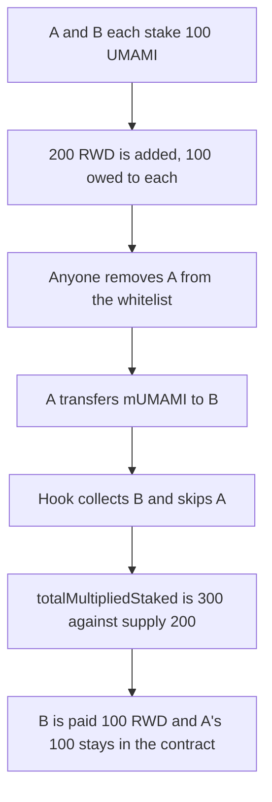

# Umami MarinateV2: delisted marinator rewards are never collected

> **Vulnerability classes:** vuln/dos/frozen-funds
>
> **Reproduction:** faithful local reproduction of AuditVault 57560. Removing a whitelisted marinator does not pay it, and the transfer hook collects rewards only while `isWhitelisted` is true.

<!-- non-defihacklabs -->
<!-- source-auditvault: https://github.com/Auditware/AuditVault/blob/main/findings/57560-issues-with-token-transfers-and-rewards-when-a-marinator-is.md -->
<!-- date: 2022-09 -->

## Root cause

`removeFromContractWhitelist` is permissionless and does not pay the marinator. `_beforeTokenTransfer` then skips `_collect` for any party that is no longer whitelisted. A's pending rewards are never written to `toBePaid`. After A transfers its mUMAMI away, relisting A cannot recover them because A's balance is zero. `totalMultipliedStaked` is also left at 300 while supply is 200, because the delisted sender's stake is not removed and the recipient's receipt is added.

```solidity
// @> VULN: a delisted marinator is skipped, so its rewards are never collected
if (isWhitelisted(from)) _collect(from);
if (isWhitelisted(to)) _collect(to);
```

## Attack path



## Impact

100 RWD remains in MarinateV2 after B withdraws and after A is whitelisted again. A's reward balance stays 0. The fixed removal pays A before clearing the whitelist, and a later transfer requires both parties to be whitelisted, so the reward balance ends at 0.

## PoC

```bash
cd 57560-issues-with-token-transfers-and-rewards-when-a-marinator-is_exp
forge test -vv
```

## Sources

- AuditVault finding 57560
- Zokyo, Umami, 2022-09-07: https://github.com/solodit/solodit_content/blob/main/reports/Zokyo/2022-09-07-Umami%20.md
- MarinateV2 hooks: https://github.com/UmamiDAO/marinateV2/blob/main/contracts/MarinateV2.sol
