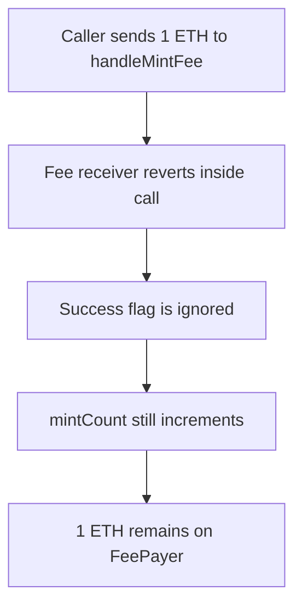

# Onemind FeePayer: ignored call success sticks the mint fee

> **Vulnerability classes:** vuln/dependency/unchecked-return-value
>
> **Reproduction:** faithful local reproduction of AuditVault 57634. `handleMintFee` forwards ETH with `call` and does not require the success flag.

<!-- non-defihacklabs -->
<!-- source-auditvault: https://github.com/Auditware/AuditVault/blob/main/findings/57634-eth-can-get-stuck-on-the-contract-zokyo-none-onemind-markdow.md -->
<!-- date: 2022-10 -->

## Root cause

`FeePayer.handleMintFee` sends `msg.value` to the fee receiver and ignores the boolean returned by `call`. A reverting receiver does not revert the mint, and the ETH remains on FeePayer.

```solidity
// @> VULN: call() success is ignored, so a failed ETH transfer does not revert
(bool ok,) = address(feeReceiver).call{value: msg.value}("");
mintCount += 1;
```

## Attack path



## Impact

The mint completes and 1 ETH is stuck in FeePayer. The receiver's balance stays 0. The fixed function requires `ok`, so the same call reverts and no ETH remains on the contract.

## PoC

```bash
cd 57634-eth-can-get-stuck-on-the-contract-zokyo-none-onemind-markdow_exp
forge test -vv
```

## Sources

- AuditVault finding 57634
- Zokyo, Onemind, 2022-10-18: https://github.com/solodit/solodit_content/blob/main/reports/Zokyo/2022-10-18-Onemind.md
