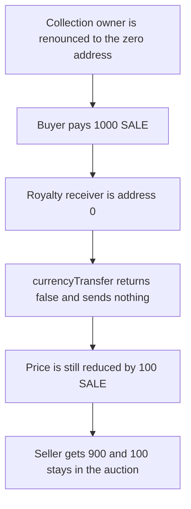

# Onemind PlatformAuction: unpaid royalty is still subtracted from price

> **Vulnerability classes:** vuln/dos/frozen-funds
>
> **Reproduction:** faithful local reproduction of AuditVault 57636. After the collection owner is the zero address, the royalty is calculated and subtracted from price even though `_currencyTransfer` refuses to send it.

<!-- non-defihacklabs -->
<!-- source-auditvault: https://github.com/Auditware/AuditVault/blob/main/findings/57636-royalties-might-get-stuck-on-the-contract-zokyo-none-onemind.md -->
<!-- date: 2022-10 -->

## Root cause

`_calculateRoyalty` returns `address(0)` when `collectionOwner` has been renounced. `_currencyTransfer` returns false for the zero address. `handleRoyalties` still subtracts the royalty from the price, so that value stays in the auction.

```solidity
bool sent = _currencyTransfer(receiver, royalty);
// @> VULN: royalty is subtracted from price even though it was not transferred
price -= royalty;
lastProceeds = price;
```

On a 1,000 SALE sale the royalty is 100 SALE. The seller receives 900 SALE. The auction keeps 100 SALE.

## Attack path



## Impact

100 SALE of the buyer's payment is locked in the auction and the seller is short that amount. The fixed `handleRoyalties` subtracts the royalty only when the transfer succeeded, so the seller receives the full 1,000 SALE and the auction balance is 0.

## PoC

```bash
cd 57636-royalties-might-get-stuck-on-the-contract-zokyo-none-onemind_exp
forge test -vv
```

## Sources

- AuditVault finding 57636
- Zokyo, Onemind, 2022-10-18: https://github.com/solodit/solodit_content/blob/main/reports/Zokyo/2022-10-18-Onemind.md
