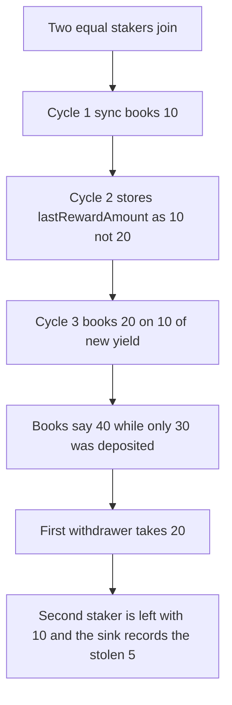

# Mystic Finance syncRewards: lastRewardAmount stores the cycle delta

> **Vulnerability classes:** vuln/logic/reward-calculation
>
> **Reproduction:** faithful local reproduction of AuditVault 57712, using the report's own 10 ether cycle numbers. `nextRewards = yieldEth - lastRewardAmount`, then `lastRewardAmount` is set to `nextRewards` instead of cumulative yield.

<!-- non-defihacklabs -->
<!-- source-auditvault: https://github.com/Auditware/AuditVault/blob/main/findings/57712-c-01-miscalculation-in-rewardswill-give-toomuchrewardstouser.md -->
<!-- date: 2025-02 -->

## Root cause

`lastRewardAmount` is supposed to track cumulative yield. The function stores only the latest delta. The next cycle subtracts that stale delta from a larger `yieldEth` and books too much.

```solidity
uint256 nextRewards = yieldEth - lastRewardAmount;
accountedRewards += nextRewards;
// @> VULN: lastRewardAmount stores the cycle delta, not cumulative yieldEth
lastRewardAmount = nextRewards;
accPerShare += nextRewards * 1e18 / totalShares;
```

Cycle 1: yield 10, next 10, last becomes 10. Cycle 2: yield 20, next 10, last is stored as 10 instead of 20. Cycle 3: yield 30, next is 20. Accounted rewards are 40 against 30 of real yield.

## Attack path



## Impact

Fair shares of the 30 ether deposited are 15 and 15. The first withdrawer receives 20 ether. The other staker can withdraw only the remaining 10 ether, a 5 ether loss. That 5 ether is forwarded to the sink. The fixed `syncRewards` sets `lastRewardAmount = yieldEth`, accounts 30 ether, and pays each staker 15 ether.

## PoC

```bash
cd 57712-c-01-miscalculation-in-rewardswill-give-toomuchrewardstouser_exp
forge test -vv
```

## Sources

- AuditVault finding 57712
- Kann, Mystic Finance: https://github.com/Kann-Audits/Kann-Audits/blob/main/reports/md-format/private-audits-reports/Mystic%20Finance.md
