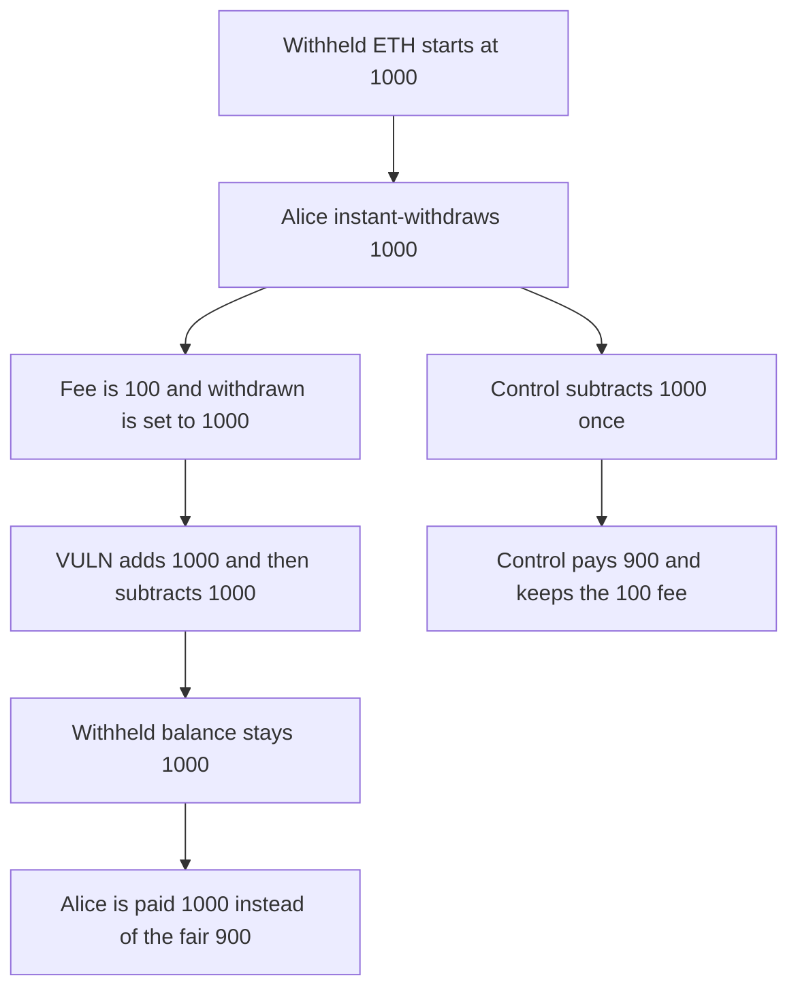

# Mystic Finance: instant withdraw leaves currentWithheldETH unchanged and pays the fee out

> **Vulnerability classes:** vuln/logic/state-update · vuln/logic/fee-calculation

<!-- non-defihacklabs -->
<!-- source-auditvault: https://github.com/Auditware/AuditVault/blob/main/findings/57713-h-01-incorrect-accounting-of-currentwithheldethininstantwith.md -->
<!-- date: 2026-05 -->

## Key info

| Field | Value |
|---|---|
| **Loss** | Alice is paid 1,000 ETH. The fair instant payout is 900. She is overpaid by 100, and currentWithheldETH stays 1,000 |
| **Vulnerable contract** | `StPlumeMinter.withdraw` |
| **Attacker EOA** | `0x1111111111111111111111111111111111111111` (Alice) |
| **Attack contract** | `Exploit` |
| **Attack tx** | `Exploit.run()` |
| **Chain / block / date** | Ethereum model · block 0 · 2026-05 |
| **Compiler** | solc 0.8.27, cancun, via IR |
| **Bug class** | Instant path adds the withdrawal it should only subtract |

## TL;DR

On the instant path the contract sets `withdrawn = amount`, adds `withdrawn` to `currentWithheldETH`, then subtracts `amount`. The withheld balance does not change. The transfer pays `withdrawn`, so the 10 percent instant fee is not kept. Alice withdraws 1,000 and receives 1,000. The fair payout is 900. The books still show 1,000 withheld. The control subtracts the amount once, pays 900, and keeps the 100 fee.

## Background

Kann's review of Mystic Finance liquid staking, H-01. Instant redemptions are paid from ETH already held in `currentWithheldETH`. The code still adds `withdrawn` as if new ETH had arrived from staking, then subtracts `amount`. The team fixed it. This reduction uses a 10 percent fee (`1,000 / 10,000`) and a 1,000 ETH withheld balance.

## The vulnerable code

```solidity
fee = amount * INSTANT_REDEMPTION_FEE / RATIO_PRECISION;
withdrawn = amount;
uint256 cachedWithheldETH = currentWithheldETH;
// @> VULN: instant path adds withdrawn and then subtracts amount, so currentWithheldETH does not fall
currentWithheldETH += withdrawn;
withHoldEth += fee;
currentWithheldETH -= amount;
uint256 payout = withdrawn;
```

The fair payout is `amount - fee`.

## Root cause

The instant branch pretends staking just delivered `amount` of new ETH. That ETH was already inside `currentWithheldETH`. Adding it and then subtracting `amount` cancels out. Paying `withdrawn` instead of `amount - fee` sends the fee to the user as well.

## Preconditions

- `currentWithheldETH` is 1,000 and the contract holds 1,000 ETH.
- `INSTANT_REDEMPTION_FEE` is 1,000 and `RATIO_PRECISION` is 10,000, so the fee on 1,000 is 100.
- The withdrawal amount is less than or equal to the withheld balance, so the instant branch runs.

## Attack walkthrough

1. The withheld balance is funded with 1,000.
2. Alice withdraws 1,000. The fee is 100 and `withdrawn` is set to 1,000.
3. `currentWithheldETH` is increased by 1,000 and then decreased by 1,000. It is still 1,000.
4. The transfer pays 1,000. The fair payout is 900. Alice is overpaid by 100.
5. The control subtracts 1,000 once, pays 900, and leaves `withHoldEth` at 100 with the withheld balance at 0.

## Diagrams



## Impact

Alice receives 1,000 ETH. The fair instant redemption is 900 ETH, so she is overpaid by 100 ETH. `currentWithheldETH` is still 1,000 after the withdrawal, which is 1,000 higher than the balance the instant path should have left. The control pays 900 and clears the withheld balance.

## Remediation

On the instant path, do not add `withdrawn` before subtracting `amount`. Transfer `amount - fee`, and account the fee in `withHoldEth`.

## How to reproduce

```bash
cd 57713-h-01-incorrect-accounting-of-currentwithheldethininstantwith_exp
forge test -vv
```

`test_exploit_overpays_and_keeps_withheld` asserts a payout of 1,000, a fair payout of 900, an unchanged withheld balance, and a 100 overpayment. `test_control_pays_nine_hundred` asserts a 900 payout, a withheld balance of 0, and 100 kept as the fee. Captured output is `output.txt`.

## Sources

- AuditVault finding: https://github.com/Auditware/AuditVault/blob/main/findings/57713-h-01-incorrect-accounting-of-currentwithheldethininstantwith.md
- Kann report: https://github.com/Kann-Audits/Kann-Audits/blob/main/reports/md-format/private-audits-reports/Mystic%20Finance.md
- Review PDF dated 2026-05-11: https://github.com/Kann-Audits/Kann-Audits/blob/main/reports/pdf-format/MysticFinance-security-review-2026-05-11.pdf
