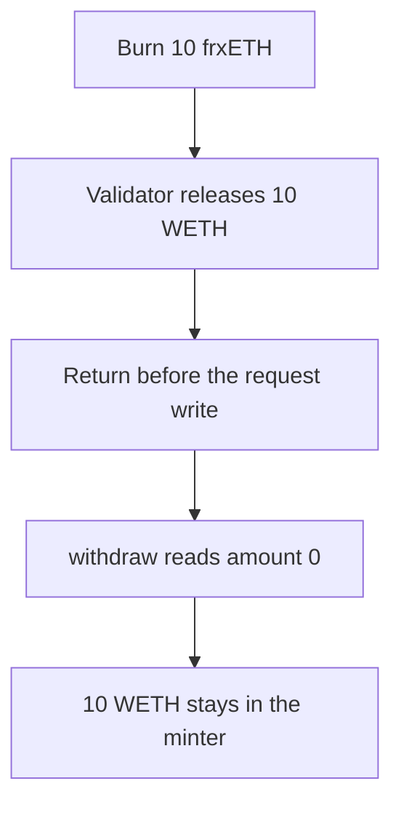

# Mystic — validator unstake burns frxETH and never records the withdrawal

> **Vulnerability classes:** vuln/logic/incorrect-state-transition · vuln/dos/frozen-funds

> **Reproduction:** a self-contained Foundry PoC that compiles and runs offline
> with only `forge-std` — no fork and no RPC. Trace: [output.txt](output.txt).
> PoC: [test/57714-h-02-user-funds-burned-with-no-eth-returned-due-to-missing-w_exp.sol](test/57714-h-02-user-funds-burned-with-no-eth-returned-due-to-missing-w_exp.sol).

<!-- non-defihacklabs -->
<!-- source-auditvault: https://github.com/Auditware/AuditVault/blob/main/findings/57714-h-02-user-funds-burned-with-no-eth-returned-due-to-missing-w.md -->
<!-- date: 2025-06 -->

---

## Key info

| | |
|---|---|
| **Impact** | **HIGH** — 10 frxETH is burned and **10 WETH** is stuck in the minter |
| **Protocol** | Mystic `stPlumeMinter` |
| **Vulnerable code** | `return amountUnstaked` before `withdrawalRequests[msg.sender]` is written |
| **Bug class** | Validator fallback returns the unstaked amount and skips the request |
| **Finding** | Kann — Mystic Finance RWA, 6 June 2025 · id 57714 |
| **Report** | [Kann Audits, June 2025](https://kannaudits.com/audits/mystic-finance-rwa-review-june-2025) |
| **Source** | [AuditVault finding](https://github.com/Auditware/AuditVault/blob/main/findings/57714-h-02-user-funds-burned-with-no-eth-returned-due-to-missing-w.md) |
| **Compiler** | solc 0.8.27, cancun, via IR |

---

## TL;DR

`unstakeFromValidator` burns the caller's frxETH, then takes the validator branch because `currentWithheldETH` is 0. That branch releases the ETH into the minter and **returns** `amountUnstaked`. The assignment of `withdrawalRequests[msg.sender]` sits after the branch, so it never runs.

`withdraw` reads that mapping. The amount is 0, so the user is paid nothing. **10 WETH** stays in the minter. The user's frxETH balance is 0.

## The vulnerable code

```solidity
if (_validatorId != 0) {
    amountUnstaked += remainingToUnstake;
    plume.release(address(this), remainingToUnstake);
    // @> VULN: return amountUnstaked before withdrawalRequests[msg.sender] is written
    return returned;
}
withdrawalRequests[msg.sender] = WithdrawalRequest({amount: amountUnstaked, timestamp: block.timestamp});
```

The audited `_unstake` returns on the explicit-validator path before the request is stored. `withdraw` then uses `request.amount`, which is still 0.

## Root cause

The burn happens before the branch. The validator path treats the returned value as the whole result and never writes the mapping the withdrawal reads.

## Preconditions

- `currentWithheldETH` is below the unstake amount, here 0.
- The caller passes a non-zero validator id.
- The validator holds the 10 WETH the shares represent.

## Attack walkthrough

1. The staker holds 10 frxETH. The validator holds 10 WETH.
2. `unstakeFromValidator(10 ether, 1)` burns the frxETH and releases the WETH into the minter.
3. The function returns 10 and skips the request write.
4. `withdraw` reads amount 0 and transfers nothing.
5. The minter still holds 10 WETH. The user holds neither token.

Control: the same call writes `withdrawalRequests[msg.sender] = 10 ether` before returning. `withdraw` then pays the 10 WETH and the minter balance is 0.

## Diagrams



## Impact

The staker loses **10 frxETH** and receives **0 WETH**. The 10 WETH is in the minter with no request that can pay it out. There is no second unstake: a non-zero request is required to be empty, but the user's shares are already burned.

## Remediation

Write `withdrawalRequests[msg.sender]` before returning from the validator branch, using the same `amountUnstaked` the function returns.

## Sources

- [AuditVault finding 57714](https://github.com/Auditware/AuditVault/blob/main/findings/57714-h-02-user-funds-burned-with-no-eth-returned-due-to-missing-w.md)
- [Kann Audits, Mystic Finance RWA, 6 June 2025](https://kannaudits.com/audits/mystic-finance-rwa-review-june-2025)
- [stPlumeMinter at a7a86bd](https://github.com/mystic-finance/Liquid-Staking/blob/a7a86bdc3d65c5c2512fe6a835c10b4bc2d4315d/src/stPlumeMinter.sol)

### Taxonomy

- `vuln/logic/incorrect-state-transition` · `vuln/dos/frozen-funds`
