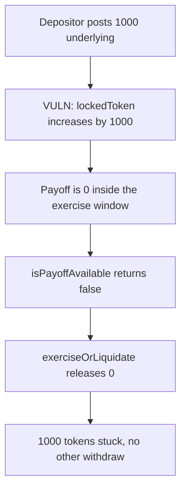

# Hyperhyper — worthless options lock collateral with no unlock

> **Vulnerability classes:** vuln/logic/missing-check · vuln/logic/state-update

<!-- non-defihacklabs -->
<!-- source-auditvault: https://github.com/Auditware/AuditVault/blob/main/findings/57735-c-01-permanent-lock-due-to-missing-unlock-mechanism-for-opti.md -->
<!-- date: 2025-03 -->

## Key info

| | |
|---|---|
| **Protocol** | Hyperhyper |
| **Finding** | Pashov Audit Group C-01, AuditVault 57735 |
| **Vulnerable code** | `PositionInteractionFacet._lockLiquidity` and `StrategyView.isPayoffAvailable` |
| **Harm** | 1000 underlying tokens locked in the pool. The only exit releases 0. |
| **Chain** | local synthetic |

## TL;DR

Opening a call locks `sizeUa` of the underlying. The only function that can release that balance is `exerciseOrLiquidate`, and it runs only when `isPayoffAvailable` is true: the option is profitable (`payoff > 0`) and the timestamp is inside `[maturity, maturity + exerciseWindow]`. A worthless option is inside the window here and still fails the check, so exercise returns 0. The pool has no other withdraw. 1000 tokens stay in the pool and the depositor's balance is 0. The control adds `unlockWorthless`, which returns the same 1000.

## The vulnerable code

```solidity
function _lockLiquidity(uint8 opType, uint256 size) internal {
    if (opType == CALL) {
        // @> VULN: locked underlying has no unlock when payoff is 0 or the window is missed.
        lockedToken = lockedToken + size;
    } else if (opType == PUT) {
        lockedUsd = lockedUsd + size;
    }
}

function isPayoffAvailable(uint256 payoff) public view returns (bool) {
    bool inWindow = block.timestamp >= maturity && block.timestamp <= maturity + exerciseWindow;
    bool profitable = payoff > 0;
    return inWindow && profitable;
}

function exerciseOrLiquidate(uint256 payoff) external returns (uint256 released) {
    if (!isPayoffAvailable(payoff)) {
        return 0;
    }
    // release path — not reached when payoff is 0
}
```

The report's `isPayoffAvailable` also requires the caller to be the position owner. That check is true in this reduction. The failing conjunct is `payoff > 0`. The same function fails when the timestamp is past `maturity + exerciseWindow`; that second case needs a later block, so this run uses the worthless-option case, which is in the report and fits one block.

## Root cause

Lock and unlock are not paired. `_lockLiquidity` runs on open. The matching decrease of `lockedToken` exists only on the exercise path, and exercise is gated on a positive payoff inside a finite window. An option that expires worthless, or that nobody exercises in time, never takes that path. Nothing else moves the tokens.

## Preconditions

A call is opened with `sizeUa = 1000` underlying. Payoff is 0. `block.timestamp` is `maturity` (1), and the window is 7 days, so the position is inside the window. No role is required to observe the failed withdraw.

## Attack walkthrough

1. The depositor approves the pool and `openCall(1000 ether)` pulls the tokens in.
2. The call branch sets `lockedToken` to 1000.
3. `isPayoffAvailable(0)` is false: the window check passes, `payoff > 0` does not.
4. `exerciseOrLiquidate(0)` returns 0 and does not transfer.
5. The pool still holds 1000. The depositor holds 0. `released` is 0.

The vulnerable pool has no other withdraw, so the 1000 cannot move. The control is a pool with the same failed exercise plus `unlockWorthless`. After that call the depositor holds 1000 again and the pool holds 0.

## Diagrams



## Impact

The liquidity provider cannot withdraw 1000 underlying. The tokens are not paid to a counterparty; they sit in the pool with `lockedToken == 1000` and no successful release. The report also describes an attacker opening many cheap options and never exercising, which locks the same way. This run is one worthless call for a measured 1000.

## Remediation

Add an unlock for options whose payoff is 0 or whose exercise window has passed, and call it from a permissionless settle path. Do not leave `lockedToken` decreasable only from `exerciseOrLiquidate`.

## How to reproduce

```bash
cd 57735-c-01-permanent-lock-due-to-missing-unlock-mechanism-for-opti_exp
forge test -vv
```

## Sources

- AuditVault finding: https://github.com/Auditware/AuditVault/blob/main/findings/57735-c-01-permanent-lock-due-to-missing-unlock-mechanism-for-opti.md
- Pashov report: https://github.com/pashov/audits/blob/master/team/md/Hyperhyper-security-review_2025-03-30.md
