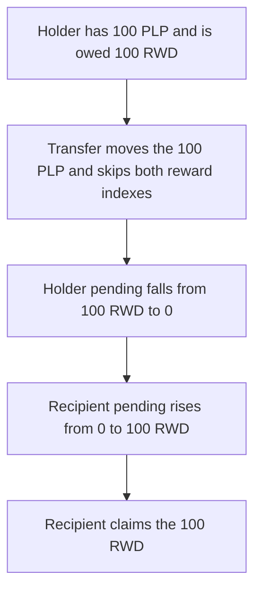

# Hyperhyper — a PLP transfer skips the reward index

> **Vulnerability classes:** vuln/logic/reward-calculation · vuln/logic/state-update · vuln/logic/missing-check

> **Reproduction:** a self-contained Foundry PoC that compiles and runs offline
> with only `forge-std` — no fork and no RPC. Trace: [output.txt](output.txt).
> PoC: [test/57736-c-02-plp-transfer-or-balance-updates-do-not-update-reward-in_exp.sol](test/57736-c-02-plp-transfer-or-balance-updates-do-not-update-reward-in_exp.sol).

<!-- non-defihacklabs -->
<!-- source-auditvault: https://github.com/Auditware/AuditVault/blob/main/findings/57736-c-02-plp-transfer-or-balance-updates-do-not-update-reward-in.md -->
<!-- date: 2025-03 -->

---

## Key info

| | |
|---|---|
| **Impact** | **HIGH** — the PLP holder loses **100 RWD** and the recipient is paid that **100 RWD** |
| **Protocol** | Hyperhyper `LiquidityFacet` / PLP |
| **Vulnerable code** | `PLP.transfer` changes balances and does not update `usrRwdIndexQ128` |
| **Bug class** | Reward index is not checkpointed when the LP balance moves |
| **Finding** | Pashov Audit Group — Hyperhyper, 30 March 2025 · C-02 · id 57736 |
| **Report** | [Hyperhyper-security-review_2025-03-30.md](https://github.com/pashov/audits/blob/master/team/md/Hyperhyper-security-review_2025-03-30.md) |
| **Source** | [AuditVault finding](https://github.com/Auditware/AuditVault/blob/main/findings/57736-c-02-plp-transfer-or-balance-updates-do-not-update-reward-in.md) |
| **Status** | Reproduced here as a local synthetic of the audited calculation. |
| **Compiler** | solc 0.8.27, cancun, via IR |

---

## TL;DR

`_getPendingRewards` pays `lpBalance * (rewardsPerLPQ128 - usrRwdIndexQ128) / Q128`. The user index is written on deposit and on claim. A PLP transfer changes `lpBalance` and does not write the index.

With **100 PLP** and a global index of **Q128**:

1. Before the transfer the holder is owed **100 RWD** and the recipient is owed **0**.
2. The holder transfers all **100 PLP**. Both indexes stay where they were.
3. After the transfer the holder is owed **0** and the recipient is owed **100 RWD**.
4. The recipient claims and receives the **100 RWD**. The holder's claim pays **0**.

The fixed transfer checkpoints both sides first. The holder is still paid **100 RWD**. The recipient is paid **0**.

## The vulnerable code

The pending-reward body from the report, and the transfer that never updates the index:

```solidity
function transfer(address to, uint256 amount) external returns (bool) {
    require(balanceOf[msg.sender] >= amount, "bal");
    // @> VULN: PLP balance moves and usrRwdIndexQ128 is not updated for either side
    balanceOf[msg.sender] -= amount;
    balanceOf[to] += amount;
    return true;
}

function _getPendingRewards(address token, address user) internal view returns (uint256) {
    RewardInfo storage rewards = PoolStorage.layout().ledger.state.rewardsByToken[token];
    ILPToken plp_ = ILPToken(PoolStorage.layout().setUp.base.plp);
    uint256 lpBalance = plp_.balanceOf(user);
    uint8 plpDecimals = IERC20Metadata(PoolStorage.layout().setUp.base.plp).decimals();
    uint8 tokenDecimals = IERC20Metadata(token).decimals();

    uint256 rewardIndexQ128 = PoolStorage.layout().ledger.state.usrRwdIndexQ128[token][user];
    rewardIndexQ128 = rewards.rewardsPerLPQ128 - rewardIndexQ128;

    return lpBalance.mulDiv(rewardIndexQ128, Q128).toDecimals(plpDecimals, tokenDecimals);
}
```

`_updateLpRewardIndex` assigns `usrRwdIndexQ128[token][user] = rewardsPerLPQ128`. Deposit and claim call it. `transfer` does not.

## Root cause

The reward is the product of the **current** balance and a **stored** index delta. Those two values are a pair. Any change to the balance has to snapshot the rewards already earned and set the index to the global index, for both the sender and the recipient, before the balances move. The transfer updates only the balances, so the recipient inherits the sender's unpaid delta and the sender's pending amount falls with the balance.

## Preconditions

- The holder deposited while the global index was lower than it is now. Here the deposit index is **0** and the global index is **Q128**, so **100 PLP** is worth **100 RWD**.
- The recipient's index is still **0** (they never deposited or claimed).
- The facet holds the **100 RWD** that the claim will pay.

## Attack walkthrough

1. Deposit **100 PLP** to the holder. The user index is set to **0**.
2. Mint **100 RWD** into the facet and set `rewardsPerLPQ128` to **Q128**.
3. Fair amounts, read from balance and index before the transfer: holder **100 RWD**, recipient **0**.
4. The holder transfers **100 PLP** to the recipient. The balance write is the vulnerable line. Neither index changes.
5. `pending` for the holder is `0 * Q128 / Q128 = 0`. `pending` for the recipient is `100e18 * Q128 / Q128 = 100 RWD`.
6. The recipient claims **100 RWD**. The holder claims **0**.

Control: `transferPLP` adds each side's pending rewards to a stored balance and sets both indexes to the current global index, then moves the PLP. The holder is paid **100 RWD**. The recipient is paid **0**.

## Diagrams



## Impact

The holder loses **100 RWD** that had already accrued on their PLP. The recipient, who held that PLP for none of the accrual, is paid the **100 RWD**. The same transfer with the index checkpointed pays the holder **100 RWD** and the recipient **0**.

## Remediation

On every PLP balance change, including `transfer`, `transferFrom`, and a partial liquidity withdrawal, checkpoint both the sender and the recipient: add the pending reward to a stored balance, then set `usrRwdIndexQ128` to the current `rewardsPerLPQ128`, and only then move the tokens.

## Sources

- [AuditVault finding 57736](https://github.com/Auditware/AuditVault/blob/main/findings/57736-c-02-plp-transfer-or-balance-updates-do-not-update-reward-in.md)
- [Pashov Hyperhyper review, 30 March 2025](https://github.com/pashov/audits/blob/master/team/md/Hyperhyper-security-review_2025-03-30.md)
- Audited file cited by the report: [Hyperhyperfi/protocol@212acfd LiquidityFacet.sol](https://github.com/Hyperhyperfi/protocol/blob/212acfdcd4066334ff5ea06ce46b0bbca7ca212f/src/core/pool/facets/LiquidityFacet.sol)

### Taxonomy

- `severity/high`
- `vuln/logic/reward-calculation` · `vuln/logic/state-update` · `vuln/logic/missing-check`
