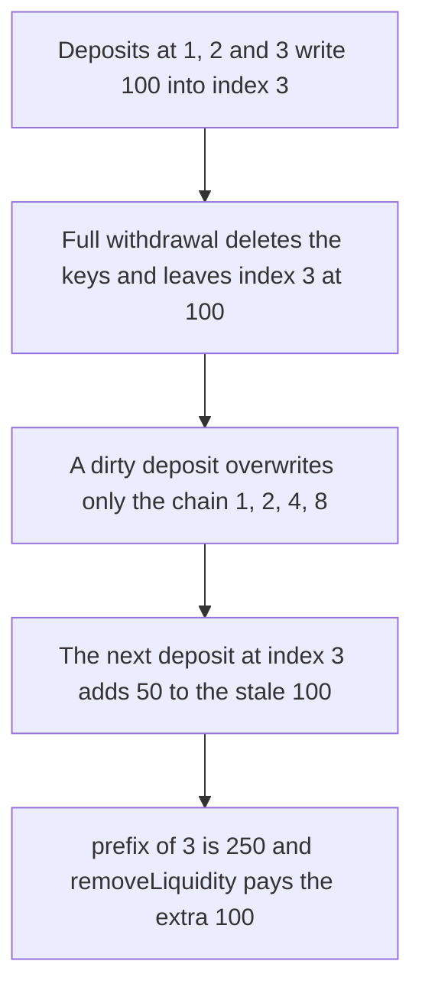

# Hyperhyper — a full withdrawal leaves Fenwick index 3 stale

> **Vulnerability classes:** vuln/logic/state-update · vuln/logic/incorrect-calculation

> **Reproduction:** a self-contained Foundry PoC that compiles and runs offline
> with only `forge-std` — no fork and no RPC. Trace: [output.txt](output.txt).
> PoC: [test/57737-c-03-incorrect-index-reset-in-fenwick-tree-after-full-withdr_exp.sol](test/57737-c-03-incorrect-index-reset-in-fenwick-tree-after-full-withdr_exp.sol).

<!-- non-defihacklabs -->
<!-- source-auditvault: https://github.com/Auditware/AuditVault/blob/main/findings/57737-c-03-incorrect-index-reset-in-fenwick-tree-after-full-withdr.md -->
<!-- date: 2025-03 -->

---

## Key info

| | |
|---|---|
| **Impact** | **HIGH** — `prefix(3)` reports **250** ether after **150** ether of new deposits, and **100** ether is taken from the other LP |
| **Protocol** | Hyperhyper Fenwick lock tree |
| **Vulnerable code** | `_fenwicksUpdate` assigns `value` only on the dirty chain |
| **Bug class** | Incomplete index reset after a full withdrawal |
| **Finding** | Pashov Audit Group — Hyperhyper, 30 March 2025 · C-03 · id 57737 |
| **Report** | [Hyperhyper-security-review_2025-03-30.md](https://github.com/pashov/audits/blob/master/team/md/Hyperhyper-security-review_2025-03-30.md) |
| **Source** | [AuditVault finding](https://github.com/Auditware/AuditVault/blob/main/findings/57737-c-03-incorrect-index-reset-in-fenwick-tree-after-full-withdr.md) |
| **Status** | Reproduced here as a local synthetic of the audited update |
| **Compiler** | solc 0.8.27, cancun, via IR |

---

## TL;DR

A dirty Fenwick update (`sortedKeys.length == 1`) writes `value` along `1, 2, 4, 8` and does not touch index **3**. After a full withdrawal the old **100** ether remains at index 3. Three new deposits of **50** ether then make `prefix(3)` equal **250** ether instead of **150**. `removeLiquidity` pays the **250**, which includes the other LP's **100** ether.

Zeroing every index on the full withdrawal makes `prefix(3)` equal **150** ether. The other LP keeps **100** ether. The extra is **0**.

## The vulnerable code

```solidity
if (isDirty) fenwicksTree[treeIndex] = value;
else fenwicksTree[treeIndex] += value;
uint256 nextIndex = treeIndex + (treeIndex & (~treeIndex + 1));
```

`isDirty` is `sortedKeys.length == 1`. The walk is the standard Fenwick step, so a reset never visits 3, 5, 6, or 7.

## Root cause

The tree is the source of unlocked liquidity, and a full withdrawal deletes the key list without clearing every node. The next deposit looks new and overwrites only its own chain. A later add at index 3 accumulates on the pre-withdrawal value.

## Preconditions

- Deposits at indices 1, 2, and 3 of **100** ether each, then a full withdrawal.
- Another LP has **100** ether of real tokens in the pool.
- The same user deposits **50** ether at indices 1, then 2, then 3.

## Attack walkthrough

1. First epoch: three deposits of **100** ether. `prefix(3)` is **300** ether. `fullWithdraw` pays **300** and leaves `fenwicksTree[3] == 100`.
2. The other LP adds **100** ether.
3. Dirty deposit of **50** at index 1 overwrites 1, 2, 4, 8. Index 3 stays **100**.
4. Deposits of **50** at indices 2 and 3. Index 3 becomes **150**. `prefix(3)` is **250**.
5. `removeLiquidity(3)` transfers **250** ether. The pool is empty. The extra over the **150** ether of new deposits is **100** ether.

Control: `fullWithdraw` sets `fenwicksTree[i] = 0` for `i` in `1..8`. The same second epoch unlocks **150** ether and the other LP's **100** ether remains.

## Diagrams



## Impact

The depositor is paid **100** ether that the new deposits did not bring in. That **100** ether is the other LP's liquidity. With the full reset the same sequence pays **150** ether and the extra is **0**.

## Remediation

On a full withdrawal, set every `fenwicksTree` slot up to `maxDepositEntries` to zero before the next deposit is accepted.

## Sources

- [AuditVault finding 57737](https://github.com/Auditware/AuditVault/blob/main/findings/57737-c-03-incorrect-index-reset-in-fenwick-tree-after-full-withdr.md)
- [Pashov Hyperhyper review, 30 March 2025](https://github.com/pashov/audits/blob/master/team/md/Hyperhyper-security-review_2025-03-30.md)
- Audited tree cited by the report, same commit as the rest of that review: [Hyperhyperfi/protocol@212acfd](https://github.com/Hyperhyperfi/protocol/blob/212acfdcd4066334ff5ea06ce46b0bbca7ca212f/src/core/pool/facets/LiquidityFacet.sol)

### Taxonomy

- `severity/high`
- `vuln/logic/state-update` · `vuln/logic/incorrect-calculation`
