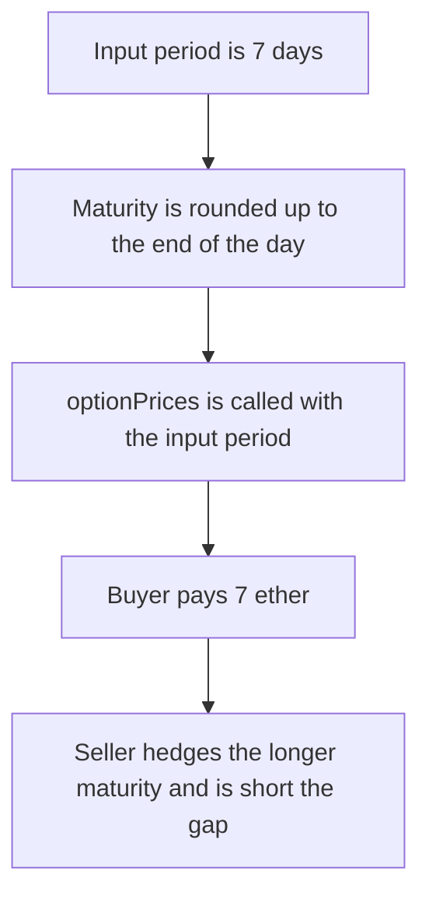

# Hyperhyper — option premium is priced on the short input period

> **Vulnerability classes:** vuln/logic/price-calculation · vuln/logic/fee-calculation · vuln/logic/incorrect-calculation

> **Reproduction:** a self-contained Foundry PoC that compiles and runs offline
> with only `forge-std` — no fork and no RPC. Trace: [output.txt](output.txt).
> PoC: [test/57738-h-01-option-premium-calculation-underprices-options-pashov-a_exp.sol](test/57738-h-01-option-premium-calculation-underprices-options-pashov-a_exp.sol).

<!-- non-defihacklabs -->
<!-- source-auditvault: https://github.com/Auditware/AuditVault/blob/main/findings/57738-h-01-option-premium-calculation-underprices-options-pashov-a.md -->
<!-- date: 2025-03 -->

---

## Key info

| | |
|---|---|
| **Impact** | **HIGH** — the buyer pays **7** ether and the seller is short **999976851851851851** wei |
| **Protocol** | Hyperhyper `Strategy._calculatePremium` |
| **Vulnerable code** | `optionPrices(period, ...)` instead of the rounded maturity |
| **Bug class** | Premium uses a shorter time than the option actually lives |
| **Finding** | Pashov Audit Group — Hyperhyper, 30 March 2025 · H-01 · id 57738 |
| **Report** | [Hyperhyper-security-review_2025-03-30.md](https://github.com/pashov/audits/blob/master/team/md/Hyperhyper-security-review_2025-03-30.md) |
| **Source** | [AuditVault finding](https://github.com/Auditware/AuditVault/blob/main/findings/57738-h-01-option-premium-calculation-underprices-options-pashov-a.md) |
| **Status** | Reproduced with the audited maturity rounding and a linear time value |
| **Compiler** | solc 0.8.27, cancun, via IR |

---

## TL;DR

`_computeMaturityDate` rounds expiry up to the last second of the day, so a 7-day input lasts longer than **604800** seconds. `_calculatePremium` still calls `optionPrices` with the input period.

On the replay timestamp the charged premium is **7 ether** (`365 ether * 7 days / 365 days`). The fair premium, using the rounded maturity, is **7999976851851851851** wei. The seller who hedges at the fair value is short **999976851851851851** wei.

Pricing `optionPrices` with `maturity - block.timestamp` makes charged equal fair. The short is **0**.

## The vulnerable code

```solidity
function _computeMaturityDate(uint256 period) public view returns (uint256 maturityTimestamp) {
    maturityTimestamp = block.timestamp + period;
    maturityTimestamp -= (maturityTimestamp % 1 days);
    maturityTimestamp += 1 days - 1;
}

premium = bs.optionPrices(period, notional);
```

The time value in this reduction is `notional * time / 365 days`, so the only difference between the two quotes is the time argument. The report's Black-Scholes numbers show the same direction: a 7-day call quoted at `8963759233891000000` against a maturity quote of `11675104193168500000`.

## Root cause

The option's lifetime and the time passed into the pricer are different values. Maturity is stored rounded up. The premium is not.

## Preconditions

- `period` is **7 days**.
- `block.timestamp + period` is not already the last second of a day, so the round-up adds time. It does on this block.

## Attack walkthrough

1. Read `actualDuration(7 days)`. It is greater than **604800**.
2. `buy` charges `optionPrices(period)` which is **7 ether**, and pulls that from the buyer.
3. The seller pays the buyer the fair hedge, `optionPrices(actualDuration)`.
4. The buyer's balance rises by the gap. The seller's reserve falls by the same gap.

Control: `StrategyFixed.buy` passes `actualDuration(period)` into `optionPrices`. Charged equals fair. Both balances are unchanged apart from the round trip. The short is **0**.

## Diagrams



## Impact

The buyer pays less than the time they receive. Here that discount is **999976851851851851** wei on a **7 ether** quote, and the seller is short exactly that amount. The fixed quote charges the fair premium and the short is **0**.

## Remediation

Pass `maturity - block.timestamp` into `optionPrices`, not the raw `period` argument.

## Sources

- [AuditVault finding 57738](https://github.com/Auditware/AuditVault/blob/main/findings/57738-h-01-option-premium-calculation-underprices-options-pashov-a.md)
- [Pashov Hyperhyper review, 30 March 2025](https://github.com/pashov/audits/blob/master/team/md/Hyperhyper-security-review_2025-03-30.md)
- [Hyperhyperfi/protocol@212acfd](https://github.com/Hyperhyperfi/protocol/blob/212acfdcd4066334ff5ea06ce46b0bbca7ca212f/src/core/pool/facets/LiquidityFacet.sol)

### Taxonomy

- `severity/high`
- `vuln/logic/price-calculation` · `vuln/logic/fee-calculation` · `vuln/logic/incorrect-calculation`
