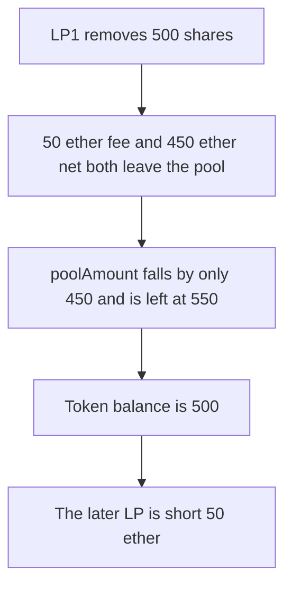

# Hyperhyper — removeLiquidity subtracts the net and not the fee

> **Vulnerability classes:** vuln/logic/incorrect-calculation · vuln/logic/state-update

> **Reproduction:** a self-contained Foundry PoC that compiles and runs offline
> with only `forge-std` — no fork and no RPC. Trace: [output.txt](output.txt).
> PoC: [test/57740-h-03-inaccurate-accounting-in-removeliquidity-overstating-li_exp.sol](test/57740-h-03-inaccurate-accounting-in-removeliquidity-overstating-li_exp.sol).

<!-- non-defihacklabs -->
<!-- source-auditvault: https://github.com/Auditware/AuditVault/blob/main/findings/57740-h-03-inaccurate-accounting-in-removeliquidity-overstating-li.md -->
<!-- date: 2025-03 -->

---

## Key info

| | |
|---|---|
| **Impact** | **HIGH** — the pool token balance is **500** ether while `poolAmount` is **550** ether, so the later LP is short **50** ether |
| **Protocol** | Hyperhyper `LiquidityFacet.removeLiquidity` |
| **Vulnerable code** | `poolAmount -= netOutAmount` while `netOut + pFee` leaves the pool |
| **Bug class** | Accounting drops the withdrawal fee |
| **Finding** | Pashov Audit Group — Hyperhyper, 30 March 2025 · H-03 · id 57740 |
| **Report** | [Hyperhyper-security-review_2025-03-30.md](https://github.com/pashov/audits/blob/master/team/md/Hyperhyper-security-review_2025-03-30.md) |
| **Source** | [AuditVault finding](https://github.com/Auditware/AuditVault/blob/main/findings/57740-h-03-inaccurate-accounting-in-removeliquidity-overstating-li.md) |
| **Status** | Reproduced here as a local synthetic of the audited update |
| **Compiler** | solc 0.8.27, cancun, via IR |

---

## TL;DR

Two LPs each hold **500** ether of shares against **1000** ether of tokens. The first removal has gross out **500** ether, fee **50** ether, net **450** ether. Both the net and the fee are transferred out. `poolAmount` is reduced only by the net, so it becomes **550** ether while **500** ether of tokens remain.

The second LP owns every remaining share, so the books owe **550** ether. The shortfall is **50** ether, and that withdrawal cannot be paid. Subtracting the full `outAmount` leaves `poolAmount` at **500** ether and the shortfall at **0**.

## The vulnerable code

```solidity
protocolFee += pFee;
// @> VULN: poolAmount loses only netOut. The tokens that leave are netOut + pFee.
poolAmount -= chargeFull ? outAmount : netOut;
```

The audited lines are `protocolFee[_tokenOut] += pFee` and `poolAmount[_tokenOut] -= netOutAmount`.

## Root cause

`poolAmount` is treated as the tokens still available to LPs, but the fee has already left the token balance. The two ledgers diverge by `pFee` on every removal.

## Preconditions

- Pool starts at **1000** ether of tokens and **1000** ether of LP shares, split evenly.
- The removal fee is 10 percent of the gross out.

## Attack walkthrough

1. LP1 removes **500** shares. Gross **500**, fee **50**, net **450**.
2. `poolAmount` becomes **550**. The token balance becomes **500**. The fee receiver holds **50**.
3. LP2's owed amount is **550**. `shortfall` is **50** ether.

Control: `poolAmount` is reduced by `outAmount` (**500**). It matches the token balance. LP2 withdraws and the shortfall is **0**.

## Diagrams



## Impact

After one removal the books overstate liquidity by the fee. The remaining LP is short **50** ether and cannot be paid in full. The fixed subtraction keeps `poolAmount` equal to the tokens, and the shortfall is **0**.

## Remediation

Subtract `outAmount` (`netOutAmount + pFee`) from `poolAmount`, not `netOutAmount` alone.

## Sources

- [AuditVault finding 57740](https://github.com/Auditware/AuditVault/blob/main/findings/57740-h-03-inaccurate-accounting-in-removeliquidity-overstating-li.md)
- [Pashov Hyperhyper review, 30 March 2025](https://github.com/pashov/audits/blob/master/team/md/Hyperhyper-security-review_2025-03-30.md)
- [Hyperhyperfi/protocol@212acfd LiquidityFacet](https://github.com/Hyperhyperfi/protocol/blob/212acfdcd4066334ff5ea06ce46b0bbca7ca212f/src/core/pool/facets/LiquidityFacet.sol)

### Taxonomy

- `severity/high`
- `vuln/logic/incorrect-calculation` · `vuln/logic/state-update`
