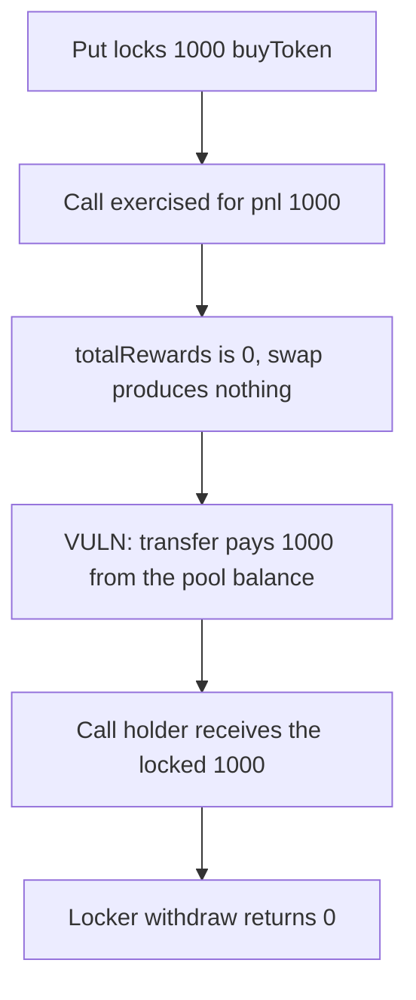

# Hyperhyper — call payout spends buyToken locked for a put

> **Vulnerability classes:** vuln/logic/missing-check · vuln/logic/state-update

<!-- non-defihacklabs -->
<!-- source-auditvault: https://github.com/Auditware/AuditVault/blob/main/findings/57741-h-04-improper-use-of-locked-funds-as-liquidity-in-positionin.md -->
<!-- date: 2025-03 -->

## Key info

| | |
|---|---|
| **Protocol** | Hyperhyper |
| **Finding** | Pashov Audit Group H-04, AuditVault 57741 |
| **Vulnerable code** | `PositionInteractionFacet._payout` |
| **Harm** | 1000 buyToken locked for a put is paid to a call. The locker withdraws 0. |
| **Chain** | local synthetic |

## TL;DR

A put locks 1000 buyToken in the pool. A call is then exercised for a pnl of 1000. `_payout` treats `rewardsByToken[buyToken].totalRewards` as the buyToken it may spend. That figure is 0, so it asks for a swap of the shortfall. The swap creates no buyToken. The function still transfers `pnl` out of the pool balance. That balance is the put lock. The call holder receives 1000. The locker's withdraw sees an empty pool and returns 0. The control pays a call only from `balance - lockedBuy`, so the same exercise pays 0 and the locker withdraws 1000.

## The vulnerable code

```solidity
function _payout(uint8 opType, uint256 pnl) internal returns (uint256) {
    uint256 availablePayoutToken = totalRewards; // rewardsByToken[buyToken].totalRewards
    if (opType == CALL && availablePayoutToken < pnl) {
        uint256 swapOut = pnl - availablePayoutToken;
        _swapAssetToAsset(swapOut);
    }
    poolAmount = poolAmount - pnl;
    // @> VULN: pnl is paid from pool buyToken, which includes funds locked for puts.
    token.transfer(msg.sender, pnl);
    return pnl;
}
```

The report's body is the same shape: read `totalRewards`, swap `pnl - available` when that is short, then `poolAmount[buyToken] -= pnl` and `_doTransferOut(buyToken, msg.sender, pnl)`. Nothing subtracts `lockedUSD` / the buyToken reserved for puts. `totalRewards` is not free liquidity. Rewards are already allocated by index even when they have not been claimed, and in this run the reward balance is 0 while the token balance is entirely locked.

## Root cause

The payout's notion of "available buyToken" is the reward accumulator, not `balanceOf(buyToken) - lockedBuy`. After the swap (which adds nothing here), the transfer uses the raw pool balance. Locked put collateral is part of that balance, so it is spent as if it were free liquidity for the call.

## Preconditions

The pool holds 1000 buyToken, all of it `lockedBuy` for one put. `totalRewards` is 0. A call is exercised with `pnl` of 1000. No free underlying is available to swap. One transaction.

## Attack walkthrough

1. The locker deposits 1000 buyToken. `lockedBuy` is 1000 and the pool balance is 1000.
2. `exerciseCall(1000)` reads `totalRewards` of 0, so it requests a swap of 1000. `lastSwap` is 1000 and no tokens are minted.
3. The pool transfers 1000 buyToken to the call holder and decreases `poolAmount` by 1000.
4. The locker calls `withdrawLocked`. The pool balance is 0, which is less than `lockedBuy`, so the function returns 0.
5. The call holder holds 1000. The locker holds 0. `lockedBuy` is still accounted as 1000, but the tokens are gone.

The control caps the call payment at `balanceOf(buyToken) - lockedBuy`. That free balance is 0, so the call receives 0. The locker then withdraws 1000 and the pool is empty because of that withdraw, not because the call took the lock.

## Diagrams



## Impact

The put locker cannot withdraw 1000 buyToken. Those tokens were pulled into the call payout. The lock accounting is unchanged at 1000, so the books still say the locker is owed funds the pool no longer holds.

## Remediation

Do not pay a call from buyToken that is locked for puts. Spend only `balance - locked`, and swap unlocked underlying when that is short. Do not treat `totalRewards` as idle inventory.

## How to reproduce

```bash
cd 57741-h-04-improper-use-of-locked-funds-as-liquidity-in-positionin_exp
forge test -vv
```

## Sources

- AuditVault finding: https://github.com/Auditware/AuditVault/blob/main/findings/57741-h-04-improper-use-of-locked-funds-as-liquidity-in-positionin.md
- Pashov report: https://github.com/pashov/audits/blob/master/team/md/Hyperhyper-security-review_2025-03-30.md
