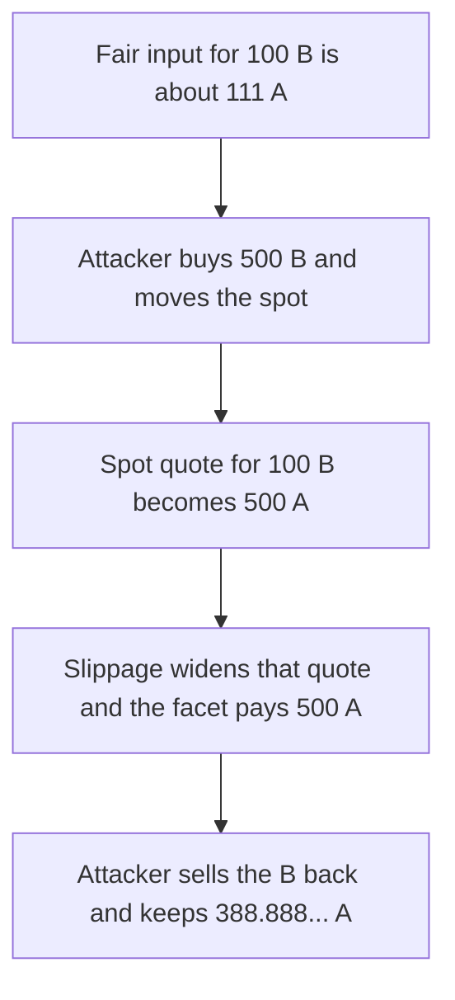

# Hyperhyper — slippage is applied to the spot quote

> **Vulnerability classes:** vuln/defi/slippage · vuln/oracle/spot-price · vuln/defi/sandwich-attack

> **Reproduction:** a self-contained Foundry PoC that compiles and runs offline
> with only `forge-std` — no fork and no RPC. Trace: [output.txt](output.txt).
> PoC: [test/57742-h-05-vulnerability-in-positioninteractionfacet-slippage-cont_exp.sol](test/57742-h-05-vulnerability-in-positioninteractionfacet-slippage-cont_exp.sol).

<!-- non-defihacklabs -->
<!-- source-auditvault: https://github.com/Auditware/AuditVault/blob/main/findings/57742-h-05-vulnerability-in-positioninteractionfacet-slippage-cont.md -->
<!-- date: 2025-03 -->

---

## Key info

| | |
|---|---|
| **Impact** | **HIGH** — the facet pays **500** ether for an output whose stated maximum was **112222222222222222222** wei, and the sandwich keeps **388888888888888888888** wei |
| **Protocol** | Hyperhyper `PositionInteractionFacet._swapAssetToAsset` |
| **Vulnerable code** | `amountInMaximum = _applySlippage(spotQuote)` |
| **Bug class** | User slippage is measured from the manipulable spot |
| **Finding** | Pashov Audit Group — Hyperhyper, 30 March 2025 · H-05 · id 57742 |
| **Report** | [Hyperhyper-security-review_2025-03-30.md](https://github.com/pashov/audits/blob/master/team/md/Hyperhyper-security-review_2025-03-30.md) |
| **Source** | [AuditVault finding](https://github.com/Auditware/AuditVault/blob/main/findings/57742-h-05-vulnerability-in-positioninteractionfacet-slippage-cont.md) |
| **Status** | Reproduced on a constant-product pool that stands in for the Uniswap quoter |
| **Compiler** | solc 0.8.27, cancun, via IR |

---

## TL;DR

The fair input for **100** ether of token B, on a **1000/1000** pool, is **111111111111111111111** wei. The user's stated maximum is that quote plus 1 percent, **112222222222222222222** wei.

An attacker buys **500** ether of B first. The spot quote for the same **100** ether of B becomes **500** ether. `_applySlippage` adds 1 percent, so the cap is **505** ether, and the fill of **500** ether is accepted. Selling the B back leaves the attacker **388888888888888888888** wei ahead.

The fixed path requires the live quote to be within the stored maximum. After the same spot move it reverts.

## The vulnerable code

```solidity
function _applySlippage(uint256 amount) internal pure returns (uint256) {
    // @> VULN: slippage widens the manipulated spot quote, so the fill can exceed statedMin.
    return amount * (10_000 + SLIP_BPS) / 10_000;
}
```

The audited function quotes `quoteExactOutputSingle` on the pool and then calls `_applySlippage` on that amount. The reduction uses `reserveIn * amountOut / (reserveOut - amountOut)` as the spot quote.

## Root cause

The maximum input is derived from the price at execution, not from a price the user bound before the trade. Moving the spot moves the maximum with it. Adding slippage on top makes the bound even looser.

## Preconditions

- The pool starts at **1000** ether of each reserve.
- The facet holds token A and will buy exactly **100** ether of token B.
- The attacker can trade the pool in the same transaction, before and after the facet.

## Attack walkthrough

1. Record the fair quote **111111111111111111111** and the stated maximum **112222222222222222222**.
2. Buy **500** ether of B for **1000** ether of A. Reserves become **2000 / 500**.
3. The facet quotes **500** ether, applies 1 percent, and pays **500** ether. That is above the stated maximum.
4. Sell the **500** ether of B. Token A out is **1388888888888888888888** wei. Profit versus the **1000** ether spent is **388888888888888888888** wei.

Control: `quoted <= statedMin` is required before the swap. The manipulated quote is **500** ether, the stated maximum is about **112** ether, and the call reverts with `slippage`.

## Diagrams



## Impact

The facet pays **500** ether where the user had stated about **112** ether. The difference is extracted by the surrounding trades: **388888888888888888888** wei. The fixed check reverts on that same quote.

## Remediation

Bound `amountInMaximum` by a price that the caller fixed before the trade, or by a TWAP, and do not add slippage on top of a same-block spot quote.

## Sources

- [AuditVault finding 57742](https://github.com/Auditware/AuditVault/blob/main/findings/57742-h-05-vulnerability-in-positioninteractionfacet-slippage-cont.md)
- [Pashov Hyperhyper review, 30 March 2025](https://github.com/pashov/audits/blob/master/team/md/Hyperhyper-security-review_2025-03-30.md)
- [Hyperhyperfi/protocol@212acfd](https://github.com/Hyperhyperfi/protocol/blob/212acfdcd4066334ff5ea06ce46b0bbca7ca212f/src/core/pool/facets/LiquidityFacet.sol)

### Taxonomy

- `severity/high`
- `vuln/defi/slippage` · `vuln/oracle/spot-price` · `vuln/defi/sandwich-attack`
