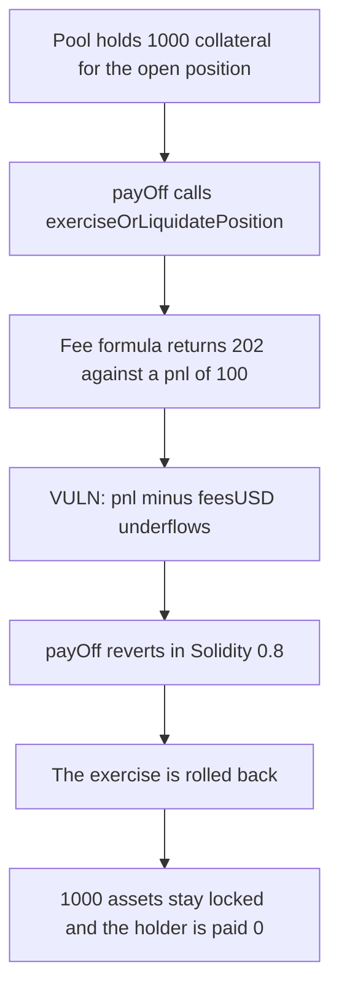

# Hyperhyper OperationalTreasury — payOff underflow locks the pool collateral

> **Vulnerability classes:** vuln/arithmetic/underflow · vuln/logic/fee-calculation · vuln/dos/frozen-funds

<!-- non-defihacklabs -->
<!-- source-auditvault: https://github.com/Auditware/AuditVault/blob/main/findings/57743-h-06-payoff-underflow-in-operationaltreasury-locks-assets-pe.md -->
<!-- date: 2025-03 -->

## Key info

| | |
|---|---|
| **Protocol** | Hyperhyper |
| **Finding** | Pashov Audit Group H-06, AuditVault 57743 |
| **Vulnerable code** | `OperationalTreasury.payOff` |
| **Harm** | `payOff` reverts; 1,000 assets stay locked in the pool; the holder is paid 0 |
| **Chain** | local synthetic |

## TL;DR

`payOff` charges a fee on the full notional times the spot, then subtracts that fee from the pnl. On a position with notional 100, strike 100 and spot 101 the fee is 202 and the pnl is 100. Solidity 0.8 reverts on `pnl - feesUSD`. The pool exercise that ran earlier in the same call is rolled back, so the 1,000 of collateral posted for the position stays locked and the holder receives nothing.

The saturating control caps the fee at the pnl. The fair net is 0, the treasury keeps the 100 pnl as the capped fee, and the position closes. 900 of the 1,000 remains in the pool as free liquidity instead of an uncloseable lock.

## The vulnerable code

```solidity
IPositionInteraction(baseSetUp.pool).exerciseOrLiquidatePosition(close);

uint256 feesUSD = _calculateFeesUSD(uAsset, uint256(amount)).toDecimals(18, baseSetUp.token.decimals());
// @> VULN: feesUSD is taken on notional times price, not on pnl.
uint256 netAmount = pnl - feesUSD;
```

`feesUSD = positionAmount × fee × currentPrice` and `pnl = positionAmount × (currentPrice − strike)`. The warden's fix caps the fee before the subtraction:

```solidity
if (feesUSD > pnl) feesUSD = pnl;
uint256 netAmount = pnl - feesUSD;
```

## Root cause

The fee does not look at the pnl. A spot only slightly above the strike makes `feesUSD` larger than `pnl`. The subtraction is checked arithmetic, so the whole `payOff` reverts, including `exerciseOrLiquidatePosition`, which is the call that would have released the pool collateral.

## Preconditions

An open position whose spot is close enough to the strike that the notional fee exceeds the pnl, with collateral already locked in the pool. No privileged role is required to call `payOff`. The numbers used here are notional 100, strike 100, spot 101, fee 2% (200 bps), collateral 1,000.

## Attack walkthrough

1. The pool is holding 1,000 assets against position 1. `lockedOf(1)` is 1,000.
2. `preview` runs the audited formula: pnl = 100, feesUSD = 202.
3. `payOff` calls `exerciseOrLiquidatePosition`. Inside that frame the pool clears the lock and transfers the 100 pnl.
4. `netAmount = 100 - 202` underflows. Solidity 0.8 reverts.
5. The exercise is rolled back. The pool balance is still 1,000, `exercised` is false, `lockedOf` is still 1,000, the holder balance is 0, and collected fees are 0.

The control uses the same position and the same 1,000 collateral. After the cap, the paid net is 0, collected fees are 100, the treasury holds that 100, `exercised` is true, `lockedOf` is 0, and the pool balance is 900.

## Diagrams



## Impact

The close that should pay the holder reverts. The 1,000 assets posted as collateral stay in the pool with the position still open, so they cannot be released by this path. The holder is paid 0. Any later `payOff` on the same prices hits the same subtraction and reverts again.

## Sources

- AuditVault finding: https://github.com/Auditware/AuditVault/blob/main/findings/57743-h-06-payoff-underflow-in-operationaltreasury-locks-assets-pe.md
- Report: https://github.com/pashov/audits/blob/master/team/md/Hyperhyper-security-review_2025-03-30.md
- Reduced from the `payOff` lines quoted in that review. The client repository is not linked from the report.
