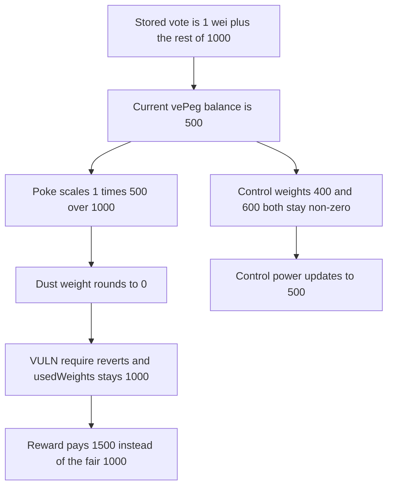

# Hyperstable: a 1-wei dust vote makes a vePeg NFT unpokeable

> **Vulnerability classes:** vuln/arithmetic/rounding · vuln/governance/proposal-manipulation

<!-- non-defihacklabs -->
<!-- source-auditvault: https://github.com/Auditware/AuditVault/blob/main/findings/57791-h-01-attacker-can-make-his-vepeg-nft-unpokeable-pashov-audit.md -->
<!-- date: 2025-02 -->

## Key info

| Field | Value |
|---|---|
| **Loss** | Voting power stays 1,000 instead of the decayed 500. A 3,000 reward pays 1,500. The fair pay is 1,000. Overpaid by 500 |
| **Vulnerable contract** | `Voter._vote` |
| **Attacker EOA** | `0x1111111111111111111111111111111111111111` |
| **Attack contract** | `Exploit` |
| **Attack tx** | `Exploit.run()` |
| **Chain / block / date** | Ethereum model · block 0 · 2025-02 |
| **Compiler** | solc 0.8.27, cancun, via IR |
| **Bug class** | Dust weight rounds to zero and poke reverts |

## TL;DR

vePeg balances decay. `poke` replays the stored vote weights against the current balance. A vote of 1 wei on a dust pool, cast when the NFT weight was 1,000, becomes `1 * 500 / 1,000 = 0` after the balance has decayed to 500. `require(_poolWeight != 0)` reverts the whole poke, so `usedWeights` stays 1,000. Split against an honest voter who also has 1,000, a 3,000 reward pays this NFT 1,500. The fair share at power 500 of 1,500 is 1,000. The control uses weights 400 and 600, both of which stay non-zero, and the power updates to 500. No warp runs inside `run()`. The decayed balance is already the value `balanceOfNFT` returns at this timestamp.

## Background

Pashov Audit Group, Hyperstable, 2025-02-26, H-01. The report's example is a `10e18` balance, a dust weight of 1, and a one-second decay that makes `1 * veWeight / 10e18` round to 0. The same division is used here with a stored total of `1,000e18` and a current balance of `500e18`, which is large enough that the 1-wei pool is still 0 and the reward gap is 500. The recommended fix is to skip a zero pool weight instead of reverting.

## The vulnerable code

```solidity
uint256 _poolWeight = weights[i] * _weight / _totalVoteWeight;
require(votes[tokenId][_pool] == 0);
// @> VULN: a 1-wei dust weight rounds to 0 after decay, so poke reverts and the stale power stays
require(_poolWeight != 0, "zero weight");
```

The recommended change is to continue the loop when `_poolWeight` is 0 instead of reverting.

## Root cause

Poke scales every previously stored weight by `currentBalance / oldTotal`. A weight of 1 does not survive that division once the balance has fallen. The require treats a rounded-to-zero pool as a hard failure, so none of the NFT's voting power is updated.

## Preconditions

- The NFT's stored weights are 1 and `1,000e18 - 1`. `usedWeights` is `1,000e18`.
- `balanceOfNFT` at this timestamp is `500e18`.
- An honest voter has `usedWeights` of `1,000e18`.
- The reward pot is 3,000.

## Attack walkthrough

1. The dust vote is already stored. The decayed balance is 500.
2. 3,000 PEG is funded.
3. Poke loads the dust weight first. `1 * 500e18 / 1,000e18` is 0.
4. `require(_poolWeight != 0)` reverts. `usedWeights` stays 1,000.
5. The reward split pays `3,000 * 1,000 / 2,000 = 1,500`. The fair pay is `3,000 * 500 / 1,500 = 1,000`.
6. The control poke, with weights 400 and 600, sets the power to 500.

## Diagrams



## Impact

The NFT keeps 1,000 of voting power after its balance has decayed to 500. It is overpaid by 500 PEG on a 3,000 reward: 1,500 received against a fair 1,000. The control updates the same decayed balance to 500.

## Remediation

In `_vote`, skip a pool whose scaled weight is 0 instead of reverting, which is the change recommended in the Hyperstable review.

## How to reproduce

```bash
cd 57791-h-01-attacker-can-make-his-vepeg-nft-unpokeable-pashov-audit_exp
forge test -vv
```

`test_exploit_stale_power_overpays` asserts stale power 1,000, a decayed balance of 500, a payment of 1,500, a fair payment of 1,000, and a control power of 500. `test_control_poke_updates_power` asserts the 400 and 600 split updates to 500. Captured output is `output.txt`.

## Sources

- AuditVault finding: https://github.com/Auditware/AuditVault/blob/main/findings/57791-h-01-attacker-can-make-his-vepeg-nft-unpokeable-pashov-audit.md
- Pashov review: https://github.com/pashov/audits/blob/master/team/md/Hyperstable-security-review_2025-02-26.md
