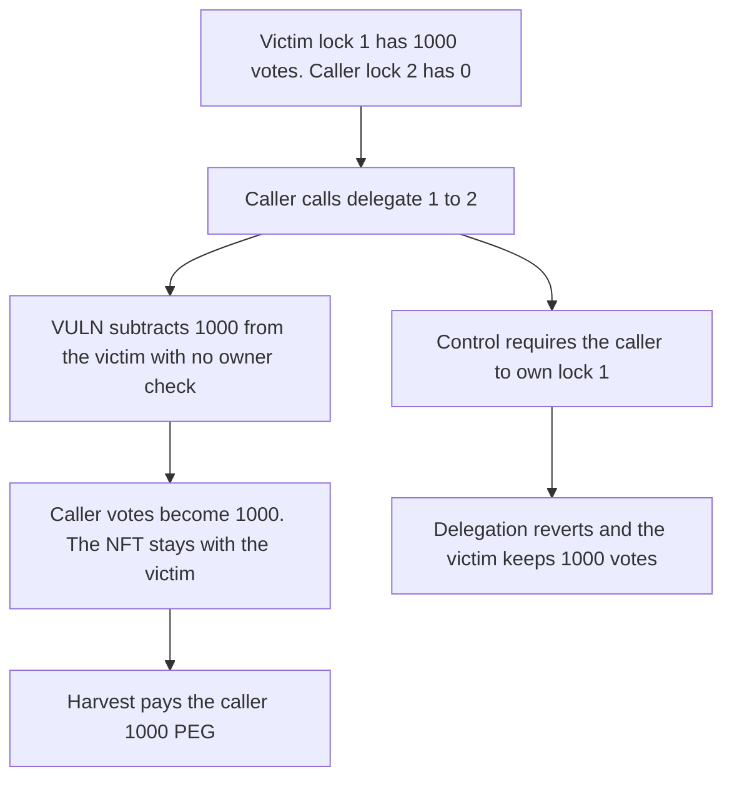

# Hyperstable: anyone can delegate a lock's votes and take its emissions

> **Vulnerability classes:** vuln/access-control/missing-auth · vuln/logic/state-update

<!-- non-defihacklabs -->
<!-- source-auditvault: https://github.com/Auditware/AuditVault/blob/main/findings/57821-c-01-delegate-permits-unauthorized-vote-delegation-pashov-au.md -->
<!-- date: 2025-03 -->

## Key info

| Field | Value |
|---|---|
| **Loss** | Caller harvests 1,000 PEG. The victim lock still exists and its 1,000 votes are gone |
| **Vulnerable contract** | `VePeg.delegate` |
| **Attacker EOA** | `0x1111111111111111111111111111111111111111` |
| **Attack contract** | `Exploit` |
| **Attack tx** | `Exploit.run()` |
| **Chain / block / date** | Ethereum model · block 0 · 2025-03 |
| **Compiler** | solc 0.8.27, cancun, via IR |
| **Bug class** | `delegate` moves voting weight with no owner or operator check |

## TL;DR

`delegate(from, to)` calls `_delegate` for any token id. Lock 1 is the victim's and carries 1,000 votes. The caller points it at their own empty lock. `votes[victim]` becomes 0 and `votes[caller]` becomes 1,000. The gauge pays 1,000 PEG to the caller. The NFT stays with the victim. Requiring the owner stops the call and the 1,000 votes stay put.

## Background

Pashov Audit Group's Hyperstable review of 19 March 2025, C-01. `delegate` is public and does not call `_isApprovedOrOwner`. The same missing check lets an attacker push a lock past `MAX_DELEGATES` and brick `lock_perpetually`, `unlock_perpetual`, and `delegateBySig`. This reduction shows the vote move and the emission it redirects.

## The vulnerable code

```solidity
function delegate(uint256 _from, uint256 _to) public {
    // @> VULN: delegate does not require _isApprovedOrOwner(msg.sender, _from)
    _delegate(_from, _to);
}
```

`_delegate` subtracts `power[from]` from the current owner's votes and adds it to the destination owner's votes. The recommended fix is `require(_isApprovedOrOwner(msg.sender, _from))`.

## Root cause

The function is permissionless. Ownership of the lock is read only to decide whose vote balance to edit, not to authorize the caller.

## Preconditions

- The victim owns lock 1 with 1,000 voting weight.
- The caller owns lock 2 with 0 weight.
- The gauge holds 1,000 PEG and pays the address that currently has the votes.

## Attack walkthrough

1. The victim lock and the empty caller lock are minted. The gauge is funded.
2. The caller calls `delegate(1, 2)`.
3. The victim's vote balance drops by 1,000. The caller's rises by 1,000. The NFT owner does not change.
4. `harvest` pays 1,000 PEG to the caller. The gauge is empty.
5. The control reverts because the caller is not the owner of lock 1, and the victim still has 1,000 votes.

## Diagrams



## Impact

The caller receives 1,000 PEG that the victim's 1,000 votes directed. The victim's vote balance is 0 while they still own the lock. The gauge is empty. The owner check reverts the delegation and leaves the 1,000 votes with the victim.

## Remediation

Require `_isApprovedOrOwner(msg.sender, _from)` at the start of `delegate`, which is the change in the review.

## How to reproduce

```bash
cd 57821-c-01-delegate-permits-unauthorized-vote-delegation-pashov-au_exp
forge test -vv
```

`test_exploit_steals_1000_votes_and_emissions` asserts a 1,000 PEG payout, a victim vote balance of 0, and unchanged NFT ownership. `test_control_stranger_cannot_delegate` asserts the call reverts and the victim still has 1,000 votes. Captured output is `output.txt`.

## Sources

- AuditVault finding: https://github.com/Auditware/AuditVault/blob/main/findings/57821-c-01-delegate-permits-unauthorized-vote-delegation-pashov-au.md
- Pashov Hyperstable review: https://github.com/pashov/audits/blob/master/team/md/Hyperstable-security-review_2025-03-19.md
