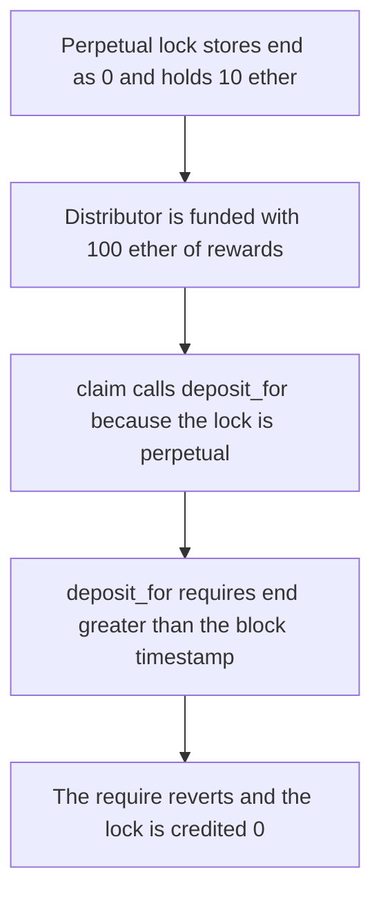

# Hyperstable — deposit_for rejects a perpetual lock

> **Vulnerability classes:** vuln/logic/wrong-condition · vuln/logic/missing-check · vuln/dos/frozen-funds

> **Reproduction:** a self-contained Foundry PoC that compiles and runs offline
> with only `forge-std` — no fork and no RPC. Trace: [output.txt](output.txt).
> PoC: [test/57822-h-01-faulty-deposit-for-check-pashov-audit-group-none-hypers_exp.sol](test/57822-h-01-faulty-deposit-for-check-pashov-audit-group-none-hypers_exp.sol).

<!-- non-defihacklabs -->
<!-- source-auditvault: https://github.com/Auditware/AuditVault/blob/main/findings/57822-h-01-faulty-deposit-for-check-pashov-audit-group-none-hypers.md -->
<!-- date: 2025-03 -->

---

## Key info

| | |
|---|---|
| **Impact** | **HIGH** — a perpetual lock is credited **0** of **100** ether, and the **100** ether stays in the distributor |
| **Protocol** | Hyperstable `vePeg.deposit_for` / `RewardsDistributor.claim` |
| **Vulnerable code** | `require(lock.end > block.timestamp)` while a perpetual lock stores `end = 0` |
| **Bug class** | The expiry check does not treat a perpetual lock as live |
| **Finding** | Pashov Audit Group — Hyperstable, 19 March 2025 · H-01 · id 57822 |
| **Report** | [Hyperstable-security-review_2025-03-19.md](https://github.com/pashov/audits/blob/master/team/md/Hyperstable-security-review_2025-03-19.md) |
| **Source** | [AuditVault finding](https://github.com/Auditware/AuditVault/blob/main/findings/57822-h-01-faulty-deposit-for-check-pashov-audit-group-none-hypers.md) |
| **Status** | Reproduced here as a local synthetic of the audited check |
| **Compiler** | solc 0.8.27, cancun, via IR |

---

## TL;DR

`claim` sends rewards into `deposit_for` when the lock is perpetual. `deposit_for` then requires `end > block.timestamp`. A perpetual lock is stored with `end = 0`, so the require fails. The lock amount stays **10** ether. The credited increase is **0**. The **100** ether reward remains pending in the distributor.

The fixed require is `end > block.timestamp || perpetuallyLocked`. The same claim adds **100** ether to that lock, and `perpetuallyLockedBalance` increases by **100** ether.

## The vulnerable code

```solidity
function deposit_for(uint256 tokenId, uint256 value) external {
    LockedBalance memory _locked = locked[tokenId];
    // @> VULN: perpetual locks keep end at 0, so this require rejects the reward deposit.
    require(_locked.end > block.timestamp || (allowPerpetual && _locked.perpetuallyLocked), "Cannot add to expired lock. Withdraw");
```

The audited line is `require(_locked.end > block.timestamp, "Cannot add to expired lock. Withdraw");`. The `allowPerpetual` flag is the control. It is false on the vulnerable ve.

## Root cause

`claim` and `deposit_for` disagree about what a live lock is. `claim` treats `perpetuallyLocked` as live. `deposit_for` treats `end == 0` as expired. Every reward deposit for a perpetual lock hits that require.

## Preconditions

- Token id 1 is perpetual: `end = 0`, `perpetuallyLocked = true`, locked amount **10** ether.
- **100** ether of rewards are pending for that id.
- `block.timestamp` is greater than 0, which it is on this block. No warp is used.

## Attack walkthrough

1. Fund the distributor with **100** ether. `pending[1]` becomes **100** ether.
2. `claim(1)` sees the perpetual flag and calls `deposit_for(1, 100 ether)`.
3. The require reverts. The low-level call returns false, so the claim's writes roll back.
4. The lock amount is still **10** ether. The credited delta is **0**. The distributor still holds **100** ether.

Control: the require accepts `perpetuallyLocked`. `claim` returns **100** ether, the lock amount becomes **110** ether, and `perpetuallyLockedBalance` is **100** ether.

## Diagrams



## Impact

The perpetual lock never receives its rewards. **100** ether stays in the distributor, and the lock's amount does not increase. The fixed check credits that same lock with **100** ether.

## Remediation

Accept `perpetuallyLocked` in `deposit_for`, and add the deposited value to `perpetuallyLockedBalance` when the lock is perpetual.

## Sources

- [AuditVault finding 57822](https://github.com/Auditware/AuditVault/blob/main/findings/57822-h-01-faulty-deposit-for-check-pashov-audit-group-none-hypers.md)
- [Pashov Hyperstable review, 19 March 2025](https://github.com/pashov/audits/blob/master/team/md/Hyperstable-security-review_2025-03-19.md)

### Taxonomy

- `severity/high`
- `vuln/logic/wrong-condition` · `vuln/logic/missing-check` · `vuln/dos/frozen-funds`
