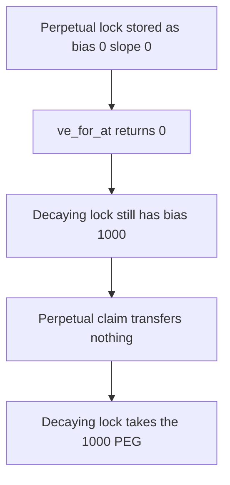

# Hyperstable — a perpetual lock scores zero voting power and is paid nothing

> **Vulnerability classes:** vuln/logic/reward-calculation

> **Reproduction:** a self-contained Foundry PoC that compiles and runs offline
> with only `forge-std` — no fork and no RPC. Trace: [output.txt](output.txt).
> PoC: [test/57823-h-02-losing-voting-power-in-rewards-distribution-pashov-audi_exp.sol](test/57823-h-02-losing-voting-power-in-rewards-distribution-pashov-audi_exp.sol).

<!-- non-defihacklabs -->
<!-- source-auditvault: https://github.com/Auditware/AuditVault/blob/main/findings/57823-h-02-losing-voting-power-in-rewards-distribution-pashov-audi.md -->
<!-- date: 2025-03 -->

---

## Key info

| | |
|---|---|
| **Impact** | **HIGH** — a perpetual lock of 1,000 is paid **0** and the other lock takes **1,000 PEG** |
| **Protocol** | Hyperstable `RewardsDistributor` |
| **Vulnerable code** | `bias - slope * time` on a lock stored as bias 0, slope 0 |
| **Bug class** | Perpetual locks are scored with the decaying-lock formula |
| **Finding** | Pashov Audit Group — Hyperstable, 19 March 2025 · id 57823 |
| **Report** | [Hyperstable security review](https://github.com/pashov/audits/blob/master/team/md/Hyperstable-security-review_2025-03-19.md) |
| **Source** | [AuditVault finding](https://github.com/Auditware/AuditVault/blob/main/findings/57823-h-02-losing-voting-power-in-rewards-distribution-pashov-audi.md) |
| **Compiler** | solc 0.8.27, cancun, via IR |

---

## TL;DR

`ve_for_at` is `bias - slope * time`. A perpetual lock is created with **bias = 0 and slope = 0**, so the result is 0 at every timestamp. An equal non-perpetual lock keeps bias equal to the locked amount.

A pot of **1,000 PEG** is split by that power. The perpetual claim transfers 0. The decaying lock is the whole denominator and receives **1,000**. A fair split of two equal locks is 500 each.

The 7 days are an argument to `ve_for_at`. `run()` does not warp.

## The vulnerable code

```solidity
function ve_for_at(uint256 tokenId, uint256 t) public view returns (uint256) {
    Point memory pt = points[tokenId];
    int256 bias = int256(pt.bias) - int256(pt.slope) * int256(t);
    // @> VULN: bias - slope * time is zero for a perpetual lock
    if (bias < 0) return 0;
    return uint256(bias);
}
```

The audit names this formula in `ve_for_at`, `_checkpoint_total_supply`, `_claim`, and `_claimable`. Perpetual locks are initialized with both terms at zero, so every one of those reads is zero.

## Root cause

A perpetual lock is a constant balance, not a decaying line. The distributor only knows the decaying point, and that point was stored as the zero point.

## Preconditions

- One lock is perpetual, bias 0, slope 0, escrow 1,000.
- One lock is a normal checkpoint with bias 1,000 and slope 0.
- The distributor holds 1,000 PEG.

## Attack walkthrough

1. Read the perpetual lock at t = 7 days. The formula returns 0.
2. Read the normal lock. The same formula returns 1,000.
3. Claim the perpetual id. The weight is 0, so the transfer is skipped.
4. Claim the normal id. It is the entire supply of power, so it is paid 1,000 PEG.

Control: voting power of a perpetual lock is the locked amount. Each claim pays 500.

## Diagrams



## Impact

The perpetual locker escrowed the same **1,000** as the other locker and receives **0** of a **1,000 PEG** pot. The other locker is overpaid by **500**. The only workaround in the report is to convert the perpetual lock into a normal lock first.

## Remediation

If the lock is perpetual, return the locked balance as a constant voting power. Do not run `bias - slope * time` on a point that was deliberately stored as zeros.

## Sources

- [AuditVault finding 57823](https://github.com/Auditware/AuditVault/blob/main/findings/57823-h-02-losing-voting-power-in-rewards-distribution-pashov-audi.md)
- [Pashov, Hyperstable, 19 March 2025](https://github.com/pashov/audits/blob/master/team/md/Hyperstable-security-review_2025-03-19.md)

### Taxonomy

- `vuln/logic/reward-calculation` · `vuln/logic/incorrect-calculation`
