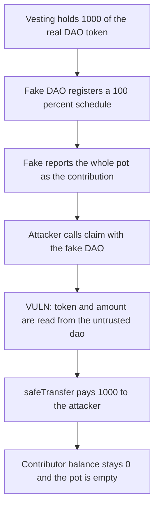

# Daos.live DaosVesting — claim() drains the vested token pot

> **Vulnerability classes:** vuln/logic/missing-validation · vuln/access-control/missing-auth

<!-- non-defihacklabs -->
<!-- source-auditvault: https://github.com/Auditware/AuditVault/blob/main/findings/57866-c-01-complete-drainage-of-vested-tokens-from-claim-in-daoves.md -->
<!-- date: 2025-06 -->

## Key info

| | |
|---|---|
| **Protocol** | Daos.live |
| **Finding** | Shieldify C-01, AuditVault 57866 |
| **Vulnerable code** | `DaosVesting.claim` |
| **Harm** | Attacker receives the full 1,000 vested tokens; the contributor receives 0 |
| **Chain** | local synthetic |

## TL;DR

`DaosVesting.claim(dao, user, index)` does not check that `dao` is a real DaosLive. It reads `token()` and `getContributionTokenAmount(user)` from whatever address was passed, then transfers that amount of that token out of the vesting contract. A fake DAO points `token()` at the legitimate DAO token, returns the vesting contract's whole balance as the contribution, and registers a 100% schedule for itself. The attacker is paid 1,000. The contributor's balance stays 0 and the pot is empty.

The control accepts a claim only from a registered DaosLive and pays the stored contribution of that user, 250 of the 1,000, leaving 750 in the contract.

## The vulnerable code

```solidity
function claim(address dao, address user, uint256 index) external {
    IDaosLive daosLive = IDaosLive(dao);
    // @> VULN: dao is not checked. token() and the contribution amount come from that contract.
    address token = daosLive.token();

    uint256 maxPercent = getClaimablePercent(dao, index);
    if (maxPercent > DENOMINATOR) revert InvalidCalculation();

    unchecked {
        uint256 totalAmount = daosLive.getContributionTokenAmount(user);
        uint256 maxAmount = (totalAmount * maxPercent) / DENOMINATOR;
        // ...
        TransferHelper.safeTransfer(token, user, amount);
    }
}
```

The warden's fix is to accept claims only through the real DaosLive and to ignore any amount the caller reports.

## Root cause

`schedules` are keyed by `msg.sender`, so any contract can call `setSchedules` and become a "dao". `claim` then trusts that contract for both the token address and the vested amount. The tokens that move are the ones already held by `DaosVesting` for the real contributors.

## Preconditions

`DaosVesting` holds the legitimate DAO token. The attacker can deploy a contract with `token()` and `getContributionTokenAmount`. No role and no time warp are required: a schedule with `date = 0` and `unlockPercent = 10_000` is already claimable.

## Attack walkthrough

1. The vesting contract holds 1,000 DAO. The contributor's balance is 0.
2. The fake DAO calls `setSchedules` with one row, date 0, unlock 10,000. That is a 100% unlock for the fake address.
3. `getContributionTokenAmount` returns `balanceOf(vesting)`, which is 1,000, for any user.
4. The attacker calls `claim(fake, attacker, 0)`.
5. `claim` reads `fake.token()`, gets a max percent of 10,000, and computes `amount = 1,000`.
6. `safeTransfer` moves 1,000 from the vesting contract to the attacker.
7. The contributor's balance is still 0. The vesting balance is 0.

The control reverts a direct call and a call from an unregistered contract. The registered DaosLive claim pays the contributor 250 and leaves 750 in the vesting contract. The attacker receives 0.

## Diagrams



## Impact

Every token sitting in `DaosVesting` for this DAO can be taken by the first caller who deploys a matching fake. Contributors cannot claim afterwards because the balance is gone. The same vesting contract serves every DAO, so the pot of each token it holds is exposed the same way.

## Sources

- AuditVault finding: https://github.com/Auditware/AuditVault/blob/main/findings/57866-c-01-complete-drainage-of-vested-tokens-from-claim-in-daoves.md
- Report: https://github.com/shieldify-security/audits-portfolio-md/blob/main/DaosLive-Security-Review.md
- Reviewed tree: https://github.com/ED3N-Ventures/daoslive-sc/tree/9a1856db2060b609a17b24aa72ab35f2cdf09031 (`contracts/DaosVesting.sol`, `claim` at the line cited by the review)
