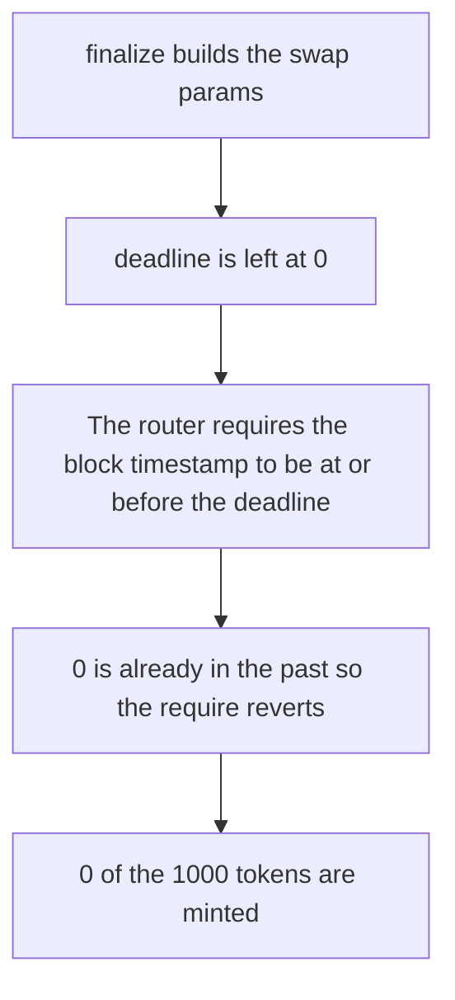

# DaosLive — the snipe swap is sent with deadline 0

> **Vulnerability classes:** vuln/logic/missing-check · vuln/input-validation/missing · vuln/dos/griefing

> **Reproduction:** a self-contained Foundry PoC that compiles and runs offline
> with only `forge-std` — no fork and no RPC. Trace: [output.txt](output.txt).
> PoC: [test/57867-c-02-the-deadline-parameter-in-uniswapv3-swap-causes-sniping_exp.sol](test/57867-c-02-the-deadline-parameter-in-uniswapv3-swap-causes-sniping_exp.sol).

<!-- non-defihacklabs -->
<!-- source-auditvault: https://github.com/Auditware/AuditVault/blob/main/findings/57867-c-02-the-deadline-parameter-in-uniswapv3-swap-causes-sniping.md -->
<!-- date: 2025-06 -->

---

## Key info

| | |
|---|---|
| **Impact** | **HIGH** — the snipe of **1000** ether of tokens reverts, and **0** tokens move |
| **Protocol** | DaosLive `finalize` / Uniswap V3 `exactInputSingle` |
| **Vulnerable code** | `ExactInputSingleParams` is built without `deadline`, so the field is **0** |
| **Bug class** | A missing deadline is already expired |
| **Finding** | Shieldify — DaosLive · C-02 · id 57867 |
| **Report** | [DaosLive-Security-Review.md](https://github.com/shieldify-security/audits-portfolio-md/blob/main/DaosLive-Security-Review.md) |
| **Source** | [AuditVault finding](https://github.com/Auditware/AuditVault/blob/main/findings/57867-c-02-the-deadline-parameter-in-uniswapv3-swap-causes-sniping.md) |
| **Status** | Reproduced against `checkDeadline` from Uniswap v3-periphery |
| **Compiler** | solc 0.8.27, cancun, via IR |

---

## TL;DR

`finalize` builds `ExactInputSingleParams` without a deadline. The field defaults to **0**. The router enforces `block.timestamp <= deadline`. **0** is before this block's timestamp, so the snipe reverts and DaosLive receives **0** of the **1000** ether of tokens it tried to buy.

A stored deadline of **0** is the same past instant: `finalizeAtStored` reverts with `Transaction too old`. Passing `deadline: block.timestamp` lets the swap mint the **1000** ether of tokens.

## The vulnerable code

```solidity
// @> VULN: deadline is omitted on the audited struct, so it is 0 and already expired.
uint256 deadline = passNow ? block.timestamp : 0;
```

The router check, from `PeripheryValidation.checkDeadline`:

```solidity
require(block.timestamp <= params.deadline, "Transaction too old");
```

The audited call site is `DaosLive.sol` line 314 at commit `9a1856db`. The struct literal in the report has no `deadline` field.

## Root cause

Uniswap treats a deadline of **0** as already expired. Omitting the field does not mean "no deadline". It means "deadline in the past", and `finalize` cannot snipe.

## Preconditions

- `block.timestamp` is greater than **0**. It is, on this block, with no warp inside `run`.
- The snipe amount is **1000** ether. The router would mint that many tokens if the deadline check passed.

## Attack walkthrough

1. Store deadline **0** and require `block.timestamp > storedDeadline`.
2. Call `finalize`. It passes deadline **0** into `exactInputSingle`.
3. The router require fails. The low-level call returns false.
4. DaosLive's token balance is **0**.

Control: `passNow` is true, so `finalize` passes `block.timestamp` and the router mints **1000** ether of tokens to DaosLive. A second call that passes the stored deadline of **0** reverts with `Transaction too old`.

## Diagrams



## Impact

Every snipe from `finalize` reverts. **0** of the **1000** ether of tokens move. The launch path that depends on this swap does not complete. Setting the deadline to `block.timestamp` moves the **1000** tokens, and a stored deadline that is already past is still rejected.

## Remediation

Set `deadline` on `ExactInputSingleParams` to a timestamp at or after `block.timestamp`. Do not leave the field at its zero default.

## Sources

- [AuditVault finding 57867](https://github.com/Auditware/AuditVault/blob/main/findings/57867-c-02-the-deadline-parameter-in-uniswapv3-swap-causes-sniping.md)
- [Shieldify DaosLive review](https://github.com/shieldify-security/audits-portfolio-md/blob/main/DaosLive-Security-Review.md)
- [ED3N-Ventures/daoslive-sc@9a1856db DaosLive.sol](https://github.com/ED3N-Ventures/daoslive-sc/blob/9a1856db2060b609a17b24aa72ab35f2cdf09031/contracts/DaosLive.sol)
- [Uniswap v3-periphery PeripheryValidation](https://github.com/Uniswap/v3-periphery/blob/v1.0.0/contracts/base/PeripheryValidation.sol)

### Taxonomy

- `severity/high`
- `vuln/logic/missing-check` · `vuln/input-validation/missing` · `vuln/dos/griefing`
