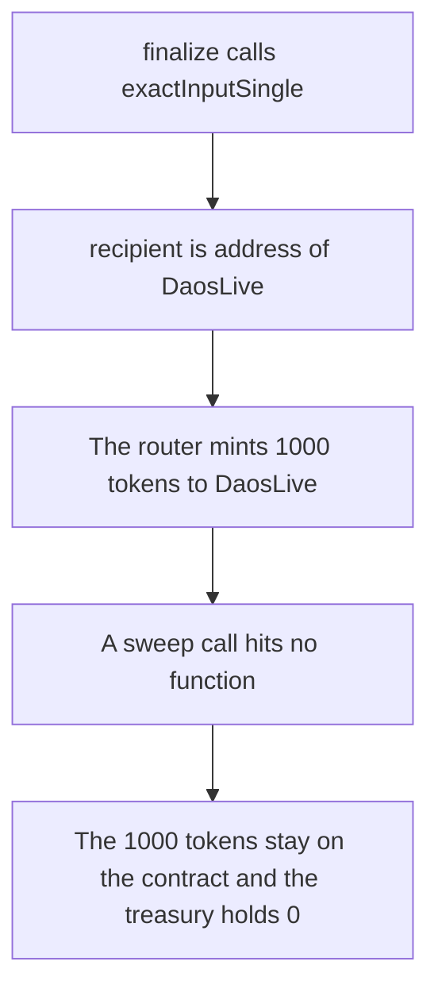

# DaosLive — sniped tokens are paid to the contract and cannot be withdrawn

> **Vulnerability classes:** vuln/dos/frozen-funds · vuln/logic/missing-check

> **Reproduction:** a self-contained Foundry PoC that compiles and runs offline
> with only `forge-std` — no fork and no RPC. Trace: [output.txt](output.txt).
> PoC: [test/57868-h-01-swapped-tokens-during-finalize-permanently-stuck-in-dao_exp.sol](test/57868-h-01-swapped-tokens-during-finalize-permanently-stuck-in-dao_exp.sol).

<!-- non-defihacklabs -->
<!-- source-auditvault: https://github.com/Auditware/AuditVault/blob/main/findings/57868-h-01-swapped-tokens-during-finalize-permanently-stuck-in-dao.md -->
<!-- date: 2025-06 -->

---

## Key info

| | |
|---|---|
| **Impact** | **HIGH** — **1000** ether of sniped tokens sit on `DaosLive` with no withdraw |
| **Protocol** | DaosLive `finalize` |
| **Vulnerable code** | `recipient: address(this)` and no sweep |
| **Bug class** | Tokens are received by a contract that cannot send them on |
| **Finding** | Shieldify — DaosLive · H-01 · id 57868 |
| **Report** | [DaosLive-Security-Review.md](https://github.com/shieldify-security/audits-portfolio-md/blob/main/DaosLive-Security-Review.md) |
| **Source** | [AuditVault finding](https://github.com/Auditware/AuditVault/blob/main/findings/57868-h-01-swapped-tokens-during-finalize-permanently-stuck-in-dao.md) |
| **Status** | Reproduced here as a local synthetic of the audited recipient |
| **Compiler** | solc 0.8.27, cancun, via IR |

---

## TL;DR

`finalize` calls `exactInputSingle` with `recipient: address(this)`. The router mints **1000** ether of tokens to `DaosLive`. The contract has no sweep, no withdraw, and no forward. A call to `sweep(address)` hits no function and returns false. The balance stays **1000** ether. The treasury balance stays **0**.

The fixed call sets `recipient` to the treasury. The treasury then holds **1000** ether and `DaosLive` holds **0**.

## The vulnerable code

```solidity
address recipient = toTreasury ? address(treasury) : address(this);
// @> VULN: recipient is address(this). Nothing in this contract can withdraw the tokens.
amountOut = router.exactInputSingle(
    ExactInputSingleParams({
        tokenIn: address(0),
        tokenOut: address(token),
        fee: 3000,
        recipient: recipient,
        amountIn: snipeAmount,
        amountOutMinimum: 0,
        sqrtPriceLimitX96: 0,
        deadline: block.timestamp
    })
);
```

`toTreasury` is false on the vulnerable contract, so `recipient` is `address(this)`. The audited source is `DaosLive.sol` line 314 at commit `9a1856db`, where the field is the literal `address(this)`.

## Root cause

The swap succeeds and the tokens have an owner. That owner is the launch contract, and the launch contract has no function that can move an ERC-20 balance.

## Preconditions

- `snipeAmount` is **1000** ether.
- The router mints `amountIn` tokens to `params.recipient` when the deadline is the current block.

## Attack walkthrough

1. `finalize` sets the recipient to itself and calls the router.
2. The router mints **1000** ether of tokens to `DaosLive`.
3. `sweep(address)` is called. There is no such function. The call returns false.
4. `DaosLive` still holds **1000** ether. The treasury holds **0**.

Control: `recipient` is the treasury. `finalize` returns **1000** ether, the treasury balance is **1000** ether, and the contract balance is **0**.

## Diagrams



## Impact

**1000** ether of the sniped token are stuck on `DaosLive`. Nothing in the contract can send them to the DAO. Sending them straight to the treasury leaves **0** on the contract and **1000** ether on the treasury.

## Remediation

Pass the DAO treasury as `recipient`, or add an authorized sweep that forwards any ERC-20 balance off `DaosLive`.

## Sources

- [AuditVault finding 57868](https://github.com/Auditware/AuditVault/blob/main/findings/57868-h-01-swapped-tokens-during-finalize-permanently-stuck-in-dao.md)
- [Shieldify DaosLive review](https://github.com/shieldify-security/audits-portfolio-md/blob/main/DaosLive-Security-Review.md)
- [ED3N-Ventures/daoslive-sc@9a1856db DaosLive.sol](https://github.com/ED3N-Ventures/daoslive-sc/blob/9a1856db2060b609a17b24aa72ab35f2cdf09031/contracts/DaosLive.sol)

### Taxonomy

- `severity/high`
- `vuln/dos/frozen-funds` · `vuln/logic/missing-check`
