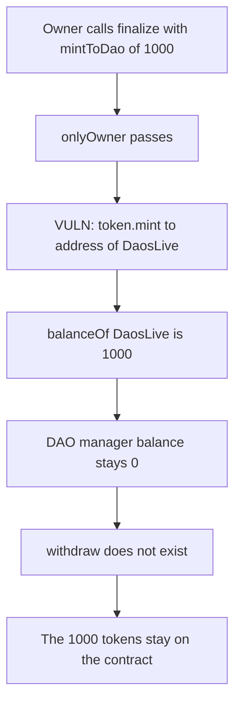

# Daos.live — finalize mints the DAO allocation into a contract that cannot withdraw

> **Vulnerability classes:** vuln/dos/frozen-funds · vuln/logic/missing-check

<!-- non-defihacklabs -->
<!-- source-auditvault: https://github.com/Auditware/AuditVault/blob/main/findings/57869-h-02-in-finalize-the-minttodao-amount-of-tokens-are-permane.md -->
<!-- date: 2025-06 -->

## Key info

| | |
|---|---|
| **Protocol** | Daos.live |
| **Finding** | Shieldify H-02, AuditVault 57869 |
| **Vulnerable code** | `DaosLive.finalize` |
| **Harm** | 1,000 tokens sit on DaosLive; the DAO manager's balance stays 0; there is no withdraw |
| **Chain** | local synthetic |

## TL;DR

`finalize` takes `_mintToDao` and, when it is greater than zero, calls `token.mint(address(this), mintToDao)`. The tokens are credited to DaosLive itself. The contract has no withdraw, sweep, or transfer. After finalize with `_mintToDao = 1,000`, `balanceOf(DaosLive)` is 1,000 and the DAO manager's balance is 0. A call to `withdraw(address)` matches no function, and the balance does not move.

The control mints that same 1,000 straight to the DAO manager. The contract balance stays 0.

## The vulnerable code

```solidity
function finalize(
    string calldata name,
    string calldata symbol,
    uint256 _mintToDao,
    uint256 _snipeAmount
) external onlyOwner {
    uint256 mintToDao = _mintToDao;
    if (mintToDao > 0) {
        // @> VULN: minted to this contract. There is no withdraw.
        IDaosToken(token).mint(address(this), mintToDao);
    }
}
```

The warden's fix is to mint to the DAO manager, or to add a function that can send the balance there.

## Root cause

The recipient of the extra mint is `address(this)`. Nothing in DaosLive reads that balance back out. The manager address is stored and never used as a mint recipient.

## Preconditions

The owner calls `finalize` with `_mintToDao > 0`. No other role and no elapsed time are required. The token's `mint` accepts the DaosLive contract as the recipient.

## Attack walkthrough

1. Before finalize, `balanceOf(DaosLive)` is 0 and the manager's balance is 0.
2. The owner calls `finalize` with `_mintToDao = 1,000`.
3. `onlyOwner` passes. `mintToDao > 0` is true.
4. `token.mint(address(this), 1000)` credits 1,000 to DaosLive.
5. `balanceOf(DaosLive)` is 1,000. The manager is still at 0.
6. `withdraw(address)` does not exist. The call fails and the 1,000 is still on the contract.

The control calls the same amount through a finalize that mints to the manager. The manager's balance is 1,000 and the contract's balance is 0.

## Diagrams



## Impact

Every DAO that passes a non-zero `_mintToDao` permanently loses that allocation. The tokens are visible on the contract and cannot be moved to the manager, to a treasury, or to any holder. The manager's balance stays 0.

## Sources

- AuditVault finding: https://github.com/Auditware/AuditVault/blob/main/findings/57869-h-02-in-finalize-the-minttodao-amount-of-tokens-are-permane.md
- Report: https://github.com/shieldify-security/audits-portfolio-md/blob/main/DaosLive-Security-Review.md
- Reviewed tree: https://github.com/ED3N-Ventures/daoslive-sc/tree/9a1856db2060b609a17b24aa72ab35f2cdf09031 (`contracts/DaosLive.sol`, `finalize`)
