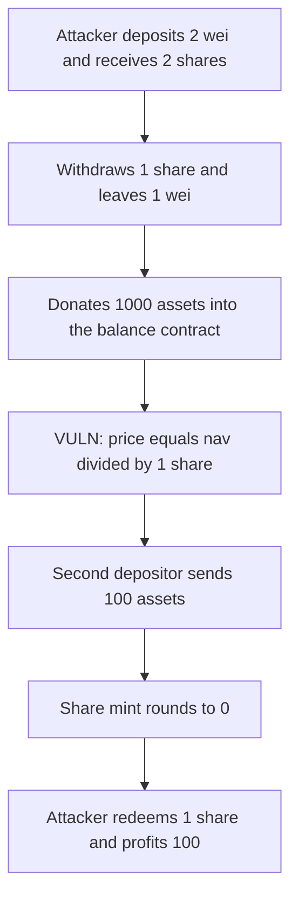

# Harmonix FundContract — first depositor inflates the share price and takes the next deposit

> **Vulnerability classes:** vuln/arithmetic/rounding · vuln/logic/price-calculation

<!-- non-defihacklabs -->
<!-- source-auditvault: https://github.com/Auditware/AuditVault/blob/main/findings/57883-c-01-first-depositor-can-inflate-share-price-to-steal-funds.md -->
<!-- date: 2025-05 -->

## Key info

| | |
|---|---|
| **Protocol** | Harmonix Finance (Hyperliquid vault) |
| **Finding** | Shieldify C-01, AuditVault 57883 |
| **Vulnerable code** | `FundContract._updateNav` |
| **Harm** | Second depositor's share balance is 0; attacker profit is that depositor's 100 assets |
| **Chain** | local synthetic |

## TL;DR

Share price is `nav * 10**decimals / totalSupply`, with no virtual offset. The attacker deposits 2 wei, withdraws 1 share, and donates 1,000 assets straight into the balance contract. Supply is 1 share. NAV is about 1,000. The next depositor sends 100 assets and receives 0 shares. The attacker redeems the remaining share and is paid the donation back plus the 100. Net profit is 100. The victim's share balance stays 0.

The control adds a virtual offset of 1,000 shares in the conversion. The same second deposit mints 299 shares instead of 0.

## The vulnerable code

```solidity
uint256 nav = getFundNavValue() +
    asset.balanceOf(balanceContract) +
    withdrawPoolAmount -
    excludedTradingFee;
// @> VULN: price is nav / supply with no virtual offset.
uint256 newPricePerShare = (nav * 10 ** decimals()) / totalSupply();
```

A direct transfer to `balanceContract` increases `nav` and does not mint shares. The warden's mitigation is to mint `10**3` dead shares (a virtual offset) so this division cannot be pushed to zero for a normal deposit.

## Root cause

`deposit` on an empty vault mints one share per wei of assets. After that, price is a plain ratio of the balance-contract balance to `totalSupply`. Donating assets is not a deposit, so the ratio moves without a matching share mint. The next depositor's share amount rounds down to 0, and the existing shareholder owns 100% of the new balance.

## Preconditions

The vault supply can be 1 wei of shares. The asset is a normal ERC-20 the attacker can transfer directly to the balance contract. No admin, no oracle, and no time delay. The victim's deposit is smaller than the inflated price of one share.

## Attack walkthrough

1. Attacker deposits 2 wei. The empty vault mints 2 shares and prices them one-to-one.
2. Attacker withdraws 1 share. 1 share and 1 wei remain. `_updateNav` computes price as nav / supply.
3. Attacker transfers 1,000 assets to the balance contract. Supply stays 1. NAV becomes 1,000e18 + 1.
4. The second depositor deposits 100 assets. Shares round to `100e18 / (1000e18 + 1 + 100e18) = 0`.
5. `sharesOf` for the victim is 0. The 100 assets are in the balance contract.
6. Attacker withdraws the last share and receives 1,100e18 + 1. Against a starting balance that included the 1,000 donation, the profit is exactly 100.

The control uses `shares = assets * (supply + 1000) / (assetsBefore + 1)`. The same 2 wei mint 2,000 shares. After the same 1,000 donation, the 100-asset deposit mints 299 shares.

## Diagrams



## Impact

The second depositor loses the full 100 assets. Their share balance is 0, so they cannot redeem. The attacker is repaid the donation and keeps the 100 as profit. A larger donation raises the minimum deposit that still mints one share, so later users either mint 0 and lose everything, or lose the rounding remainder.

## Sources

- AuditVault finding: https://github.com/Auditware/AuditVault/blob/main/findings/57883-c-01-first-depositor-can-inflate-share-price-to-steal-funds.md
- Report: https://github.com/shieldify-security/audits-portfolio-md/blob/main/HarmonixFinance-Hyperliquid-Security-Review.md
- Reviewed tree: https://github.com/harmonixfi/core-contracts/tree/f02157aba919dcdd4a1133669361224108c5caef (`contracts/vaults/hyperliquid/fundContract.sol`, `_updateNav`)
