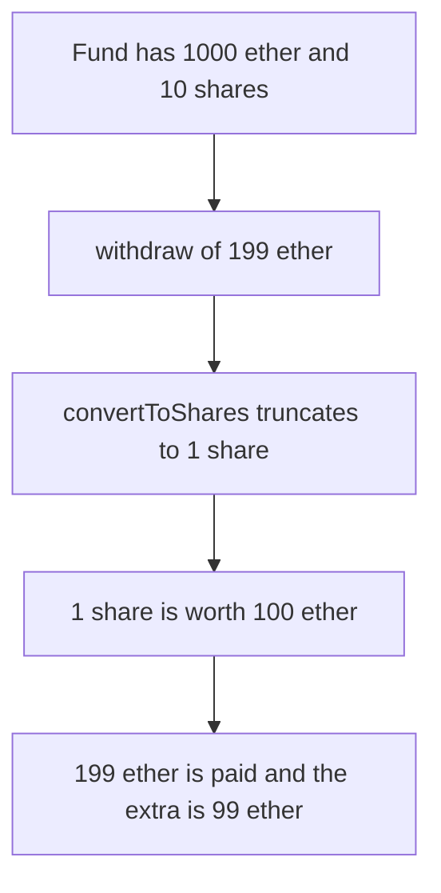

# Harmonix — withdraw burns the rounded-down share count

> **Vulnerability classes:** vuln/arithmetic/rounding-direction · vuln/arithmetic/rounding · vuln/logic/incorrect-calculation

> **Reproduction:** a self-contained Foundry PoC that compiles and runs offline
> with only `forge-std` — no fork and no RPC. Trace: [output.txt](output.txt).
> PoC: [test/57884-c-02-users-can-exploit-rounding-to-withdraw-excess-assets-fr_exp.sol](test/57884-c-02-users-can-exploit-rounding-to-withdraw-excess-assets-fr_exp.sol).

<!-- non-defihacklabs -->
<!-- source-auditvault: https://github.com/Auditware/AuditVault/blob/main/findings/57884-c-02-users-can-exploit-rounding-to-withdraw-excess-assets-fr.md -->
<!-- date: 2025-05 -->

---

## Key info

| | |
|---|---|
| **Impact** | **HIGH** — **199** ether is paid out while **1** share worth **100** ether is burned, so the extra is **99** ether |
| **Protocol** | Harmonix `FundContract.withdraw` |
| **Vulnerable code** | `shares = convertToShares(assets)` rounds down |
| **Bug class** | ERC-4626 withdraw must round the burned shares up |
| **Finding** | Shieldify — Harmonix Finance · C-02 · id 57884 |
| **Report** | [HarmonixFinance-Hyperliquid-Security-Review.md](https://github.com/shieldify-security/audits-portfolio-md/blob/main/HarmonixFinance-Hyperliquid-Security-Review.md) |
| **Source** | [AuditVault finding](https://github.com/Auditware/AuditVault/blob/main/findings/57884-c-02-users-can-exploit-rounding-to-withdraw-excess-assets-fr.md) |
| **Status** | Reproduced here as a local synthetic of the audited conversion |
| **Compiler** | solc 0.8.27, cancun, via IR |

---

## TL;DR

The fund holds **1000** ether of assets and **10** shares. One share is worth **100** ether. The caller holds **5** shares and withdraws **199** ether.

`convertToShares` computes `assets * supply / totalAssets`, which is `199 ether * 10 / 1000 ether = 1` share after truncation. The caller receives **199** ether and burns **1** share. The extra over that share's **100** ether is **99** ether. The other holder still has **5** shares.

Rounding the burn up gives `ceil(199 ether * 10 / 1000 ether) = 2` shares, worth **200** ether. The same **199** ether payout then has extra **0**.

## The vulnerable code

```solidity
function convertToShares(uint256 assets) public view returns (uint256) {
    if (roundUp) return (assets * totalSupply + totalAssets - 1) / totalAssets;
    return assets * totalSupply / totalAssets;
}

function withdraw(uint256 assets, address receiver) external returns (uint256 shares) {
    // @> VULN: convertToShares rounds down. withdraw must round the burned shares up.
    shares = convertToShares(assets);
```

The audited body is `uint256 shares = convertToShares(assets); return _withdraw(shares, receiver, owner);` in `fundContract.sol` at commit `f02157ab`. `roundUp` is the control. It is false on the vulnerable fund.

## Root cause

`withdraw` specifies the assets that leave and derives the shares that burn. Rounding that division down burns too few shares for the assets paid. ERC-4626 rounds this conversion up so the vault does not pay assets that the burned shares do not cover.

## Preconditions

- `totalAssets` is **1000** ether and `totalSupply` is **10**.
- The caller owns **5** shares. Another address owns the other **5**.
- The withdrawal amount is **199** ether, which does not divide the share price evenly.

## Attack walkthrough

1. Preview: shares round to **1**, and that share is worth **100** ether.
2. `withdraw(199 ether)` burns **1** share and transfers **199** ether.
3. Extra is `199 ether - 100 ether = 99 ether`.
4. The caller has **4** shares left. The other holder still has **5**. Assets left are **801** ether for **9** shares.

Control: the same withdrawal burns **2** shares. Two shares were worth **200** ether. Received **199** ether does not exceed that, so the extra is **0**.

## Diagrams



## Impact

The caller takes **99** ether more than the burned share was worth. The other holder keeps the same **5** shares against a smaller asset balance. Rounding the burn the other way makes the extra **0** on this same withdrawal.

## Remediation

In `withdraw`, convert assets to shares with a round-up: `(assets * supply + totalAssets - 1) / totalAssets`.

## Sources

- [AuditVault finding 57884](https://github.com/Auditware/AuditVault/blob/main/findings/57884-c-02-users-can-exploit-rounding-to-withdraw-excess-assets-fr.md)
- [Shieldify Harmonix review](https://github.com/shieldify-security/audits-portfolio-md/blob/main/HarmonixFinance-Hyperliquid-Security-Review.md)
- [harmonixfi/core-contracts@f02157ab fundContract.sol](https://github.com/harmonixfi/core-contracts/blob/f02157aba919dcdd4a1133669361224108c5caef/contracts/vaults/hyperliquid/fundContract.sol)

### Taxonomy

- `severity/high`
- `vuln/arithmetic/rounding-direction` · `vuln/arithmetic/rounding` · `vuln/logic/incorrect-calculation`
