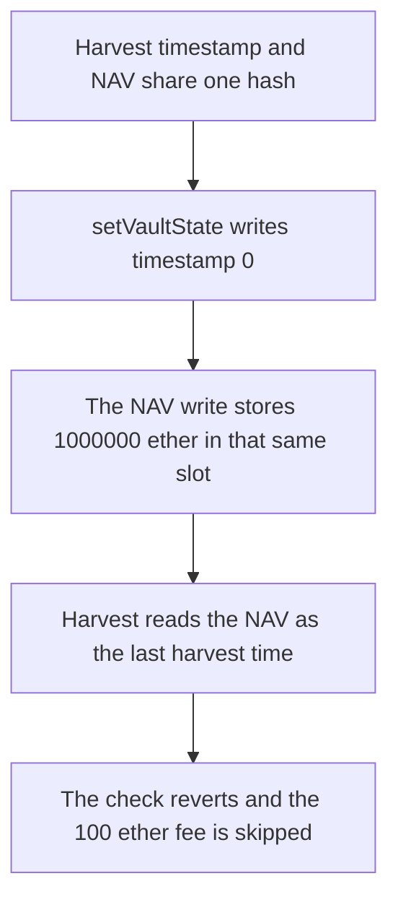

# Harmonix — writing the NAV replaces the fee-harvest timestamp

> **Vulnerability classes:** vuln/logic/state-update · vuln/logic/fee-calculation · vuln/logic/incorrect-state-transition

> **Reproduction:** a self-contained Foundry PoC that compiles and runs offline
> with only `forge-std` — no fork and no RPC. Trace: [output.txt](output.txt).
> PoC: [test/57885-c-03-nav-value-overwrites-last-fee-harvest-time-shieldify-no_exp.sol](test/57885-c-03-nav-value-overwrites-last-fee-harvest-time-shieldify-no_exp.sol).

<!-- non-defihacklabs -->
<!-- source-auditvault: https://github.com/Auditware/AuditVault/blob/main/findings/57885-c-03-nav-value-overwrites-last-fee-harvest-time-shieldify-no.md -->
<!-- date: 2025-05 -->

---

## Key info

| | |
|---|---|
| **Impact** | **HIGH** — the performance-fee harvest reverts, and **100** ether of fees are skipped |
| **Protocol** | Harmonix `VaultStore` / fund harvest |
| **Vulnerable code** | `LAST_HARVEST_PERFORMANCE_FEE_TIME` is `keccak256(abi.encode("NAV"))` |
| **Bug class** | The NAV write and the harvest timestamp share one slot |
| **Finding** | Shieldify — Harmonix Finance · C-03 · id 57885 |
| **Report** | [HarmonixFinance-Hyperliquid-Security-Review.md](https://github.com/shieldify-security/audits-portfolio-md/blob/main/HarmonixFinance-Hyperliquid-Security-Review.md) |
| **Source** | [AuditVault finding](https://github.com/Auditware/AuditVault/blob/main/findings/57885-c-03-nav-value-overwrites-last-fee-harvest-time-shieldify-no.md) |
| **Status** | Reproduced here as a local synthetic of the audited constants |
| **Compiler** | solc 0.8.27, cancun, via IR |

---

## TL;DR

`LAST_HARVEST_PERFORMANCE_FEE_TIME` is defined as `keccak256(abi.encode("NAV"))`, the same constant as `NAV`. `setVaultState` writes the harvest timestamp and then the NAV into that one slot. The second write wins.

The timestamp that was requested is **0**, which is already due. The NAV that replaces it is **1000000** ether, which is above `block.timestamp`. `harvestPerformanceFee` requires `block.timestamp >= lastHarvest + 1` and reverts. `feesCollected` stays **0**. The **100** ether fee token balance stays on the fund.

A distinct hash for the timestamp leaves the slot at **0** after the NAV write. The same harvest then pays the **100** ether.

## The vulnerable code

```solidity
bytes32 internal constant NAV = keccak256(abi.encode("NAV"));
// @> VULN: this is keccak256(abi.encode("NAV")), the same constant as NAV.
bytes32 internal constant LAST_HARVEST_PERFORMANCE_FEE_TIME = keccak256(abi.encode("NAV"));
```

```solidity
store[_timeKey()] = lastHarvest;
// @> VULN: the NAV key equals the harvest-time key, so this write replaces the timestamp.
store[_navKey()] = nav;
```

The audited constant is the one in `lib/VaultStore.sol` at commit `f02157ab`.

## Root cause

Two storage keys are built from the same id. Writing NAV is not a separate slot. It is an overwrite of the last harvest time, and the value written is a NAV, not a timestamp. The harvest check then treats that NAV as the last harvest and refuses to run.

## Preconditions

- The fee due is **100** ether, already minted to the fund.
- `setVaultState` is called with `lastHarvest = 0` and `nav = 1000000 ether`.
- The minimum interval is **1** second. `block.timestamp` is at least **1**, so a preserved timestamp of **0** is already due. No warp is used.

## Attack walkthrough

1. Compare the keys. They are equal.
2. `setVaultState(1000000 ether, 0)` writes **0** and then overwrites it with the NAV.
3. The slot read back is **1000000** ether, which is greater than `block.timestamp`.
4. `harvestPerformanceFee` reverts with `HARVEST_TOO_SOON`. The fee token balance is still **100** ether.

Control: the time key is `keccak256(abi.encode("LAST_HARVEST_PERFORMANCE_FEE_TIME"))`. After the same `setVaultState`, the time slot is still **0** and the NAV slot is **1000000** ether. `harvestPerformanceFee` pays **100** ether to the caller.

## Diagrams



## Impact

The performance fee cannot be collected after a NAV update. **100** ether that was due stays on the fund, and `feesCollected` is **0**. Distinct keys preserve the timestamp and the same harvest pays the **100** ether.

## Remediation

Define `LAST_HARVEST_PERFORMANCE_FEE_TIME` as `keccak256(abi.encode("LAST_HARVEST_PERFORMANCE_FEE_TIME"))`, not as the NAV id.

## Sources

- [AuditVault finding 57885](https://github.com/Auditware/AuditVault/blob/main/findings/57885-c-03-nav-value-overwrites-last-fee-harvest-time-shieldify-no.md)
- [Shieldify Harmonix review](https://github.com/shieldify-security/audits-portfolio-md/blob/main/HarmonixFinance-Hyperliquid-Security-Review.md)
- [harmonixfi/core-contracts@f02157ab VaultStore.sol](https://github.com/harmonixfi/core-contracts/blob/f02157aba919dcdd4a1133669361224108c5caef/contracts/lib/VaultStore.sol)

### Taxonomy

- `severity/high`
- `vuln/logic/state-update` · `vuln/logic/fee-calculation` · `vuln/logic/incorrect-state-transition`
