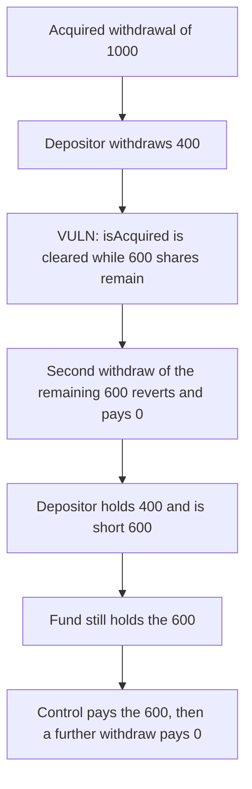

# Harmonix: a partial withdrawal clears isAcquired and strands the rest

> **Vulnerability classes:** vuln/logic/state-update · vuln/logic/incorrect-state-transition · vuln/dos/frozen-funds

<!-- non-defihacklabs -->
<!-- source-auditvault: https://github.com/Auditware/AuditVault/blob/main/findings/57886-h-01-incorrect-withdrawal-state-update-causes-partial-withdr.md -->
<!-- date: 2025-05 -->

## Key info

| | |
|---|---|
| **Protocol** | Harmonix Finance, Hyperliquid fund |
| **Finding** | Shieldify H-01, AuditVault 57886 |
| **Vulnerable code** | `FundContract._updateUserWithdrawal` |
| **Harm** | A depositor who takes 400 of an acquired 1000 is short the other 600. The second withdraw pays 0. The corrected update pays the 600, and a further withdraw pays 0 |
| **Chain** | local synthetic |

## TL;DR

`_updateUserWithdrawal` always sets `isAcquired = false`. A partial completion of 400 from an acquired 1000 leaves 600 shares in storage, but `_canCompleteWithdraw` now returns false. The second withdraw reverts and pays 0, so the depositor holds 400 and the fund still holds 600. The corrected function clears the flag only when the remaining shares are zero. That path pays 400 and then 600, and a further withdraw pays 0.

## The vulnerable code

```solidity
function _updateUserWithdrawal(
    address user,
    WithdrawData memory userWithdraw,
    uint256 _shares,
    uint256 withdrawAmount
) internal {
    userWithdraw.withdrawAmount -= withdrawAmount;
    userWithdraw.shares -= _shares;
    userWithdraw.isAcquired = false;
    withdrawals[user].withdrawAmount = userWithdraw.withdrawAmount;
    withdrawals[user].shares = userWithdraw.shares;
    // @> VULN: a partial withdrawal clears isAcquired even though shares remain
    withdrawals[user].isAcquired = false;
}
```

The fix is to assign `isAcquired = false` only when `userWithdraw.shares == 0`.

## Root cause

`acquireWithdrawalFunds` sets `isAcquired` so the user can complete. The completion helper then clears that flag on every call, including a partial one. Shares and `withdrawAmount` are reduced, so the position is still open, but the only gate that allows completion is now false. The leftover assets stay in the fund.

## Preconditions

The depositor has an acquired withdrawal of 1000 shares and 1000 assets. The fund holds 1000. The first completion requests 400. The second requests the remaining 600. Both calls are in the same transaction. `run()` does not warp.

## Attack walkthrough

1. The fund is minted 1000 and the withdrawal is stored with `isAcquired = true`.
2. The depositor withdraws 400. The gate passes.
3. `_updateUserWithdrawal` subtracts 400 from the shares and the amount, then sets `isAcquired = false`.
4. Storage now shows 600 shares, 600 assets, and `isAcquired == false`.
5. The second withdraw hits `require(_canCompleteWithdraw(msg.sender))` and reverts. The catch records 0.
6. The depositor's balance is 400. The fund still holds 600. `shortfall` is 600.

The control contract clears `isAcquired` only after the shares reach zero. The same 400 then 600 sequence pays both amounts. A third withdraw pays 0, and the fund balance is 0.

## Diagrams



## Impact

The depositor receives 400 of an acquired 1000. The other 600 cannot be completed, so that depositor is short 600 and those assets stay in the fund. Every later partial completion of the same open withdrawal hits the same cleared flag.

## How to reproduce

```bash
cd 57886-h-01-incorrect-withdrawal-state-update-causes-partial-withdr_exp
forge test -vv
```

`run()` does not warp. The control test pays the remainder and then asserts the next withdraw pays 0.

## Sources

- AuditVault finding: https://github.com/Auditware/AuditVault/blob/main/findings/57886-h-01-incorrect-withdrawal-state-update-causes-partial-withdr.md
- Shieldify report: https://github.com/shieldify-security/audits-portfolio-md/blob/main/HarmonixFinance-Hyperliquid-Security-Review.md
- Reviewed tree: https://github.com/harmonixfi/core-contracts/blob/f02157aba919dcdd4a1133669361224108c5caef/contracts/vaults/hyperliquid/fundContract.sol
