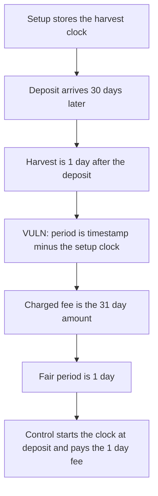

# Harmonix: the management fee clock starts at vault setup

> **Vulnerability classes:** vuln/logic/fee-calculation · vuln/defi/fee-manipulation

<!-- non-defihacklabs -->
<!-- source-auditvault: https://github.com/Auditware/AuditVault/blob/main/findings/57887-h-02-incorrect-fee-calculation-period-leads-to-overcharging.md -->
<!-- date: 2025-05 -->

## Key info

| | |
|---|---|
| **Protocol** | Harmonix Finance, Hyperliquid fund |
| **Finding** | Shieldify H-02, AuditVault 57887 |
| **Vulnerable code** | `FundContract._calculateManagementFeeAmount` |
| **Harm** | A 1000 position held for 1 day is charged 84931528320000000000. The fair 1 day fee is 2739726720000000000. The extra is 82191801600000000000 |
| **Chain** | local synthetic |

## TL;DR

`setupVaultSetting` writes the current timestamp into `lastHarvestManagementFeeTime`. The fee formula then uses `period = timestamp - lastHarvestManagementFeeTime`. A vault set up 30 days before the deposit, harvested 1 day after the deposit, is charged for 31 days. With rate 100 and NAV 1000 ether the verbatim per-second formula charges 84931528320000000000. The same formula from the deposit timestamp charges 2739726720000000000. The control starts the clock on the first deposit and pays that fair amount.

## The vulnerable code

```solidity
uint256 perSecondRate = (managementFeeRate * 1e12) / (365 * 86400) + 1;
// @> VULN: period runs from vault setup, not from the moment funds were deposited
chargedPeriod = timestamp - lastHarvestManagementFeeTime;
return (navAmount * perSecondRate * chargedPeriod) / 1e14;
```

The fix subtracts the first-deposit timestamp instead of the setup timestamp.

## Root cause

The harvest timestamp is stored when the vault is configured, which can be long before any assets arrive. The fee multiplies NAV by that whole gap. Days with a zero balance are billed at the later NAV. The `+ 1` on the per-second rate is the quoted rounding, and it is present in both the buggy period and the fair period, so it is not the gap.

## Preconditions

Rate is 100. NAV is 1000 ether. Setup timestamp is 1700000000 minus 31 days. Deposit timestamp is 1700000000 minus 1 day. Harvest timestamp is 1700000000. These are arguments, not a block warp. `run()` does not warp.

## Attack walkthrough

1. `setupVaultSetting` stores the setup timestamp as `lastHarvestManagementFeeTime`.
2. `deposit` mints 1000 and records a deposit time 30 days later. It does not move the harvest clock.
3. `harvest` calls `_calculateManagementFeeAmount`. `chargedPeriod` is 31 days.
4. The fee receiver is paid 84931528320000000000.
5. `fairFee` repeats the formula with `timestamp - depositTime`, which is 1 day, and returns 2739726720000000000.
6. The extra is 82191801600000000000. The 31 day charge is exactly 31 times the 1 day charge.

The control writes `lastHarvestManagementFeeTime = whenDeposited` inside `deposit`. The same harvest pays 2739726720000000000.

## Diagrams



## Impact

The fee receiver takes 84931528320000000000 from a position that was deposited for 1 day. The fair charge is 2739726720000000000. The depositor overpays by 82191801600000000000. A longer gap between setup and the first deposit scales the same way.

## How to reproduce

```bash
cd 57887-h-02-incorrect-fee-calculation-period-leads-to-overcharging_exp
forge test -vv
```

`run()` does not warp. Both periods are differences of the stored timestamps.

## Sources

- AuditVault finding: https://github.com/Auditware/AuditVault/blob/main/findings/57887-h-02-incorrect-fee-calculation-period-leads-to-overcharging.md
- Shieldify report: https://github.com/shieldify-security/audits-portfolio-md/blob/main/HarmonixFinance-Hyperliquid-Security-Review.md
- Reviewed tree: https://github.com/harmonixfi/core-contracts/blob/f02157aba919dcdd4a1133669361224108c5caef/contracts/vaults/hyperliquid/fundContract.sol
