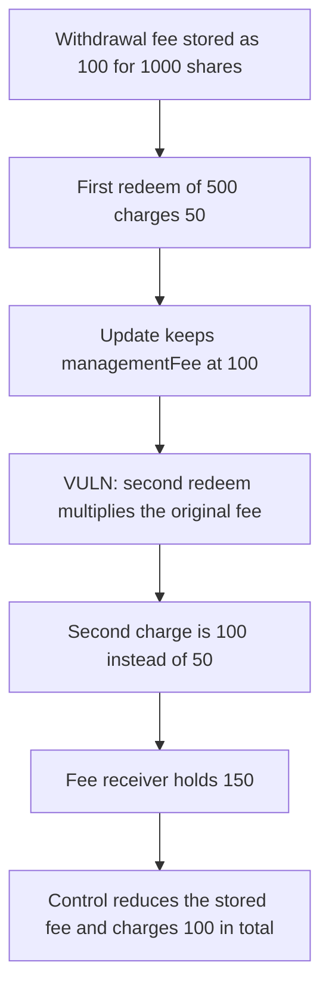

# Harmonix: a second partial redeem charges the original fee again

> **Vulnerability classes:** vuln/logic/fee-calculation · vuln/logic/state-update

<!-- non-defihacklabs -->
<!-- source-auditvault: https://github.com/Auditware/AuditVault/blob/main/findings/57888-h-03-partial-withdrawers-suffer-double-fee-charging-due-to-s.md -->
<!-- date: 2025-05 -->

## Key info

| | |
|---|---|
| **Protocol** | Harmonix Finance, Hyperliquid fund |
| **Finding** | Shieldify H-03, AuditVault 57888 |
| **Vulnerable code** | `redeem` fee product, fed by `_updateUserWithdrawal` |
| **Harm** | Two half redeems of a 100 fee charge 50 and then 100. The fair total is 100. The extra fee is 50 |
| **Chain** | local synthetic |

## TL;DR

`_updateUserWithdrawal` reduces shares and `withdrawAmount` but writes `managementFee` back unchanged. The redeem fee is `(sharesOut * managementFee) / shares`. The first 500 of 1000 shares correctly costs 50 of a 100 fee. The stored fee is still 100 and the remaining shares are 500, so the second 500 costs 100. The fee receiver takes 150. The corrected update subtracts the fee it just charged, and the same two redeems cost 50 and 50.

## The vulnerable code

```solidity
uint256 gross = (userWithdraw.withdrawAmount * sharesOut) / userWithdraw.shares;
// @> VULN: managementFee is still the original full fee, so the next partial charges it again
lastFee = (sharesOut * userWithdraw.managementFee) / userWithdraw.shares;
```

`_updateUserWithdrawal` then stores `userWithdraw.managementFee` without subtracting `lastFee`. The fix subtracts the fee from `managementFee` before the write.

## Root cause

The fee stored at withdrawal open is the fee for the whole share balance. Each partial redeem treats that number as if it still belonged to the shares that remain. Cutting the shares in half without cutting the fee doubles the fee per share. The second half therefore costs as much as the original whole.

## Preconditions

The open withdrawal has 1000 shares, 1000 assets, and `managementFee` of 100 ether. The fund holds 1000 ether. The user redeems 500 and then 500 in the same transaction. `run()` does not warp.

## Attack walkthrough

1. The fund is minted 1000 and the withdrawal is seeded with a fee of 100.
2. The first `redeem(500)` computes `500 * 100 / 1000 = 50` and pays the user `500 - 50`.
3. The update writes shares 500 and the same management fee of 100.
4. The second `redeem(500)` computes `500 * 100 / 500 = 100` and pays the user `500 - 100`.
5. The fee receiver holds 150. The extra above the original 100 is 50.

The control subtracts each charged fee from `managementFee`. The second redeem computes `500 * 50 / 500 = 50`. The receiver holds 100.

## Diagrams



## Impact

A user who leaves in two halves pays 150 of fees on a position whose fee was 100. The extra 50 is taken by the fee receiver. Each further partial, while any shares remain, prices the fee off the original amount rather than the amount still owed.

## How to reproduce

```bash
cd 57888-h-03-partial-withdrawers-suffer-double-fee-charging-due-to-s_exp
forge test -vv
```

`run()` does not warp. The control test charges 50 and then 50.

## Sources

- AuditVault finding: https://github.com/Auditware/AuditVault/blob/main/findings/57888-h-03-partial-withdrawers-suffer-double-fee-charging-due-to-s.md
- Shieldify report: https://github.com/shieldify-security/audits-portfolio-md/blob/main/HarmonixFinance-Hyperliquid-Security-Review.md
- Reviewed tree: https://github.com/harmonixfi/core-contracts/blob/f02157aba919dcdd4a1133669361224108c5caef/contracts/vaults/hyperliquid/fundContract.sol
