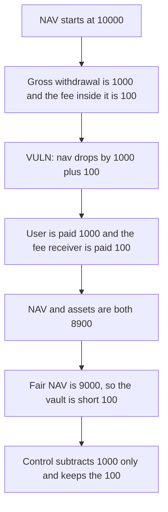

# Harmonix: NAV subtracts a fee that is already inside the withdrawal

> **Vulnerability classes:** vuln/logic/fee-calculation · vuln/logic/state-update

<!-- non-defihacklabs -->
<!-- source-auditvault: https://github.com/Auditware/AuditVault/blob/main/findings/57889-h-04-faulty-nav-update-logic-creates-compounding-asset-deple.md -->
<!-- date: 2025-05 -->

## Key info

| | |
|---|---|
| **Protocol** | Harmonix Finance, Hyperliquid fund |
| **Finding** | Shieldify H-04, AuditVault 57889 |
| **Vulnerable code** | `FundContract._updateVaultState` |
| **Harm** | A 1000 withdrawal with a 100 fee drops NAV and assets by 1100. The fair drop is 1000. The vault is short 100 |
| **Chain** | local synthetic |

## TL;DR

`initiateWithdrawal` computes the management fee from `withdrawAmount` and does not subtract it. `_updateVaultState` then does `nav -= (withdrawAmount + feeAmount)`. The same fee is removed twice. Starting from NAV 10000, a 1000 withdrawal with a 100 fee leaves NAV 8900, and the contract also transfers the 1000 and the 100, so the asset balance is 8900. The fair accounting drops NAV by 1000 only and does not transfer the fee a second time. The control keeps that 100 in the vault.

## The vulnerable code

```solidity
withdrawPoolAmount = withdrawAmount;
// @> VULN: nav drops by withdrawAmount + feeAmount even though the fee is already inside withdrawAmount
nav = nav - (withdrawAmount + feeAmount);
```

The fix is `nav = nav - withdrawAmount`.

## Root cause

The gross withdrawal already contains the fee. Subtracting the fee again treats one outflow as two. Each withdrawal removes `feeAmount` of NAV that no asset movement in the fair model requires, and this reduction also pulls that amount out of the contract a second time. Repeating the withdrawal compounds the hole.

## Preconditions

NAV and the asset balance start at 10000 ether. The withdrawal is 1000 ether. The fee is `withdrawAmount / 10`, so 100 ether, and it is not removed from the 1000. `run()` does not warp.

## Attack walkthrough

1. The fund is filled to NAV 10000.
2. `withdraw(1000)` sets the fee to 100 and does not reduce the 1000.
3. `_updateVaultState` sets NAV to `10000 - 1000 - 100 = 8900`.
4. The user receives 1000 and the fee receiver receives 100.
5. The fund balance is 8900. `shortfall` against the fair NAV of 9000 is 100.

The control subtracts only 1000 from NAV and transfers only 1000. The fee receiver stays at 0 and the fund holds 9000.

## Diagrams



## Impact

One 1000 withdrawal removes 1100 from the fund. The vault is short 100 relative to the assets that should have remained. Every later withdrawal widens the same hole by its fee.

## How to reproduce

```bash
cd 57889-h-04-faulty-nav-update-logic-creates-compounding-asset-deple_exp
forge test -vv
```

`run()` does not warp. The control test leaves 9000 in the vault and 0 on the fee receiver.

## Sources

- AuditVault finding: https://github.com/Auditware/AuditVault/blob/main/findings/57889-h-04-faulty-nav-update-logic-creates-compounding-asset-deple.md
- Shieldify report: https://github.com/shieldify-security/audits-portfolio-md/blob/main/HarmonixFinance-Hyperliquid-Security-Review.md
- Reviewed tree: https://github.com/harmonixfi/core-contracts/blob/f02157aba919dcdd4a1133669361224108c5caef/contracts/vaults/hyperliquid/fundContract.sol
