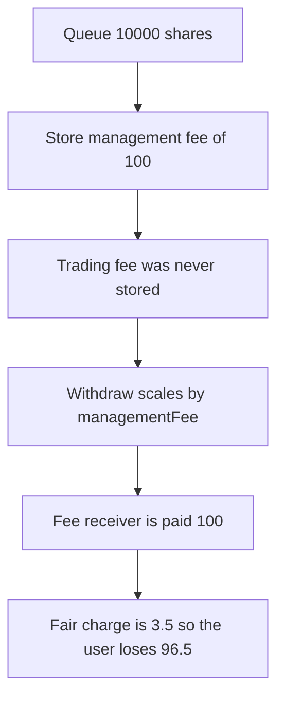

# Harmonix — a withdrawal is charged 100 instead of the 3.5 trading fee

> **Vulnerability classes:** vuln/logic/fee-calculation

> **Reproduction:** a self-contained Foundry PoC that compiles and runs offline
> with only `forge-std` — no fork and no RPC. Trace: [output.txt](output.txt).
> PoC: [test/57890-h-05-admin-can-overcharge-users-due-to-incorrect-fee-applica_exp.sol](test/57890-h-05-admin-can-overcharge-users-due-to-incorrect-fee-applica_exp.sol).

<!-- non-defihacklabs -->
<!-- source-auditvault: https://github.com/Auditware/AuditVault/blob/main/findings/57890-h-05-admin-can-overcharge-users-due-to-incorrect-fee-applica.md -->
<!-- date: 2025-04 -->

---

## Key info

| | |
|---|---|
| **Impact** | **HIGH** — charged **100**, fair trading fee **3.5**, overcharge **96.5** |
| **Protocol** | Harmonix `FundContract` |
| **Vulnerable code** | `(_shares * userWithdraw.managementFee) / userWithdraw.shares` |
| **Bug class** | The trading-fee line reads the management fee |
| **Finding** | Shieldify — Harmonix Hyperliquid, April 2025 · H-05 · id 57890 |
| **Report** | [HarmonixFinance-Hyperliquid-Security-Review](https://github.com/shieldify-security/audits-portfolio-md/blob/main/HarmonixFinance-Hyperliquid-Security-Review.md) |
| **Source** | [AuditVault finding](https://github.com/Auditware/AuditVault/blob/main/findings/57890-h-05-admin-can-overcharge-users-due-to-incorrect-fee-applica.md) |
| **Status** | The rates are the published 1% and 0.035%. No admin sets a higher fee. |
| **Compiler** | solc 0.8.27, cancun, via IR |

---

## TL;DR

`initiateWithdrawal` stores the management fee, which is **1%** of the shares. It does not store the trading fee, which is **0.035%**. `_withdraw` then computes `sharesTradingFee` from `userWithdraw.managementFee`.

On a **10,000** share withdrawal the fee receiver is paid **100**. The fair trading fee is **3.5**. The user is short **96.5**. About 28.6 times, the report's "nearly 30 times".

The rates are constants. The attack does not call an admin setter.

## The vulnerable code

```solidity
function _sharesTradingFee(WithdrawData memory userWithdraw, uint256 _shares) internal view returns (uint256) {
    // @> VULN: trading fee is computed from managementFee, which is 1% of shares, not 0.035%
    return (_shares * userWithdraw.managementFee) / userWithdraw.shares;
}
```

That return is the line the report quotes.

## Root cause

When `_shares` equals `userWithdraw.shares`, the expression equals `managementFee`. The management fee was computed as `shares * 10_000 / 1_000_000`. The trading fee is `shares * 350 / 1_000_000`. The withdrawal uses the first number under the second name.

## Preconditions

- Management fee is 1%. Trading fee is 0.035%. Both are the published rates.
- The user withdraws the full 10,000 shares they queued.
- Share price is 1, so the gross is 10,000 assets.

## Attack walkthrough

1. `initiateWithdrawal(10_000)` stores `managementFee = 100`.
2. The fund is minted 10,000 USDC.
3. `withdraw` loads that struct and returns 100 as the trading fee.
4. The fee receiver is transferred 100. The user receives 9,900.
5. Fair is 3.5. Overcharge is 96.5.

Control: `_sharesTradingFee` returns `fairTradingFee`. The receiver gets 3.5 and the user gets 9,996.5.

## Diagrams



## Impact

The withdrawer pays **96.5** more than the trading fee on this 10,000 withdrawal. Every full withdrawal is charged at the management-fee rate instead of the trading-fee rate.

## Remediation

Store the trading fee at initiation and use that stored value in `_sharesTradingFee`.

## Sources

- [AuditVault finding 57890](https://github.com/Auditware/AuditVault/blob/main/findings/57890-h-05-admin-can-overcharge-users-due-to-incorrect-fee-applica.md)
- [Shieldify Harmonix Hyperliquid review](https://github.com/shieldify-security/audits-portfolio-md/blob/main/HarmonixFinance-Hyperliquid-Security-Review.md)
- [fundContract.sol at f02157ab](https://github.com/harmonixfi/core-contracts/blob/f02157aba919dcdd4a1133669361224108c5caef/contracts/vaults/hyperliquid/fundContract.sol)

### Taxonomy

- `vuln/logic/fee-calculation` · `vuln/logic/incorrect-calculation`
