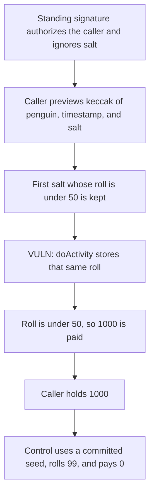

# PenguinGotchi: the activity roll is the caller's salt

> **Vulnerability classes:** vuln/logic/missing-validation · vuln/access-control/missing-modifier · vuln/logic/wrong-condition

<!-- non-defihacklabs -->
<!-- source-auditvault: https://github.com/Auditware/AuditVault/blob/main/findings/57907-h-01-predictable-randomness-in-activity-outcomes-shieldify-n.md -->
<!-- date: 2025-05 -->

## Key info

| | |
|---|---|
| **Protocol** | PenguinGotchi |
| **Finding** | Shieldify H-01, AuditVault 57907 |
| **Vulnerable code** | `Game.doActivity` roll |
| **Harm** | The caller submits a salt whose roll is under 50 and receives 1000. A committed seed the caller cannot set rolls 99 and pays 0 |
| **Chain** | local synthetic |

## TL;DR

`doActivity` sets the roll to `keccak256(penguinId, block.timestamp, salt) % 100`. Salt is a caller argument. The signature check accepts a standing 4 byte blob from an authorized caller and has no expiry, so it does not constrain the salt. The attacker hashes the same inputs locally, skips every salt at or above 50, and submits the first salt under 50. The game pays 1000. Replacing the hash with `keccak256(committedSeed, penguinId)` for seed 1 and penguin 1 rolls 99 and pays 0.

## The vulnerable code

```solidity
// @> VULN: roll is keccak(penguinId, block.timestamp, salt), and the caller chooses salt
lastRoll = uint256(keccak256(abi.encodePacked(penguinId, block.timestamp, salt))) % PERCENT;
if (lastRoll < SUCCESS) {
    paid = 1000 ether;
    token.transfer(msg.sender, paid);
}
```

The fix replaces the caller-chosen salt with a seed the caller cannot set.

## Root cause

Every input to the hash is known before the call. `block.timestamp` is the timestamp of the transaction the caller is building, and salt is theirs. They can discard a losing salt and submit a winning one. The signature does not expire and does not cover the salt, so the same authorization works for the salt they just selected.

## Preconditions

Penguin id is 1. Success is a roll under 50. The reward pot is 1000 ether. The caller is authorized and passes the standing signature `0x01020304`. The search tries salts `bytes32(0)` upward and stops at the first preview under 50. `run()` does not warp. The timestamp is whatever block the call executes in, and the preview uses that same timestamp.

## Attack walkthrough

1. The game is minted 1000 and the caller is authorized.
2. The caller hashes `(penguinId, block.timestamp, salt)` for successive salts.
3. The first preview under 50 is stored and submitted to `doActivity`.
4. The game writes that same roll and, because it is under 50, transfers 1000 to the caller.
5. The caller's balance is 1000.

The control ignores salt. `keccak256(uint256(1), penguinId)` for penguin 1 is 99, which is not under 50, so the payout is 0 and the 1000 stays in the game.

## Diagrams



## Impact

The caller receives 1000 by choosing the salt, instead of taking the chance the activity is supposed to have. Any later activity that pays on this roll can be taken the same way. The committed-seed control pays nothing for the same call shape.

## How to reproduce

```bash
cd 57907-h-01-predictable-randomness-in-activity-outcomes-shieldify-n_exp
forge test -vv
```

`run()` does not warp. The control asserts the committed seed rolls 99 and pays 0.

## Sources

- AuditVault finding: https://github.com/Auditware/AuditVault/blob/main/findings/57907-h-01-predictable-randomness-in-activity-outcomes-shieldify-n.md
- Shieldify report: https://github.com/shieldify-security/audits-portfolio-md/blob/main/PenguinGotchi-Security-Review.md
- Reviewed tree: https://github.com/WebitLabs/pengu-sc/blob/cd9e0fd078f55dbd1067be0fd4b25002ac59a425/src/PenguinManager.sol
