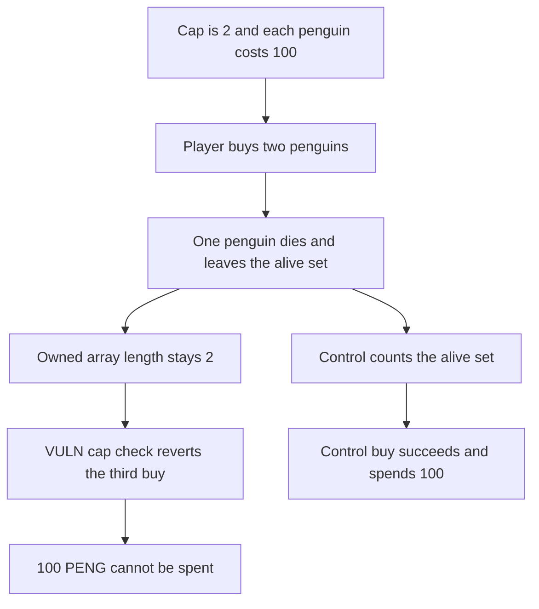

# Penguingotchi: dead penguins still count toward the alive purchase cap

> **Vulnerability classes:** vuln/logic/wrong-condition · vuln/dos/frozen-funds

<!-- non-defihacklabs -->
<!-- source-auditvault: https://github.com/Auditware/AuditVault/blob/main/findings/57908-h-02-user-can-be-permanently-denied-from-purchasing-new-peng.md -->
<!-- date: 2025-08 -->

## Key info

| Field | Value |
|---|---|
| **Loss** | 100 PENG cannot be spent. One penguin is alive, two were ever owned, and the alive cap is 2 |
| **Vulnerable contract** | `PenguinManager.checkCanGetExtraPenguin` |
| **Attacker EOA** | `0x1111111111111111111111111111111111111111` |
| **Attack contract** | `Exploit` |
| **Attack tx** | `Exploit.run()` |
| **Chain / block / date** | Ethereum model · block 0 · 2025-08 |
| **Compiler** | solc 0.8.27, cancun, via IR |
| **Bug class** | Purchase cap reads the historical owned array |

## TL;DR

`checkCanGetExtraPenguin` counts `playerOwnedPenguins[owner].length` and compares it with `maxAlivePenguins`. Dead penguins are removed from the alive set and left in the owned array. With a cap of 2, a player who bought two penguins and lost one cannot buy a replacement. The last 100 PENG stays unspent. The control counts `aliveCount`, which is 1, and the third purchase spends 100.

## Background

Shieldify, Penguingotchi, H-02. The manager keeps `playerOwnedPenguins` for every penguin a player has ever owned and a separate alive set. `doActivity` removes a dead penguin from the alive set only. The purchase modifier still uses the historical array. The recommended fix is to compare `alivePenguins[owner].length()` with the cap. This reduction uses a cap of 2 and a price of 100 so the stuck amount is the price of the penguin the player cannot buy.

## The vulnerable code

```solidity
modifier checkCanGetExtraPenguin(address owner) {
    uint256[] memory penguinIds = owned[owner];
    uint256 penguinCount = penguinIds.length;
    // @> VULN: playerOwnedPenguins keeps dead penguins, so the alive cap counts them too
    if (penguinCount >= settings.limits.maxAlivePenguins) {
        revert("MaximumPenguinsAcquired");
    }
    _;
}
```

The recommended change is to use the alive count:

```diff
- uint256 penguinCount = playerOwnedPenguins[owner].length;
+ uint256 penguinCount = alivePenguins[owner].length();
```

## Root cause

The cap is named and documented as a limit on living penguins, but the modifier reads the array that is append-only. A death updates only the alive counter.

## Preconditions

- `maxAlivePenguins` is 2. Each penguin costs 100 PENG.
- The player can buy the first two penguins.
- One of those penguins then dies and is removed from the alive count only.

## Attack walkthrough

1. The player buys two penguins and spends 200 PENG.
2. One penguin dies. The alive count falls to 1. The owned array length stays 2.
3. The third `buyPenguin` hits `2 >= 2` and reverts.
4. The player's remaining 100 PENG is not spent.
5. The control, after the same death, sees an alive count of 1 and spends 100 on a replacement. The player ends with two living penguins.

## Diagrams



## Impact

The player holds 100 PENG that the purchase would have spent. They have one living penguin and cannot buy another, even though the alive cap is 2. The control spends that 100 and ends with two living penguins.

## Remediation

Compare the alive-penguin count with `maxAlivePenguins`, not the length of the historical owned array.

## How to reproduce

```bash
cd 57908-h-02-user-can-be-permanently-denied-from-purchasing-new-peng_exp
forge test -vv
```

`test_exploit_cannot_spend_100` asserts one penguin alive, two ever owned, and 100 PENG left unspent, while the control manager receives 300. `test_control_third_buy_spends_100` asserts the fixed cap lets the third buy spend the wallet down to 0. Captured output is `output.txt`.

## Sources

- AuditVault finding: https://github.com/Auditware/AuditVault/blob/main/findings/57908-h-02-user-can-be-permanently-denied-from-purchasing-new-peng.md
- Shieldify report: https://github.com/shieldify-security/audits-portfolio-md/blob/main/PenguinGotchi-Security-Review.md
- Blamed modifier: https://github.com/WebitLabs/pengu-sc/blob/cd9e0fd078f55dbd1067be0fd4b25002ac59a425/src/PenguinManager.sol#L168
