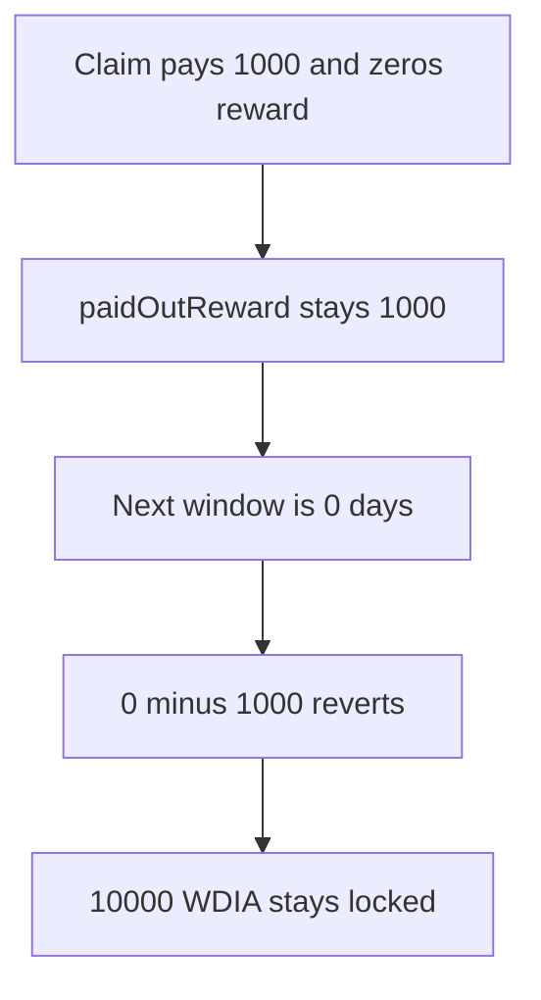

# DIA — paidOutReward makes the next unstake revert, and 10000 stays locked

> **Vulnerability classes:** vuln/arithmetic/underflow · vuln/dos/frozen-funds

> **Reproduction:** a self-contained Foundry PoC that compiles and runs offline
> with only `forge-std` — no fork and no RPC. Trace: [output.txt](output.txt).
> PoC: [test/57913-paidoutreward-subtraction-may-lead-to-unstake-and-unstakepri_exp.sol](test/57913-paidoutreward-subtraction-may-lead-to-unstake-and-unstakepri_exp.sol).

<!-- non-defihacklabs -->
<!-- source-auditvault: https://github.com/Auditware/AuditVault/blob/main/findings/57913-paidoutreward-subtraction-may-lead-to-unstake-and-unstakepri.md -->
<!-- date: 2025-06 -->

---

## Key info

| | |
|---|---|
| **Impact** | **HIGH** — the second unstake reverts and **10,000 WDIA** of principal stays locked |
| **Protocol** | DIA `DIAWhitelistedStaking` |
| **Vulnerable code** | `rewardToSend = currentStore.reward - currentStore.paidOutReward` |
| **Bug class** | Reward is zeroed and paidOutReward is not |
| **Finding** | MixBytes — DIA Lumina Staking, June 2025 · id 57913 |
| **Report** | [Lumina Staking](https://github.com/mixbytes/audits_public/blob/master/DIA/Lumina%20Staking/README.md#1-paidoutreward-subtraction-may-lead-to-unstake-and-unstakeprincipal-functions-reverting) |
| **Source** | [AuditVault finding](https://github.com/Auditware/AuditVault/blob/main/findings/57913-paidoutreward-subtraction-may-lead-to-unstake-and-unstakepri.md) |
| **Compiler** | solc 0.8.27, cancun, via IR |

---

## TL;DR

A 10,000 stake that has already run 10 days at 100 bps has a reward of **1,000**. The first `unstake` pays that 1,000, sets `reward` to 0, and leaves `paidOutReward` at 1,000.

The user requests unstake again in the same block. The new window is 0 days, so the next reward is 0. `unstakePrincipal` computes `0 - 1000` and Solidity 0.8 reverts. The **10,000** principal never moves.

The 10 days are stored timestamps, `1` and `1 + 10 days`. `run()` does not warp.

## The vulnerable code

```solidity
updateReward(stakingStoreIndex);
// @> VULN: rewardToSend = currentStore.reward - currentStore.paidOutReward underflows
uint256 rewardToSend = currentStore.reward - currentStore.paidOutReward;
```

The first `unstake` is the line the report describes: it zeros `currentStore.reward` after adding the payout to `paidOutReward`, and it does not clear `paidOutReward`.

## Root cause

`paidOutReward` is a lifetime accumulator. `reward` is reset to 0 on every claim. The next short window cannot catch up to the accumulator, so the subtraction underflows and both `unstake` and `unstakePrincipal` revert.

## Preconditions

- Rate is 100, meaning 1 percent per day.
- The stored interval is 10 full days, so the first reward is 1,000.
- The user claims once, then requests unstake again before another full day accrues.

## Attack walkthrough

1. Put 11,000 WDIA on the staking contract and record a 10,000 stake.
2. First `unstake` pays 1,000, zeros `reward`, and leaves `paidOutReward` at 1,000.
3. `requestUnstake` sets the request time to this block. A fresh calculation is 0.
4. `unstakePrincipal` reverts on `0 - 1000`.
5. The contract still holds 10,000 WDIA. The user holds only the first 1,000.

Control: the second call pays principal from `getRewardForStakingStore` and does not subtract the stale `paidOutReward`. The user receives the 10,000 and the contract balance is 0.

## Diagrams



## Impact

The staker cannot withdraw the remaining **10,000 WDIA**. The report notes they also cannot wait for a larger reward: a second request is refused while the first request is still open, and fulfilling that request is what reverts.

## Remediation

Pay `getRewardForStakingStore` minus what was already paid only when the new total is greater. When `reward` is zeroed, do not keep a `paidOutReward` that the next zero reward cannot cover.

## Sources

- [AuditVault finding 57913](https://github.com/Auditware/AuditVault/blob/main/findings/57913-paidoutreward-subtraction-may-lead-to-unstake-and-unstakepri.md)
- [MixBytes DIA Lumina Staking, June 2025](https://github.com/mixbytes/audits_public/blob/master/DIA/Lumina%20Staking/README.md#1-paidoutreward-subtraction-may-lead-to-unstake-and-unstakeprincipal-functions-reverting)
- [DIAWhitelistedStaking.sol at 50b70919](https://github.com/diadata-org/lumina-staking/blob/50b709199461ae48e3186d5a04cd22eff39ebcf5/contracts/DIAWhitelistedStaking.sol)

### Taxonomy

- `vuln/arithmetic/underflow` · `vuln/dos/frozen-funds`
