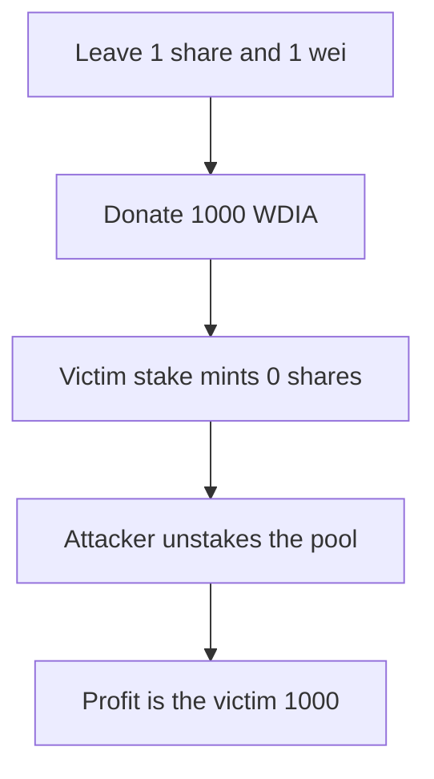

# DIA — a 1-wei share rounds the next deposit to zero and takes it

> **Vulnerability classes:** vuln/arithmetic/rounding · vuln/logic/wrong-condition

> **Reproduction:** a self-contained Foundry PoC that compiles and runs offline
> with only `forge-std` — no fork and no RPC. Trace: [output.txt](output.txt).
> PoC: [test/57914-inflation-attack-in-diaexternalstaking-allows-stealing-first_exp.sol](test/57914-inflation-attack-in-diaexternalstaking-allows-stealing-first_exp.sol).

<!-- non-defihacklabs -->
<!-- source-auditvault: https://github.com/Auditware/AuditVault/blob/main/findings/57914-inflation-attack-in-diaexternalstaking-allows-stealing-first.md -->
<!-- date: 2025-06 -->

---

## Key info

| | |
|---|---|
| **Impact** | **HIGH** — the attacker withdraws the victim's **1,000 WDIA** |
| **Protocol** | DIA `DIAExternalStaking` |
| **Vulnerable code** | `poolSharesGiven = (amount * totalShareAmount) / totalPoolSize` |
| **Bug class** | Donation inflates the pool so the next mint rounds to 0 |
| **Finding** | MixBytes — DIA Lumina Staking, June 2025 · id 57914 |
| **Report** | [Lumina Staking](https://github.com/mixbytes/audits_public/blob/master/DIA/Lumina%20Staking/README.md#2-inflation-attack-in-diaexternalstaking-allows-stealing-first-depositors-stake) |
| **Source** | [AuditVault finding](https://github.com/Auditware/AuditVault/blob/main/findings/57914-inflation-attack-in-diaexternalstaking-allows-stealing-first.md) |
| **Compiler** | solc 0.8.27, cancun, via IR |

---

## TL;DR

`addRewardToPool` is permissionless and increases `totalPoolSize` without minting shares. The attacker stakes the 1 ether minimum in an empty pool, unstakes all but 1 wei, and donates **1,000 WDIA**.

The victim then stakes 1,000. Shares are `1000 ether * 1 / (1000 ether + 1) = 0`. The attacker's remaining 1 share is the whole supply, so the next unstake returns the donation and the victim's deposit. Net profit is **1,000 WDIA**.

`unstakingDuration` is 0, so request and unstake fit in this block. `run()` does not warp.

## The vulnerable code

```solidity
if (totalShareAmount == 0) {
    poolSharesGiven = amount;
} else {
    // @> VULN: poolSharesGiven = (amount * totalShareAmount) / totalPoolSize rounds to 0
    poolSharesGiven = (amount * totalShareAmount) / totalPoolSize;
}
```

`addRewardToPool` only does `totalPoolSize += amount`.

## Root cause

Share price is `totalPoolSize / totalShareAmount`. One share against a pool of `deposit + 1` prices the next deposit below 1 share, and the division rounds down to 0. The victim's tokens still join the pool.

## Preconditions

- The pool is new. The first stake mints shares 1:1.
- The attacker can leave 1 wei of pool and 1 share.
- `addRewardToPool` has no access check.

## Attack walkthrough

1. Stake 1 ether. Receive 1 ether of shares.
2. Unstake `1 ether - 1`. One share and 1 wei remain.
3. Donate 1,000 WDIA. The pool is now 1,000 ether plus 1 wei, still with 1 share.
4. The victim stakes 1,000 and receives 0 shares.
5. The attacker unstakes the whole pool. Profit is the victim's 1,000.

Control: `stake` reverts when the minted share count is 0. The victim's transfer is rolled back and their balance stays 1,000.

## Diagrams



## Impact

The victim's **1,000 WDIA** is transferred in and credited to nobody. The attacker withdraws it together with the donation, which they get back. The pool can be emptied and the same setup repeated.

## Remediation

Revert when the minted share count is 0, and do not let an arbitrary caller inflate `totalPoolSize` through `addRewardToPool`.

## Sources

- [AuditVault finding 57914](https://github.com/Auditware/AuditVault/blob/main/findings/57914-inflation-attack-in-diaexternalstaking-allows-stealing-first.md)
- [MixBytes DIA Lumina Staking, June 2025](https://github.com/mixbytes/audits_public/blob/master/DIA/Lumina%20Staking/README.md#2-inflation-attack-in-diaexternalstaking-allows-stealing-first-depositors-stake)
- [DIAExternalStaking.sol at 50b70919](https://github.com/diadata-org/lumina-staking/blob/50b709199461ae48e3186d5a04cd22eff39ebcf5/contracts/DIAExternalStaking.sol)

### Taxonomy

- `vuln/arithmetic/rounding` · `vuln/logic/incorrect-calculation`
