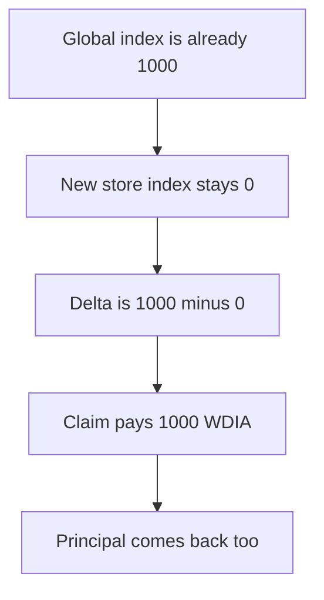

# DIA — a new stake is paid every reward the pool ever accrued

> **Vulnerability classes:** vuln/logic/reward-calculation · vuln/data/uninitialized

> **Reproduction:** a self-contained Foundry PoC that compiles and runs offline
> with only `forge-std` — no fork and no RPC. Trace: [output.txt](output.txt).
> PoC: [test/57915-missing-reward-accumulator-initialization-in-stake-creation_exp.sol](test/57915-missing-reward-accumulator-initialization-in-stake-creation_exp.sol).

<!-- non-defihacklabs -->
<!-- source-auditvault: https://github.com/Auditware/AuditVault/blob/main/findings/57915-missing-reward-accumulator-initialization-in-stake-creation.md -->
<!-- date: 2025-06 -->

---

## Key info

| | |
|---|---|
| **Impact** | **HIGH** — a new stake withdraws **1,000 WDIA** of rewards accrued before it existed |
| **Protocol** | DIA `DIAWhitelistedStaking` / `DIAStakingCommons` |
| **Vulnerable code** | `stakerDelta = rewardAccumulator - currentStore.rewardAccumulator` |
| **Bug class** | Stake creation leaves the user index at 0 |
| **Finding** | MixBytes — DIA Lumina Staking, June 2025 · id 57915 |
| **Report** | [Lumina Staking](https://github.com/mixbytes/audits_public/blob/master/DIA/Lumina%20Staking/README.md#3-missing-reward-accumulator-initialization-in-stake-creation) |
| **Source** | [AuditVault finding](https://github.com/Auditware/AuditVault/blob/main/findings/57915-missing-reward-accumulator-initialization-in-stake-creation.md) |
| **Compiler** | solc 0.8.27, cancun, via IR |

---

## TL;DR

`_internalStakeForAddress` records principal and never copies `rewardAccumulator` into the new store. The global index is already **1,000**. The user's stored index stays **0**.

`claim` computes `stakerDelta = 1000 - 0` and pays `(1000 * 10000 ether) / 10000 = 1000 ether`. The principal round-trips. Net theft is **1,000 WDIA**. `rewardLastUpdateTime` is this block, so the update inside the claim adds nothing. `run()` does not warp.

## The vulnerable code

```solidity
// stake() does not set newStore.rewardAccumulator
_updateRewardAccumulator();
// @> VULN: stakerDelta = rewardAccumulator - currentStore.rewardAccumulator
stakerDelta = rewardAccumulator - currentStore.rewardAccumulator;
stakerReward = (stakerDelta * currentStore.principal) / 10000;
```

The report quotes that subtraction. Because the store field was never written, it is 0 and the delta is the whole historical index.

## Root cause

The index is a cumulative rate. A late staker must start at the current index so they only earn what accrues after they arrive. The stake path skips that write.

## Preconditions

- `rewardAccumulator` is already 1,000 from earlier accrual.
- The new stake's stored index is the zero default.
- Principal is 10,000 ether, so the payout is `1000 * principal / 10000 = 1000 ether`.
- The contract holds that 1,000 WDIA.

## Attack walkthrough

1. Stake 10,000 against a global index of 1,000. The store index stays 0.
2. Claim. Delta is 1,000. The transfer is 1,000 WDIA.
3. Unstake the 10,000 principal.
4. The caller's balance is 1,000 higher than it started. The reward pool is empty.

Control: `stake` sets `newStore.rewardAccumulator = rewardAccumulator`. The same claim pays 0 and the 1,000 stays in the contract.

## Diagrams



## Impact

Anyone who stakes after rewards have accrued is paid those historical rewards. Here that is **1,000 WDIA** on a single 10,000 stake, taken from the reward balance other stakers were owed.

## Remediation

On stake creation set both `rewardAccumulator` and `initialRewardAccumulator` to the current global index, and compute rewards from the difference.

## Sources

- [AuditVault finding 57915](https://github.com/Auditware/AuditVault/blob/main/findings/57915-missing-reward-accumulator-initialization-in-stake-creation.md)
- [MixBytes DIA Lumina Staking, June 2025](https://github.com/mixbytes/audits_public/blob/master/DIA/Lumina%20Staking/README.md#3-missing-reward-accumulator-initialization-in-stake-creation)
- [DIAWhitelistedStaking.sol at dfd0bb6](https://github.com/diadata-org/lumina-staking/blob/dfd0bb6dc60735ed6983ee2aa4b10c7fac875ff6/contracts/DIAWhitelistedStaking.sol)

### Taxonomy

- `vuln/logic/reward-calculation` · `vuln/data/uninitialized`
