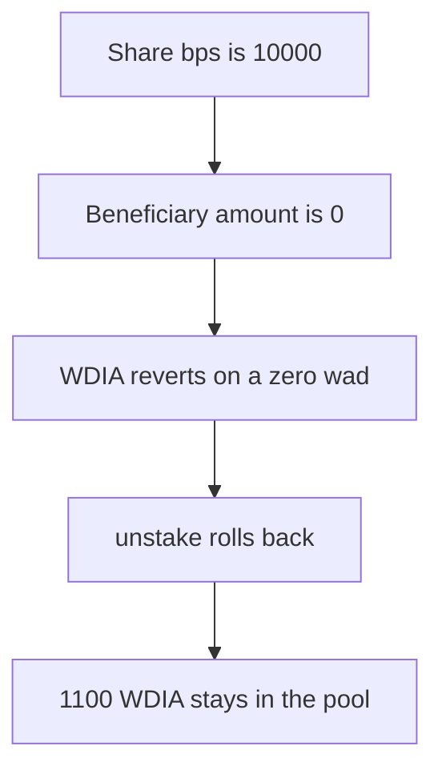

# DIA — a 100 percent principal share cannot unstake, because WDIA rejects a zero transfer

> **Vulnerability classes:** vuln/dos/frozen-funds · vuln/input-validation/boundary

> **Reproduction:** a self-contained Foundry PoC that compiles and runs offline
> with only `forge-std` — no fork and no RPC. Trace: [output.txt](output.txt).
> PoC: [test/57917-wdia-prohibits-zero-transfers-which-will-block-rewards-distr_exp.sol](test/57917-wdia-prohibits-zero-transfers-which-will-block-rewards-distr_exp.sol).

<!-- non-defihacklabs -->
<!-- source-auditvault: https://github.com/Auditware/AuditVault/blob/main/findings/57917-wdia-prohibits-zero-transfers-which-will-block-rewards-distr.md -->
<!-- date: 2025-06 -->

---

## Key info

| | |
|---|---|
| **Impact** | **HIGH** — unstake reverts and **1,100 WDIA** stays in the pool |
| **Protocol** | DIA `WDIA` and `DIAExternalStaking` |
| **Vulnerable code** | `if (wad == 0) revert ZeroTransferAmount()` on the beneficiary transfer |
| **Bug class** | A zero beneficiary amount reverts the whole unstake |
| **Finding** | MixBytes — DIA Lumina Staking, June 2025 · id 57917 |
| **Report** | [Lumina Staking](https://github.com/mixbytes/audits_public/blob/master/DIA/Lumina%20Staking/README.md#5-wdia-prohibits-zero-transfers-which-will-block-rewards-distribution-to-beneficiary-address-if-100-goes-to-principal-unstaker) |
| **Source** | [AuditVault finding](https://github.com/Auditware/AuditVault/blob/main/findings/57917-wdia-prohibits-zero-transfers-which-will-block-rewards-distr.md) |
| **Compiler** | solc 0.8.27, cancun, via IR |

---

## TL;DR

A stake with `principalWalletShareBps = 10000` assigns every reward to the principal wallet. Unstaking 1,100 (1,000 principal plus 100 reward) therefore sets `requestedUnstakeRewardAmount` to **0**.

`unstake` still calls `WDIA.transfer` for that 0. WDIA reverts with `ZeroTransferAmount`. The whole call rolls back. The request flag stays set, so the user cannot request again, and the next unstake hits the same zero transfer. **1,100 WDIA** remains in the pool.

`unstakingDuration` is 0, so the request and the unstake are the same block. `run()` does not warp.

## The vulnerable code

```solidity
function transferFrom(address src, address dst, uint256 wad) public returns (bool) {
    // @> VULN: if (wad == 0) revert ZeroTransferAmount()
    if (wad == 0) revert ZeroTransferAmount();
    ...
}

STAKING_TOKEN.transfer(currentStore.beneficiary, currentStore.requestedUnstakeRewardAmount);
```

The principal-wallet reward transfer is guarded with `> 0`. The beneficiary transfer is not. At a 100 percent principal share that amount is 0.

## Root cause

A 100 percent principal share is a configured, valid split. It produces a zero transfer, and the token treats zero as an error instead of a no-op. The staking contract does not skip it.

## Preconditions

- `principalWalletShareBps` is 10,000.
- The position has a non-zero reward, here 100 WDIA on 1,000 of principal, so the unstake amount is 1,100 and the beneficiary slice is 0.
- WDIA reverts on `wad == 0`.

## Attack walkthrough

1. Stake 1,000 at 10,000 bps and add 100 of rewards.
2. Request unstake of 1,100. The beneficiary amount reads back as 0.
3. `unstake` transfers the principal amounts and then transfers 0 to the beneficiary.
4. WDIA reverts. The call returns false.
5. The pool still holds 1,100. The user holds 0.

Control: skip any transfer whose amount is 0. The user receives the full 1,100 and the pool is empty.

## Diagrams



## Impact

The staker cannot finish the unstake. **1,100 WDIA** is stuck: 1,000 of their principal and 100 of rewards. A second request is rejected because the first request was stored, and repeating `unstake` hits the same revert.

## Remediation

Do not call `transfer` when `requestedUnstakeRewardAmount` or the principal amount is 0. The token may also accept a zero wad.

## Sources

- [AuditVault finding 57917](https://github.com/Auditware/AuditVault/blob/main/findings/57917-wdia-prohibits-zero-transfers-which-will-block-rewards-distr.md)
- [MixBytes DIA Lumina Staking, June 2025](https://github.com/mixbytes/audits_public/blob/master/DIA/Lumina%20Staking/README.md#5-wdia-prohibits-zero-transfers-which-will-block-rewards-distribution-to-beneficiary-address-if-100-goes-to-principal-unstaker)
- [WDIA.sol at dfd0bb6](https://github.com/diadata-org/lumina-staking/blob/dfd0bb6dc60735ed6983ee2aa4b10c7fac875ff6/contracts/WDIA.sol)

### Taxonomy

- `vuln/dos/frozen-funds` · `vuln/input-validation/boundary`
