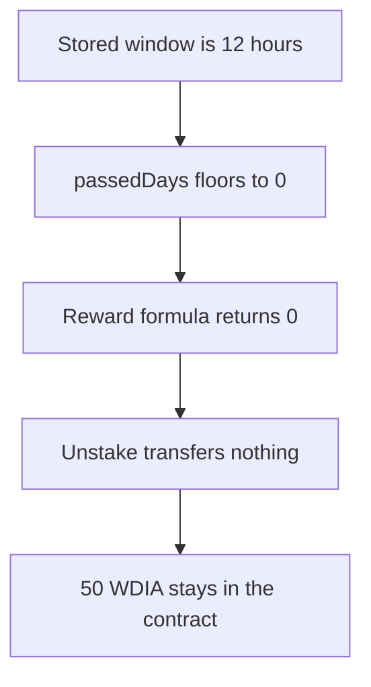

# DIA — a 12-hour stake is paid zero because the reward counts only full days

> **Vulnerability classes:** vuln/logic/reward-calculation · vuln/arithmetic/precision-loss

> **Reproduction:** a self-contained Foundry PoC that compiles and runs offline
> with only `forge-std` — no fork and no RPC. Trace: [output.txt](output.txt).
> PoC: [test/57918-rewards-are-lost-if-user-requests-unstake-in-less-than-one-d_exp.sol](test/57918-rewards-are-lost-if-user-requests-unstake-in-less-than-one-d_exp.sol).

<!-- non-defihacklabs -->
<!-- source-auditvault: https://github.com/Auditware/AuditVault/blob/main/findings/57918-rewards-are-lost-if-user-requests-unstake-in-less-than-one-d.md -->
<!-- date: 2025-06 -->

---

## Key info

| | |
|---|---|
| **Impact** | **HIGH** — a 12-hour window pays **0** instead of **50 WDIA** |
| **Protocol** | DIA `DIAWhitelistedStaking` |
| **Vulnerable code** | `passedDays = passedSeconds / (24 * 60 * 60)` |
| **Bug class** | A partial day is floored to zero and the reward is dropped |
| **Finding** | MixBytes — DIA Lumina Staking, June 2025 · id 57918 |
| **Report** | [Lumina Staking](https://github.com/mixbytes/audits_public/blob/master/DIA/Lumina%20Staking/README.md#1-rewards-are-lost-if-user-requests-unstake-in-less-than-one-day) |
| **Source** | [AuditVault finding](https://github.com/Auditware/AuditVault/blob/main/findings/57918-rewards-are-lost-if-user-requests-unstake-in-less-than-one-d.md) |
| **Compiler** | solc 0.8.27, cancun, via IR |

---

## TL;DR

`getRewardForStakingStore` counts only full days. A stake whose stored window is **12 hours** has `passedDays = 43200 / 86400 = 0`, so the reward is 0.

At 100 bps per day on a 10,000 principal, those 12 hours are **50 WDIA**. The 50 is delivered to the contract as the reward for that window and the claim transfers none of it. The user receives nothing.

The 12 hours are two stored timestamps, `1` and `1 + 12 hours`. `run()` does not warp.

## The vulnerable code

```solidity
uint256 passedSeconds = currentStore.unstakingRequestTime - currentStore.stakingStartTime;
// @> VULN: passedDays = passedSeconds / (24 * 60 * 60) drops a partial day
uint256 passedDays = passedSeconds / (24 * 60 * 60);
return (rewardRatePerDay * passedDays * currentStore.principal) / 10000;
```

That division is the line the report quotes.

## Root cause

The reward is linear in whole days and silent on the remainder. Any unstake requested before the first full day, or in the leftover hours after the last full day, is paid as if that time did not happen.

## Preconditions

- Rate is 100 and principal is 10,000, so one full day is 100 WDIA and 12 hours is 50.
- The stored unstake request is 12 hours after the stored start.

## Attack walkthrough

1. Open the stake with a 12-hour stored window.
2. Quote the reward. The quote is 0.
3. Move 50 WDIA into the contract. That is the half-day reward.
4. Unstake. The transfer amount is the quote, so nothing is sent.
5. The contract still holds 50. The user holds 0.

Control: the same function multiplies by `passedSeconds` and divides by `1 days * 10000`. The claim pays 50 and the contract balance is 0.

## Diagrams



## Impact

The staker loses **50 WDIA** that the rate and the elapsed seconds had already earned. The same floor applies to any request made with less than 24 hours on the clock. The client called full-day rounding intentional. The numbers here are the loss against the seconds-based accrual the report asks for.

## Remediation

Accrue by the second, `rate * passedSeconds * principal / (1 days * 10000)`, or reject `requestUnstake` until a full day has elapsed so the zero result cannot be a surprise.

## Sources

- [AuditVault finding 57918](https://github.com/Auditware/AuditVault/blob/main/findings/57918-rewards-are-lost-if-user-requests-unstake-in-less-than-one-d.md)
- [MixBytes DIA Lumina Staking, June 2025](https://github.com/mixbytes/audits_public/blob/master/DIA/Lumina%20Staking/README.md#1-rewards-are-lost-if-user-requests-unstake-in-less-than-one-day)
- [DIAWhitelistedStaking.sol at 50b70919](https://github.com/diadata-org/lumina-staking/blob/50b709199461ae48e3186d5a04cd22eff39ebcf5/contracts/DIAWhitelistedStaking.sol)

### Taxonomy

- `vuln/logic/reward-calculation` · `vuln/arithmetic/precision-loss`
